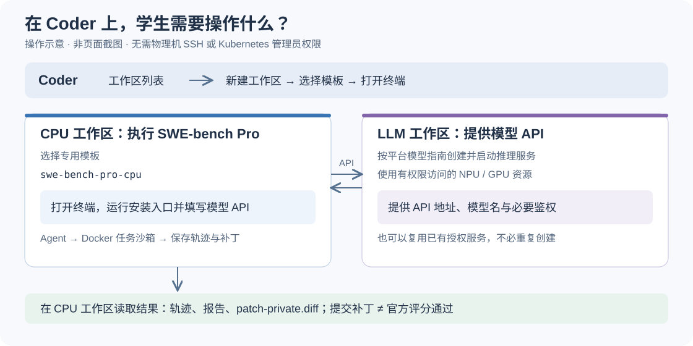
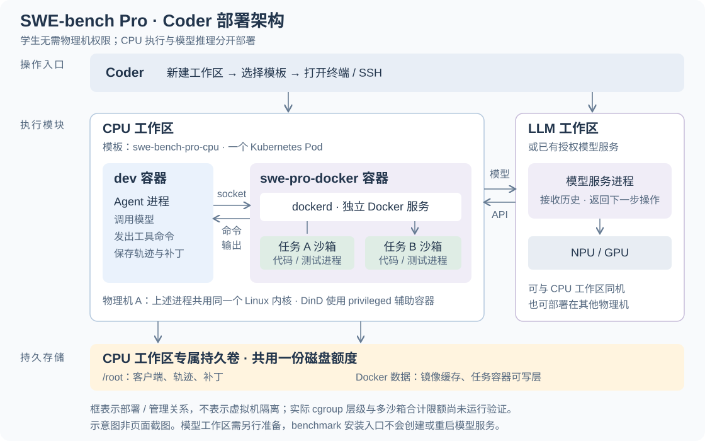

# SWE-bench Pro V1：运行一个真实 Agent

通用环境、任务与镜像校验、官方 Agent 运行入口和用户指南由 **vllm-hust-benchmark** 维护。 `request-throttling-controller` 只提供可选的
Controller 接入与验证；运行本指南不需要克隆或安装它。 这是独立诊断工作负载，不会自动成为网站榜单成绩。

## 新用户推荐入口

### 当前平台状态（2026-10-31）

[Coder 9443 平台](https://coder.sage.org.ai:9443/)已完成普通账号的新工作区准备复验。经授权回收 7 个未绑定、无 Pod 的空 PVC 后， 释放 700
GiB 申请额度；普通账号从 `swe-bench-pro-cpu` 模板重试创建新的 20 GiB 工作区成功。 此次核验后配额使用量为 3945 / 4625
GiB，余量为当时快照，后续创建仍按平台实时容量准入。

新工作区使用全新 PVC，初始 Docker 镜像数为 0；`dev` 与 `swe-pro-docker` 均 Ready。 本文固定 bootstrap
的源码、客户端、依赖、Agent、benchmark、检查和输入准备全部通过，返回 `READY`； 固定 ARM64 任务镜像及 V1 数据通过校验，模型 API 可达，同路径只读 bind
探针通过。 使用者在自己工作区终端填入模型 API、模型名及必要凭据即可执行下方命令，无需裸机权限或手工搭 Docker。

独立评分目录挂载修复已发布为模板版本 `cpu-grade-bind-1031-1fd0da18`
（`3eb13404-43e9-4b41-b270-0eb52cf8fd3f`）。已有本人工作区可通过 Coder 更新到该版本； 保存当前工作后更新会重建本工作区
Pod，持久卷和历史结果保留。新工作区默认使用该版本。

**模型服务与任务执行工作区是两个不同的东西。** 模型服务负责回答模型请求；本指南的 CPU 工作区负责运行 Agent、启动 Docker 任务容器、修改代码与测试。 有模型的 Ray
地址，不代表已经有可运行任务的 Docker 环境。不要给模型工作区挂宿主机 Docker socket，也不要把客户端依赖装入模型环境。

在 Coder 中选择管理员发布的 `swe-bench-pro-cpu` 模板，新建自己的 **CPU 工作区**。该模板提供独立 Docker 服务、客户端和 socket；Docker
镜像、容器数据与 `/root` 共用所选持久卷额度。单题可使用模板默认 20 GiB（安装前至少 15 GiB 可用）；多任务请先确认平台存储额度。普通 `ascend-devbox` 和模型
Ray 模板不能替代这个模板。

模板不存在时，由管理员先按私有云仓库的
[`scripts/create_swe_bench_workspace.py`](https://github.com/yancanmao/npu-private-cloud/blob/main/scripts/create_swe_bench_workspace.py)
发布；**不是让每位使用者寻找某个已手工搭好的共享工作区**。管理员一次性准备的内容见下表。

| 管理员负责一次性准备                        | 新工作区入口负责自动完成                                   | 使用者只需提供                                 |
| ------------------------------------------- | ---------------------------------------------------------- | ---------------------------------------------- |
| Linux ARM64 CPU 模板、独立 Docker、存储额度 | 检查真实 Docker daemon 的架构与可用性                      | 自己的工作目录                                 |
| 把固定 ARM 任务镜像放入可达镜像仓库         | 下载固定官方源码、创建独立客户端、安装依赖                 | 已有模型 API `/v1` 地址与服务模型名            |
| 在模板配置数据下载源和镜像仓库地址          | 下载并校验 V1 数据、固定镜像摘要和代码起点                 | 模型需要鉴权时，提供密钥环境变量名             |
| 验证仓库制品可拉取，不依赖节点缓存          | 启动一个真实 Agent，保存状态、轨迹与补丁，清理本次任务容器 | 不需要知道旧工作区名称、Docker 路径或手填 JSON |

在新工作区终端填写模型 API 与模型名，执行以下固定版本入口。已验证的 9443 平台网关提供小型运行包与原版 ARM64 crane 制品， 全部按校验和验证；无需 GitHub
token，也不依赖共享出口的 GitHub 匿名 API 配额。

```bash
MODEL_API=https://MODEL_HOST/v1
MODEL_NAME=openai/SERVED_MODEL_NAME
export PIP_INDEX_URL="${PIP_INDEX_URL:-https://pypi.tuna.tsinghua.edu.cn/simple}"
BASE=https://coder.sage.org.ai:9443/swe-bench-pro-artifacts
REV=33efa2a4ce065bcd6d25ab387ddffd85b3826a3f # pragma: allowlist secret
BUNDLE_SHA=fcf21b81bc91e569ab57ebb43791a0a4b7b1b8678dd5dc3487ad931c57e5e7b8 # pragma: allowlist secret
curl --fail --location "$BASE/$REV/bootstrap_swe_bench_pro.py" --output bootstrap_swe_bench_pro.py
echo 'f4700673883af8447442c89193881efa314649cb949b2fdca00bf8ea88fecea9  bootstrap_swe_bench_pro.py' | sha256sum --check # pragma: allowlist secret
python3 bootstrap_swe_bench_pro.py --source-revision "$REV" \
  --source-bundle-url "$BASE/$REV/runtime.tar.gz" \
  --source-bundle-sha256 "$BUNDLE_SHA" \
  --crane-archive-url "$BASE/crane-v0.20.3-linux-arm64.tar.gz" \
  --work "$HOME/swe-pro-first" --model-api "$MODEL_API" --model-name "$MODEL_NAME" --run
```

`MODEL_API` 和 `MODEL_NAME` 换成已有模型服务信息；脚本先检查 `/v1/models` 是否确实包含该模型。 需要认证时追加
`--api-key-env MODEL_API_KEY`，密钥值只放工作区环境变量，不能写进 URL、命令参数或配置文件。 不加 `--run` 只准备环境，不发模型推理请求。

安装脚本验证指定 Git commit 的运行包 SHA256、文件清单与逐文件摘要，随后复用本仓库现有的 `check → prepare → verify-inputs → run`，没有第二套
Agent 实现。 固定官方 Agent、V1 数据 SHA256 和社区 ARM 镜像来源仍以原锁定清单为准；入门任务的不可变 manifest/config 与工具下载摘要另见
[`swe_bench_pro_bootstrap_lock.json`](../src/vllm_hust_benchmark/data/swe_bench_pro_bootstrap_lock.json)。
镜像仓库返回不同摘要时，拒绝启动 Agent。现有客户端源码安装方式仍保留在后续章节。

平台模板为安装入口提供 `SWE_BENCH_PRO_DATASET_BASE`、`SWE_BENCH_PRO_IMAGE_MIRROR` 和
`SWE_BENCH_PRO_IMAGE_REGISTRY_INSECURE`。可用 `--dataset-base`、`--image-mirror-prefix` 显式覆盖；只有管理员明确使用
HTTP 私有仓库时才启用 `--insecure-image-registry`，默认继续使用 HTTPS。 普通 ARM Linux 环境已有自己获授权的 Docker
时，也可使用此入口，相关下载源由操作者配置；脚本不会安装系统 Docker、申请卡、扩大磁盘额度或重启模型。

失败时查看 `--work` 下的 `bootstrap-state.json` 与对应步骤日志。环境准备失败后，修正明确的下载源等配置，再为同一命令加
`--resume`；已完成步骤复用，失败的镜像准备目录另存，不删除证据。 **已有 Agent 运行目录时不会自动再跑一次**。退出码与状态必须一起看：`READY`
仅表示环境准备完成；`RUN_RECORDED` 还要求这个真实 Agent 主动提交。修题是否正确另由官方评分验证，不能把提交等同于修题成功。

管理员在可访问上游的机器上一次性镜像入门任务：

```bash
python3 scripts/mirror_swe_bench_pro_image.py \
  --crane /absolute/path/to/crane \
  --source-prefix registry-1.docker.io/ \
  --destination-prefix PRIVATE_REGISTRY \
  --output /private/path/image-publication.json
```

该入口直接从固定上游摘要复制，不读取任何旧工作区或 Docker 数据目录。发布完成后重新读取目标摘要验证一致；私有仓库凭据使用正常 Docker 凭据机制，不写入源码。HTTP 仓库需显式追加
`--insecure`。 网络限制应在管理员准备阶段解决，不能把“镜像在某台机器的缓存里”当成可交付制品。

慢链路先下载为 OCI 制品；上传超过仓库请求时限时，把完整制品传到仓库节点，在节点本机发布。 zot 接收该上游 Docker Schema 2 镜像时，需要官方支持的
[`http.compat: ["docker2s2"]`](https://zotregistry.dev/v2.1.18/admin-guide/admin-configuration/#compatibility-with-other-image-schema-types)。
平台仓库提供 `configure_registry_compat.py`，按实际运行版本验证配置并备份；不能为绕过 415 错误转换清单后仍宣称摘要相同。

### 2026-10-30—31 普通账号验收与评分修复

2026-10-30，普通账号 `user`（roles=[]）从模板新建独立 20 GiB PVC，初始 Docker 为 0 images / 0 containers； `dev` 与
`swe-pro-docker` 均 Ready，固定 ARM64 镜像、V1 数据与官方源码通过校验，模型 API 可达。 固定入口仍为本文的
`33efa2a4ce065bcd6d25ab387ddffd85b3826a3f`，任务仍为入门 NodeBB V1 单题。

| 阶段       | 实际结果                                                                                                      |
| ---------- | ------------------------------------------------------------------------------------------------------------- |
| 环境就绪   | 10月31日配额回收后，普通账号第二个新工作区使用全新 PVC、空 Docker 数据目录，bootstrap READY、目录挂载探针通过 |
| Agent 提交 | 61 次模型调用、1200.261 秒后达到既定时间预算；未 Submitted，保留 4165 字节未完成补丁                          |
| 官方评分   | 10月31日仅复评原补丁，未新增模型调用；补丁应用退出码 0，取证完整，官方结果 0/1；解析输出 117 PASSED、4 FAILED |

首次 `grade-001` 返回 127，缺失 `output.json`。文件探针证实 `dev` 中的评分目录在独立 daemon 中不存在。 模板修复为 `swe-pro-docker`
挂载本工作区 home PVC 到与 `dev` 相同的路径；不挂宿主机 Docker socket， 不将整个 home 挂给 Agent 任务容器。使用普通账号更新验收工作区后，同一探针通过。

`grade-002` 保留了原入口、官方评分源码、模型生成的补丁及固定任务镜像；评分前后 image ID 一致。 原始补丁与实际应用补丁 SHA256 均为
`5d188aaa24ccb28a7dc2ac23bd9b33f4a5deab48b3ce13aab245b23f3bb4d1b6`。
`grading_status=OUTPUTS_PRESENT`、`patch_application.status=applied`、`state_capture=complete`；
这是未完成补丁的有效独立评分，不是 Agent 提交成功。

本次私有原件保留在验收工作区 `/root/swe-pro-first/`：
`run/task-000/report-private.json`、`run/task-000/patch-private.diff`、`grade-001/`、`grade-002/`、
`grade-002-private.log` 和 `diagnostics-1031/`。 逐题 `grade-002/instance_*/workspace/` 包含
`output.json`、`stdout.log`、`stderr.log`、 `hust-patch-apply.*` 及应用前后文件状态；私有题目、轨迹和补丁不公开。

配额解除后的复验使用普通账号 `user`（roles=[]），新的 20 GiB PVC 和初始为空的独立 Docker 数据目录。
从固定下载入口完成环境与输入准备；没有复制旧工作区的客户端、任务镜像或结果。 该复验只运行 bootstrap 准备和目录挂载探针，没有新增 Agent 或评分，未放宽预算或重启模型。 表中的
Agent 与官方评分仍对应此前保存的同一份补丁，不能把新环境 `READY` 写成新 Agent 已提交或评分通过。

### 2026-10-24 历史干净工作区验收

2026-10-24，使用新建 CPU 工作区、新建 40 GiB 持久卷、初始 Docker 镜像数量 0， 从 GitHub 固定版本
`820f6af85434367973c1131ea5e608845e328252` 下载安装入口， 自动建立客户端、下载校验数据与镜像，并复用既有模型 API 跑了一道真实 V1 任务。 结果为
`RUN_RECORDED` / `Submitted`：99 次模型返回，270.78 秒，补丁 66,725 字节；任务容器已清理。 准备阶段的镜像发布失败记录保留，修正仓库后显式
`--resume`，实际 Agent 仅提交运行一次。

这是部署链路验收，官方评分仍为 `DEFERRED`、`quality_score: null`，不代表补丁正确、项目测试通过或性能提升。
原始题目、轨迹、补丁和运行日志保存在私有目录，不上传到本仓库。两平台均发布独立 CPU 模板与固定摘要镜像； 上述真实 Agent 运行只发生在其中一个平台，不能据此声称两个平台都完成了 Agent
评测。

## 运行链路与前提

```text
本仓库入口 → 固定版本官方 Agent → 已有 OpenAI-compatible 模型 API
                          ↓
                一个独立 ARM Docker 任务容器
                          ↓
                逐步日志、官方轨迹、私有补丁
                          ↓
                可选：官方评分器独立复验
```

需要 Linux ARM64 CPU 环境、Python 3.10+、可用 Docker daemon/CLI，以及到模型 API 的网络。 首次准备镜像还需要 `crane`
和对应仓库访问权限。Agent 在 CPU 上运行；模型可以由另一个已部署的推理服务提供。 入口不部署、重启或修改模型，也不要求特定 NPU、RIDE、Ray 或 Controller。 默认示例只选
NodeBB 的一道 V1 任务、一个独立 Agent。任务容器需要至少示例指定的 2 CPU/4 GiB； 这不是已证明足够所有测试的资源承诺。

请使用独立的 **CPU 客户端虚拟环境**，不要把客户端依赖装进现有模型服务环境。 现成已验证的客户端可以直接复用，随后仍会重新校验来源和输入。

## Coder 上的执行结构：Docker-in-Docker 沙箱

### 学生需要什么权限、创建什么工作区



**不需要物理机 SSH 或 Kubernetes 管理员权限。** 管理员先发布带 Docker 执行能力的 `swe-bench-pro-cpu` 模板、准备固定 ARM
任务镜像和下载源；学生创建该模板的 CPU 工作区， 再连接自己有权使用的模型 API。模型可运行在另一个 LLM 工作区，也可复用已授权的服务。 两个工作区之间的模型 API
必须可达，服务需要鉴权时由 Agent 客户端提供凭据。 普通 CPU `ascend-devbox` 不保证具有 Docker 执行能力；安装 Docker 客户端本身不会提供 Docker 服务。

### 从网页入口到物理机上的实际进程

当前专用模板采用 **DinD（Docker-in-Docker）**：CPU 工作区 Pod 中除了运行 Agent 的 `dev` 容器，还有运行独立 `dockerd` 的
`swe-pro-docker` 辅助容器。Agent 通过工作区内部共享的 Unix socket 连接这个 Docker 服务，由它创建每个任务的沙箱容器；不挂宿主机 Docker socket。
这些沙箱不是新建的 Coder 工作区，也不是 Kubernetes 单独调度的新 Pod。



图中的嵌套表示部署和管理关系，不代表沙箱有独立内核或独占 CPU。`dockerd` 与任务中的 shell、测试程序是不同进程，最终都由执行节点的同一个 Linux
内核运行；一个任务沙箱可有多个进程。 模型工作区由学生或管理员另行创建，本 benchmark 安装入口不会创建它。

平台模板的实际启动配置为：

```bash
dockerd --host=unix:///run/swe-pro-docker/docker.sock \
  --data-root=/var/lib/docker --storage-driver=overlay2
```

`dev` 与 `swe-pro-docker` 在相同 home 路径挂载本工作区自己的 PVC，使官方评分器的 bind mount 能解析评分工作目录。评分沙箱只挂本次评分目录。

`dev` 容器通过 `DOCKER_HOST=unix:///run/swe-pro-docker/docker.sock` 访问它。 这与把物理机 `/var/run/docker.sock`
挂入工作区、直接控制宿主 Docker 的方式不同。 该实现使用 **privileged 辅助容器**，不能据此宣称具备虚拟机级安全隔离；普通 devbox 不自动开放这项能力。 平台实现见
[工作区模板](https://github.com/yancanmao/npu-private-cloud/blob/main/templates/devbox/main.tf) 和
[专用 CPU 模板生成器](https://github.com/yancanmao/npu-private-cloud/blob/main/scripts/create_swe_bench_workspace.py)。

### 一道题的沙箱生命周期与数据位置

1. 准备入口固定 V1 数据、Agent 源码和 ARM 任务镜像身份。
1. 每个独立 Agent 创建自己的任务容器，以 `/app` 为代码工作目录；检查 `base_commit`、初始工作树、 镜像身份，并拒绝挂载卷的任务容器。不会把工作区 `/root`
   或宿主代码目录挂给任务沙箱。
1. Agent 在 CPU 工作区请求模型，收到操作后通过 Docker 服务在任务沙箱中执行；命令输出回到 Agent，再进入下一轮模型请求。代码修改和测试发生在沙箱内。
1. 提交或失败后保存轨迹、报告与补丁，清理本次创建的任务容器。未提交时也尝试提取已有修改。 镜像缓存与 `/root` 中保存的运行结果保留；不能依靠已删除的沙箱恢复未提取的文件。
1. `Submitted` 只表示 Agent 主动提交；官方评分是独立步骤，见后文结果判据。

`/root` 与 Docker 的 `/var/lib/docker` 来自同一工作区持久卷的不同目录，共用所选额度。 例如申请 40 GiB，是客户端、结果、镜像和容器可写层合计使用 40
GiB，不是每部分各有 40 GiB。 工作区 stop/start 可保留该卷的数据，但本入口不会自动恢复中断的 Agent 或保证任务进程继续运行。 生命周期实现见
[`create_task_environment` 与 `_agent_task`](../src/vllm_hust_benchmark/swe_bench_pro.py)。

### CPU 和内存限制：配置与运行验证分开

| 对象                           | 当前源码或入门示例                        | 解释                                                                   |
| ------------------------------ | ----------------------------------------- | ---------------------------------------------------------------------- |
| 每个任务沙箱                   | `container.cpus=2`、`container.memory=4g` | 运行器传给 Docker 的单任务资源限制，可在实验配置中调整                 |
| 平台 `swe-pro-docker` 辅助容器 | CPU limit `2`、memory limit `4Gi`         | 模板中外层容器的限制，不是每增加一个沙箱就新增这份资源                 |
| Agent 所在 `dev` 容器          | 工作区模板与所选 CPU 档位                 | 与 Docker 辅助容器分别配置；CPU 工作区的档位不能直接当作每个沙箱的额度 |

`--cpus=2` 限制的是约两核的 CPU 时间总量，不是固定绑定两个物理核心；指定核心集合是另一种配置。 参见
[Docker 官方资源限制说明](https://docs.docker.com/engine/containers/resource_constraints/)。 如果内部沙箱的
cgroup（Linux 资源限制组）确实位于外层 2 核限制之下，多个沙箱将共享这份总上限。 **当前文档核对了模板与运行器配置，但尚未证明特权 DinD 的实际 cgroup
归属和多沙箱合计限额。** 不能仅凭嵌套图、`docker inspect` 的单任务配置或容器内看到的 CPU 数量声称已验证总隔离。 并行容量验收还需记录外层与任务进程的实际 cgroup、有效
CPU/内存上限及受控负载测量；未做时标为未验证。

## 1. 获取本仓库与固定版本上游源码

从本仓库根目录运行；`WORK` 必须是自己的绝对路径，`sources` 目录必须尚不存在：

```bash
git clone https://github.com/vLLM-HUST/vllm-hust-benchmark.git
cd vllm-hust-benchmark
export WORK=/absolute/private/swe-pro-v1
mkdir -p "$WORK"
PYTHONPATH=src python3 scripts/prepare_swe_bench_pro_environment.py --root "$WORK/sources"
python3 -m venv "$WORK/client"
"$WORK/client/bin/python" -m pip install -r docs/examples/swe-bench-pro/client-requirements.txt
"$WORK/client/bin/python" -m pip install -c docs/examples/swe-bench-pro/client-requirements.txt -e "$WORK/sources/agent"
"$WORK/client/bin/python" -m pip install --no-deps -e .
```

源码下载器输出 `source-receipt.json`，逐文件核对本仓库
[`swe_bench_pro_v1_lock.json`](../src/vllm_hust_benchmark/data/swe_bench_pro_v1_lock.json) 的 SHA256。
客户端依赖文件记录已验证组合；安装结束后保存 `pip freeze`，如依赖解析改变组合应先解决，不能当作同配置复现。

固定上游来源：

- [官方 Agent](https://github.com/scaleapi/mini-swe-agent/tree/d74716a3c8104a113f77cc9ab94cf407ecdcf1e9)
- [官方 Pro V1 评分与任务代码](https://github.com/scaleapi/SWE-bench_Pro-os/tree/66f92766bba642462d4bbe5479e83f91f9211862)
- [社区 ARM 镜像构建来源](https://github.com/bdqnghi/swe_benchmark_arm/tree/b2834f1b0cf94294f409e93c7dccc398b0a2699b)

实际 Agent、任务格式化代码及评分文件都会在运行前检查，不能仅凭已安装包的版本号替代固定源码身份。

## 2. 准备 V1 数据及私有配置

从
[ScaleAI/SWE-bench_Pro](https://huggingface.co/datasets/ScaleAI/SWE-bench_Pro/tree/2d52cb3df914a3fcf80c7f66738b3a88ae37fc50)
获取有权访问的 **v1** parquet，放入私有目录。锁定文件的 SHA256 为：

```text
c8cd7115496ad4e9a8b21d088cef576a65bf821bb542b24336f13f714cef13f8
```

复制示例，按实际环境编辑绝对路径、Docker socket、模型名称及 API 地址：

```bash
cp docs/examples/swe-bench-pro/single-agent.json "$WORK/settings-private.json"
```

需要填写的字段：

| 字段                                | 含义                                                            |
| ----------------------------------- | --------------------------------------------------------------- |
| `paths.dataset_parquet`             | 已下载的固定 V1 parquet                                         |
| `paths.agent_source`                | 上一步的 `sources/agent`                                        |
| `paths.official_v1_source`          | 上一步的 `sources/official-v1`                                  |
| `paths.docker`、`paths.docker_host` | 本用户有权使用的 Docker CLI 与 daemon                           |
| `paths.crane`                       | `crane` 可执行文件绝对路径                                      |
| `model.model_name`                  | LiteLLM 的提供方前缀及服务模型名，例如 `openai/Qwen3.5-35B-A3B` |
| `model.api_base`                    | 已有模型服务的完整 `/v1` 地址                                   |
| `model.api_key_env`                 | 需要认证时填环境变量名称，密钥值仅放环境变量                    |
| `run_id`                            | 本次唯一运行标识；每次新运行使用新标识和新目录                  |

不要把凭据写进 URL 或 JSON。示例 `api_key_env: null` 用于无需认证的自有服务。 示例保持
`size=1`、`program_instances=1`、`independent_agents_per_task=1`，不自动扩大批次。 当前锁定清单覆盖 8 道 NodeBB V1
任务；扩展其他任务需要补齐对应官方文件哈希与 ARM 镜像验收。 可以用 `batch.instance_ids` 显式指定一道任务，必须同时匹配 repository 与 size。

## 3. 检查、准备与运行

安装后命令 `swe-bench-pro`、`python -m vllm_hust_benchmark.swe_bench_pro` 和
`PYTHONPATH=src python scripts/run_swe_bench_pro.py` 使用同一个实现。以下使用客户端虚拟环境：

```bash
export PYTHON="$WORK/client/bin/python"
"$PYTHON" -m vllm_hust_benchmark.swe_bench_pro check \
  --settings "$WORK/settings-private.json" --output "$WORK/check"
"$PYTHON" -m vllm_hust_benchmark.swe_bench_pro prepare \
  --settings "$WORK/settings-private.json" --output "$WORK/inputs"
"$PYTHON" -m vllm_hust_benchmark.swe_bench_pro run \
  --settings "$WORK/settings-private.json" --inputs "$WORK/inputs" \
  --output "$WORK/run-001" > "$WORK/run-001-private.log" 2>&1
"$PYTHON" -m vllm_hust_benchmark.swe_bench_pro summarize \
  --settings "$WORK/settings-private.json" --output "$WORK/run-001"
```

`prepare` 校验数据/源码，固定 ARM 镜像 digest 和本地 image ID，并检查容器代码起点。 Docker 29 环境采用 `crane pull` 加
`docker load`，不依赖 Docker Hub 的直接 pull。 如果已有本入口或历史环境生成的私有准备材料，可用下列命令复用；它会重新核对完整数据行、源码及不可变镜像身份：

```bash
"$PYTHON" -m vllm_hust_benchmark.swe_bench_pro prepare \
  --settings "$WORK/settings-private.json" --reuse-inputs /absolute/previous/inputs \
  --output "$WORK/inputs"
```

输出目录必须不存在。运行写入独占 intent；失败不自动重提、不自动改配置。每个 Agent 新建独立任务容器， 不挂宿主代码目录，结束后只清理本次容器，保留模型服务。CPU 运行环境若要求由
Ray 管理进程， 可把同一命令交给自己的具名 Ray job/actor；这是外部进程管理，不改变通用入口。

## 4. 逐步观察与判断结果

```bash
tail -f "$WORK/run-001-private.log"
cat "$WORK/run-001/task-000/progress-private.json"
cat "$WORK/run-001/task-000/report-private.json"
```

- `agent-events-private.jsonl`：模型请求起止、成功回复 usage、工具命令及完整工具输出。
- `trajectory-live-private.json`、`trajectory-private.json`：官方格式实时/最终轨迹。
- `patch-private.diff`：已修改但可能未完成的补丁；未主动提交时也保留。
- `report-private.json`：`status`、`model_calls`、`agent_submitted`、补丁字节及容器清理结果。
- `batch-report.json`：本次一个 program 的汇总；`quality_score: null` 表示尚未评分。
- `runner-provenance.json`、`input-verification.json`：入口源码身份和输入检查。

示例 100 步、1200 秒、每次最多输出 4096 tokens、工具超时 60 秒、temperature=0、thinking=false， 是显式诊断协议，不是最优修题参数。HTTP
read=null 只取消读取时限，其余三阶段仍各 180 秒。 模型上下文上限由服务端决定，包含输入和预留输出；本入口不会自动调大上下文。 固定官方 Agent
保留完整累计历史，仅对单次过长工具输出裁剪字符，没有全局历史压缩。 因此 100 步也可能先遇到上下文限制；日志会保留这个真实失败，不把它写成任务完成。

运行进程 exit=0 只说明编排与结果保存结束，Agent 是否完成必须读取 report 的 status。

`Submitted` 只表示 Agent 主动结束并给出补丁，不能证明修复正确。`ContextWindowExceededError`、
`LimitsExceeded`、超时均是执行失败；未评分不等于 0 分。迁移验收状态见
[单 Agent 验收记录](../reports/swe-bench-pro-environment-migration-20261020/README.md)。

### 模型上下文与最新单 Agent 记录

本入口没有规定模型只能使用 32K。应核对模型原生窗口、服务端实际上限和当前硬件/SDK资源， 上下文预算包含累计输入历史与预留输出。不要把沿用配置当作模型的原生限制。

Qwen3.5-35B-A3B 已在保留的两张 Ascend 910B2、BF16 TP2、每卡16GiB KV池上， 实际启用原生262144上下文并验证双卡图执行，其他引擎/Agent参数保持。
一个真实Agent在79次回复后Submitted，最大输入37370 tokens；独立官方评分为0/1， 说明上下文阻塞解除与修复正确性是两件事。详见
[原生上下文单 Agent 报告](../reports/swe-bench-pro-native-context-20261020/README.md)。
这是特定部署的实测配置，通用入口仍只依赖你自己的模型API；不会自动替你重启模型或调整资源。

## 5. 对保存的补丁独立评分

上面的 bootstrap 已安装本地官方评分所需 CPU 依赖。使用以下命令复验保存的补丁， 不用重跑 Agent，不会发送模型请求，也不需要模型 API 仍然在线：

```bash
WORK="$HOME/swe-pro-first"
"$WORK/client/bin/python" -m vllm_hust_benchmark.swe_bench_pro grade \
  --settings "$WORK/settings-private.json" --inputs "$WORK/inputs" \
  --batch-directory "$WORK/run" --output "$WORK/grade-001"
```

bootstrap 的实际输出目录为 `$WORK/run`；若使用前文手动配置流程，按实际目录改为 `run-001`。
每次评分使用新的输出目录，保留此前失败证据。评分器使用固定官方源码和独立任务容器， 不修改官方测试、补丁过滤或计分逻辑。

保存 `grading-status.json` 及评分原件；只有官方输出完整才能判定 resolved，缺失输出保留未决。

新评分入口在固定官方脚本外增加补丁应用取证，不改官方补丁过滤、测试、解析器或计分规则：

- 保存 `git apply -v` 的退出码、标准输出和错误输出；应用失败仍保留官方后续测试及原分。
- 保存应用前、应用后和官方测试文件恢复后、测试启动前的受影响文件类型、大小、模式及 SHA256。
- `grading-status.json.patch_application` 分别标记 `applied`、`apply_failed`、 `unattested`；这与
  `official_scores`、缺失评分输出分别记录，不能把应用失败后的测试当作完整补丁验证。
- 入口与取证模块 SHA 进入 `source-and-patch-bindings.json`。原始补丁和官方实际过滤后的补丁各自保留身份。

工作区内 `hust-patch-*` 文件属于受控原始证据，可能包含任务路径或补丁错误文本，不直接公开。
这些记录仅适用于新评分执行；不补造历史日志，不因此重跑旧任务、重判旧分数或更改历史证据适用结论。

## 原镜像自带的已跟踪文件

默认仍要求任务容器位于干净的官方 base。少数固定镜像在构建阶段生成了已跟踪的依赖校验文件； 只有在模型请求前确认它们来自该原镜像并冻结身份后，才能配置
`container.allowed_initial_tracked`。不能用 `allowed_initial_untracked` 冒充已跟踪状态。

此可选对象必须同时包含 `image_id`、`base_commit` 和非空 `files` 映射。 每个精确相对路径都绑定完整文件的 `file_sha256` 及
`git diff --binary --no-ext-diff --no-textconv HEAD -- <path>` 输出的 `diff_sha256`。
不接受通配符、路径逃逸、额外路径、已暂存修改、缺失预期修改或不同镜像/base。 首次模型调用前实际读取文件及差异，保留
`initial-tracked-fixtures-private.json`； 任一测量失败或身份不一致立即拒绝，不清理、重置、修复或改写文件。

这一准入只保留原始镜像状态，不改变 Agent、输入、预算或官方评分。 最终补丁仍按原流程完整保存和提交，不事后删除初始文件差异；官方原 reset/apply/test
顺序不变。旧镜像、旧入口、失败记录和既有评分不被覆盖，也不会触发重跑。 具体任务是否可执行仍由其事前冻结配置与真实容器回执决定。

## Controller 接入与迁移边界

Controller 可选实现 `integration.hook = "module:factory"`：`before_run`、`before_program`、
`after_program`、`after_run` 四个生命周期钩子。不配置则不导入任何 Controller 模块。 Controller 专属身份验证、Native/Controller
选择、会话释放和机制观测留在
[request-throttling-controller](https://github.com/vLLM-HUST/request-throttling-controller)。
通用入口不含模型部署、容量调参或政策实现。

通用准备/评分逻辑从 Controller 的历史 `ea13820` 提取，官方核心保持固定来源； Controller 历史脚本、配置和实验记录可以作为备份保留，但新用户入口以本仓库为准。
本次迁移不改写历史运行、网站矩阵或已有实验成绩。
