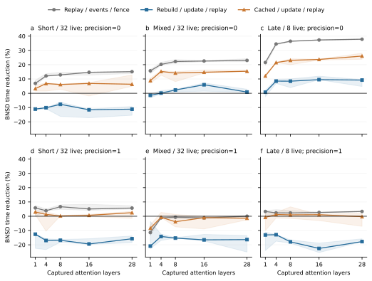

# Captured-input precision and execution-scope study

Research measurements on Ascend 910B2; not leaderboard data. Captured Qwen2.5-7B attention inputs, BF16, two inner-precision settings. The component graphs contain independent captured layers, compacted KV and one final fence. They omit projections, MLPs, KV writes and natural generation.

## Design

Three states (short/32 live, mixed/32 live, late/8 live), five nested depth-spread layer subsets (1, 4, 8, 16, 28), two paths (native TND/BNSD), three scopes (replay with events/fence, rebuilt arguments plus update/replay, cached arguments plus update/replay), and two precision settings. Three fresh-process blocks per precision, with three rounds of 40 iterations per timing condition. Every source/input hash is checked; CPU math-library threads are fixed at one.

Completed 6 processes and 1620 timing conditions, with 18468 post-timing per-layer FP32 comparisons. These are repeated checks, not independent input samples. Finite tolerance failures remain in all timing summaries.

## Complete update/replay results

BNSD time reduction relative to native TND. Positive is faster. Entries are paired process medians with three-process ranges, not confidence intervals.

| Precision | State | Layers | Median reduction (%) | Range (%) | Positive blocks |
|---|---|---:|---:|---:|---:|
| 0 | short_wide | 1 | -11.04 | -11.58 to -10.93 | 0/3 |
| 0 | short_wide | 4 | -10.10 | -10.87 to -10.10 | 0/3 |
| 0 | short_wide | 8 | -7.74 | -16.19 to -6.25 | 0/3 |
| 0 | short_wide | 16 | -11.55 | -17.15 to -11.06 | 0/3 |
| 0 | short_wide | 28 | -11.13 | -15.38 to -9.23 | 0/3 |
| 0 | mixed_wide | 1 | -1.43 | -3.05 to -0.59 | 0/3 |
| 0 | mixed_wide | 4 | 0.13 | -0.53 to 1.90 | 2/3 |
| 0 | mixed_wide | 8 | 2.31 | 0.94 to 2.78 | 3/3 |
| 0 | mixed_wide | 16 | 5.96 | 1.48 to 7.20 | 3/3 |
| 0 | mixed_wide | 28 | 0.86 | 0.65 to 2.85 | 3/3 |
| 0 | long_narrow | 1 | 0.74 | -2.49 to 2.09 | 2/3 |
| 0 | long_narrow | 4 | 8.51 | 6.85 to 9.75 | 3/3 |
| 0 | long_narrow | 8 | 8.47 | 3.99 to 10.06 | 3/3 |
| 0 | long_narrow | 16 | 9.55 | 9.45 to 11.97 | 3/3 |
| 0 | long_narrow | 28 | 9.24 | 4.76 to 9.56 | 3/3 |
| 1 | short_wide | 1 | -12.56 | -22.46 to -12.31 | 0/3 |
| 1 | short_wide | 4 | -16.98 | -23.35 to -15.80 | 0/3 |
| 1 | short_wide | 8 | -16.82 | -18.14 to -16.26 | 0/3 |
| 1 | short_wide | 16 | -19.43 | -19.78 to -15.74 | 0/3 |
| 1 | short_wide | 28 | -15.74 | -18.45 to -13.79 | 0/3 |
| 1 | mixed_wide | 1 | -20.90 | -22.64 to -3.63 | 0/3 |
| 1 | mixed_wide | 4 | -14.16 | -16.92 to -12.52 | 0/3 |
| 1 | mixed_wide | 8 | -15.29 | -15.31 to -14.99 | 0/3 |
| 1 | mixed_wide | 16 | -16.52 | -17.34 to -12.71 | 0/3 |
| 1 | mixed_wide | 28 | -16.35 | -25.08 to -13.53 | 0/3 |
| 1 | long_narrow | 1 | -13.08 | -24.06 to -11.13 | 0/3 |
| 1 | long_narrow | 4 | -12.93 | -17.45 to -12.85 | 0/3 |
| 1 | long_narrow | 8 | -17.93 | -18.86 to -16.56 | 0/3 |
| 1 | long_narrow | 16 | -22.53 | -25.41 to -18.82 | 0/3 |
| 1 | long_narrow | 28 | -17.75 | -17.82 to -15.80 | 0/3 |



## Numerical diagnostics

The original captured native outputs and both replay paths are compared with explicit CPU FP32 attention at atol=0.003, rtol=0.02. The following non-duplicated snapshot selection uses the 28-layer replay condition, round zero, once per state/path/process. It is diagnostic, not a task-quality or numerical-equivalence guarantee.

| Precision | State | Path | FP32 out-of-tolerance elements, three processes | Elements per process |
|---|---|---|---|---:|
| 0 | short_wide | native | 8, 8, 8 | 3211264 |
| 0 | short_wide | bnsd | 8, 8, 8 | 3211264 |
| 0 | mixed_wide | native | 4, 4, 4 | 3211264 |
| 0 | mixed_wide | bnsd | 7, 7, 7 | 3211264 |
| 0 | long_narrow | native | 0, 0, 0 | 802816 |
| 0 | long_narrow | bnsd | 0, 0, 0 | 802816 |
| 1 | short_wide | native | 7, 7, 7 | 3211264 |
| 1 | short_wide | bnsd | 8, 8, 8 | 3211264 |
| 1 | mixed_wide | native | 4, 4, 4 | 3211264 |
| 1 | mixed_wide | bnsd | 7, 7, 7 | 3211264 |
| 1 | long_narrow | native | 0, 0, 0 | 802816 |
| 1 | long_narrow | bnsd | 0, 0, 0 | 802816 |

## Interpretation and limits

- Layer count also changes which real captured inputs are included. The nested subset rule is frozen; this is not repeated identical-operator scaling.
- Cached arguments alternate two block-table addresses with identical contents. Lengths and live counts remain static. This bounds removable preparation work; it does not establish a safe cache under changing serving metadata.
- Individual CPU/device durations are not added to infer complete latency. Direct wall timings include the observed execution boundary, with one fence per graph.
- All 84 captured inputs come from one model family and three states. Precision changes do not constitute independent-model transfer.
- Numerical tolerance failures are retained. Successful synthetic-input checks in the previous campaign do not certify these captured inputs or natural generated answers.
- Shared-host activity is not fully isolated. Three paired processes support descriptive repeatability; no population prevalence, significance or universal crossover claim is made.

## Evidence and access

`evidence.tar.gz.b64` contains original timing and numerical records, smoke results, all process logs and NPU telemetry, frozen plans, input manifests, source snapshots, and executable analysis. `manifest.json` binds all archived bytes. `summary.json` and `per-case.csv` contain complete comparisons, including regressions.

The 84 original captured tensor files are additionally centralized in the container checkout of vllm-hust-benchmark under `local-artifacts/ascend-nmi-captured-inputs-20261028/`, verified against their original capture SHA256 values. `captured-inputs.json` records each file, size, hash and storage location. These multi-gigabyte tensors are **not uploaded in the Git capsule**. Public analysis reproduction is self-contained; device reproduction also requires these archived tensors, the matching vendor runtime and a device lease. This distinction is explicit rather than treating a manifest as a public tensor deposit.

```sh
python verify_archive.py --extract /tmp/ascend-nmi-bridge
python /tmp/ascend-nmi-bridge/campaign/analyze.py
```

The source runner and capture receipt contain original absolute paths. For device reproduction, restore those paths or explicitly rebase the plan and receipt and record new hashes; do not overwrite this campaign. `run_campaign.py` preserves the exact measurement commands.

## Separate device-profile diagnostic

On the late 28-layer state, native summed attention-kernel time per graph changes from 7.214 ms at setting 0 to 4.561 ms at setting 1; BNSD changes from 4.390 to 4.439 ms. These are profiler-on diagnostic sums, not serving speedups. Each layout/setting export contains 168 attention events, exactly 28 layers times six replays. The exported operator name, core class and block count are unchanged; the trace does not expose an exact internal tiling identity.

The profiler emitted a stop-in-RECORD warning and reported unsupported op_attr export in Text mode. Expected attention-event counts were verified; other trace fields are not assumed complete. Full profiles and the 112 output/reference tensor files are centralized in the benchmark container checkout under local-artifacts/ascend-nmi-dispatch-20261028. The public capsule includes exported text/CSV/JSON diagnostics and their source; binary profiler files and output tensors are indexed by dispatch-local-artifacts.json.
