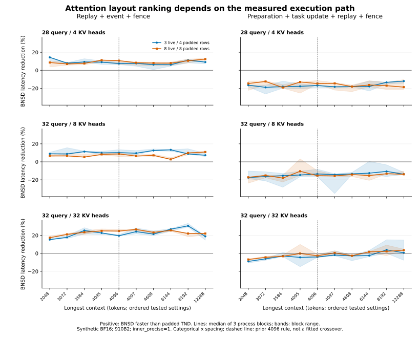

# Ascend NMI: attention structure and execution-scope evidence

Real measurements on one Ascend 910B2, collected on 27-28 October 2026. This is a research mechanism study, not a public leaderboard submission.

## What was tested

- Three attention configurations: 28 query / 4 KV heads, 32 / 8, and 32 / 32; head dimension 128.
- 24 geometries per configuration: 20 threshold-scan conditions and four equal-total-context controls. Three fresh-process blocks per configuration; identical seeded tensors across blocks; rotated path order.
- Three execution paths: native padded TND, compact live-row TND, and live-row BNSD. Replay-only timing includes the external-event record and a completion fence. Complete-path timing additionally includes argument preparation and task updates.
- BF16 synthetic inputs with an explicit CPU FP32 attention reference, absolute tolerance 0.003 and relative tolerance 0.02. All paths use inner_precise=1. No model weights are loaded.
- All formal runs fix OPENBLAS_NUM_THREADS, OMP_NUM_THREADS and MKL_NUM_THREADS to 1. The existing runner also sets torch CPU threads to 1.

## Measured results

9 formal processes completed 216 geometry repetitions (72 distinct architecture/geometry combinations). The analyzer checked 6264 reference/warmup/post-timing comparisons. Failed numerical cases: 0.

Percentages below are medians across the 24 designed geometries, after taking the median paired reduction over the three process blocks. Positive means BNSD is faster than padded TND. These are descriptive grid summaries, not model throughput or an average production workload.

| Query / KV heads | Replay reduction (%) | Complete-path reduction (%) | Stable replay-win / complete-path-loss cases |
| --- | ---: | ---: | ---: |
| 28 / 4 | 8.84 | -16.45 | 23 / 24 |
| 32 / 8 | 8.77 | -14.16 | 19 / 24 |
| 32 / 32 | 22.05 | -2.72 | 11 / 24 |

A stable reversal requires BNSD to be faster in replay-only timing in all three blocks and slower in complete-path timing in all three blocks. Mixed-sign conditions remain in per-case.csv and are not counted as stable reversals.



The bands show the minimum and maximum across three process blocks, not confidence intervals. The dashed 4096 line is the pre-existing model-path rule; it is not a crossover fitted to these data.

### Equal total context

Both uniform and concentrated controls contain exactly 32,768 live context tokens. Batch 8 compares 8 x 4096 with 7 x 1024 + 25,600; batch 32 compares 32 x 1024 with 31 x 128 + 28,800. The table reports the median increase in native padded TND cost for concentrated versus uniform input, paired within each process block.

| Query / KV heads | Batch | Replay cost increase (%) | Complete-path cost increase (%) |
| --- | ---: | ---: | ---: |
| 28 / 4 | 8 | -1.42 | 1.93 |
| 28 / 4 | 32 | 30.10 | 12.00 |
| 32 / 8 | 8 | -1.22 | -10.36 |
| 32 / 8 | 32 | 55.27 | 27.53 |
| 32 / 32 | 8 | -1.22 | -10.72 |
| 32 / 32 | 32 | 35.94 | 27.09 |

## Implications for the NMI manuscript

Across the 72 architecture/geometry combinations, 53 exhibit a replay-win / complete-path-loss reversal in every process block (23, 19 and 11 in the three configurations). At a longest context of exactly 4096, all six configuration/batch-size combinations have slower BNSD complete-path timing in every block. Thus this grid does not support interpreting 4096 as a universal single-operator crossover.

Four of 24 MHA (32/32) geometries show a BNSD complete-path gain in every block, versus none of the 24 geometries in either GQA configuration. For equal total tokens, concentration raises the batch-32 native replay cost by 30.10%, 55.27% and 35.94% (median paired increases), whereas the batch-8 controls do not reproduce the same penalty. This supports geometry-dependent costs, not a universal claim that more concentrated contexts are always slower.

The new evidence tests whether execution-scope sensitivity is specific to the original 28/4 attention configuration. The complete per-case data, including regressions and inconsistent signs, support only conclusions stable within the measured geometries. The equal-total controls separately test whether token totals determine execution cost.

These results can strengthen the mechanism section, but do not close the independent-model, cross-hardware or task-quality validation gaps. A single-operator crossover does not establish the best switching threshold for a graph containing every attention layer, or for end-to-end generation. The main manuscript's inner_precise=0 model experiments and these inner_precise=1 numerical-qualified controls must remain distinguishable.

## Retained attempts and diagnostic repair

The initial environment completed two configuration blocks but stalled in the CPU FP32 einsum reference for the 32/32 concentrated batch-32 case. A nonblocking py-spy attempt was denied by container permissions. An owned-process traceback located the stall in attention_reference, outside measured timing windows. Restricting CPU math-library threads allowed the diagnostic case to complete. This does not independently isolate which library's threading caused the delay.

The complete formal matrix was then restarted with the same thread settings for every configuration. Original attempts, a failed final-telemetry serialization smoke, a lease-rejection log, diagnostic traces and the environment amendment remain in the capsule. They are excluded from final numerical summaries; no failed or partial run is backfilled as a successful formal result.

## Evidence and reproduction

- manifest.json binds the encoded capsule, decoded archive, every member and all derived report files by SHA256.
- evidence.tar.gz.b64 contains original per-round measurements, seeds and input fingerprints, numerical checks, process logs, NPU telemetry, lease receipts, source snapshots, both experiment plans and analysis/plotting code.
- summary.json and per-case.csv expose all final comparisons. CPU reference inputs are specified by the frozen generator, seed, versions and input fingerprints; complete random Q/K/V tensors are not stored for successful conditions.
- Runtime source is the repository-local AST-resolved import closure. PyTorch, torch-npu, driver and CANN identities are recorded. Binary dependencies must be supplied by a matching environment.

Verify the capsule and recompute analysis without an accelerator:

```sh
python verify_archive.py --extract /tmp/ascend-nmi-mechanism-evidence
python /tmp/ascend-nmi-mechanism-evidence/campaign/analyze.py
```

The verifier refuses overwrites and checks member paths and hashes. The analysis checks the complete frozen matrix, unchanged source/input identities, round counts, numerical checks and repeated-input fingerprints.

To reproduce device measurements, restore source-tree at the original project root or explicitly rebase the recorded absolute paths, provide matching dependencies and the configured npu-share pool, and use a fresh output root. run_campaign_thread_limited.py records the exact bounded commands. Do not overwrite the archived measurement directories.

## Limits

- Single-operator synchronous graph timing, including event/fence overhead; not kernel-only timing or model throughput.
- Synthetic BF16 inputs, independent FP32 reference at atol .003 / rtol .02; no task-quality equivalence.
- Inner-precise=1 for all variants; not a direct replication of the paper's default inner-precise=0 model path.
- Three attention head configurations on one 910B2 software stack; not three loaded model families.
- Three independent fresh processes per architecture with identical seeded inputs; no asymptotic significance claims.
- Native-live control materializes compact query/output/table storage outside timing; BNSD views alias padded storage. Layout and storage effects are not fully separated.
- One seeded input realization per geometry is repeated to measure execution variability; independent random seeds are not a separate replication axis.
- The 3-to-4 padded and 8-to-8 unpadded scan cases change batch size as well as padding. Native-live is a useful control, but this grid does not fully identify a padding-only causal effect.
- Successful numerical tolerance checks do not establish generated-answer quality or exact numerical equivalence.
