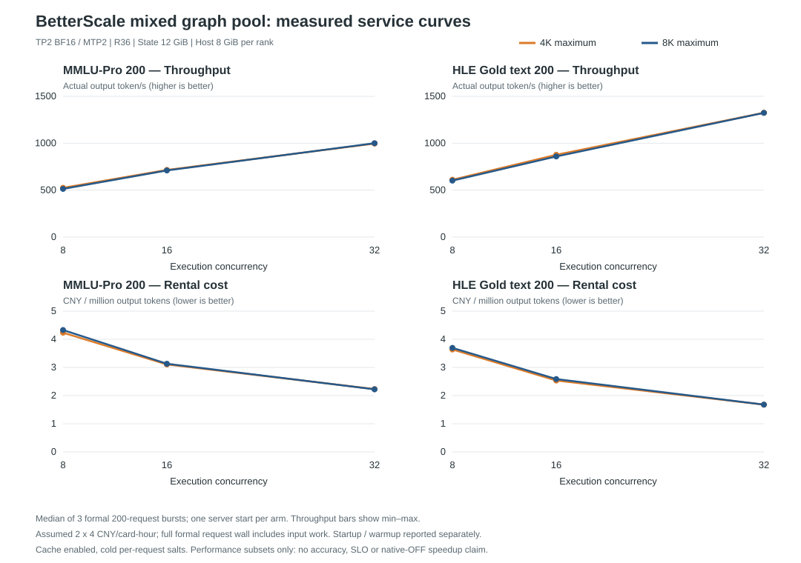

# BetterScale + solver mixed graph pool: measured serving results

**Six configurations completed; all 7,200 formal requests succeeded, with no retries.** An
additional 2,400 warmup requests completed. Devices were released after each arm. Payload-free
per-repeat receipts and effective server arguments are in [receipts.json](receipts.json); aggregate
data are in [results.json](results.json). Full-response capsules remain private, bound by SHA-256.
Measurement date: 2026-10-20 (Asia/Shanghai).

## Results

Medians of three complete 200-request bursts, one server startup per configuration. All use fresh
HTTP connections, real weights, natural EOS, max256 output, seed17 and cold per-request cache salts.
Cache maintenance remains enabled; these are not reuse-hit throughput curves.

|   C | Maximum graph | MMLU output token/s | HLE-text output token/s | MMLU CNY/M output | HLE CNY/M output |
| --: | ------------: | ------------------: | ----------------------: | ----------------: | ---------------: |
|   8 |          4096 |               524.9 |                   610.9 |             4.234 |            3.637 |
|   8 |          8192 |               513.4 |                   601.5 |             4.329 |            3.695 |
|  16 |          4096 |               715.6 |                   876.8 |             3.105 |            2.534 |
|  16 |          8192 |               709.8 |                   859.1 |             3.131 |            2.587 |
|  32 |          4096 |               996.4 |                  1324.9 |             2.230 |            1.677 |
|  32 |          8192 |              1000.0 |                  1323.6 |             2.222 |            1.679 |

## Reading the result

- Execution concurrency has a much larger observed effect than maximum graph capacity here.
- At C32,4K and8K are effectively close in this bounded run: MMLU996.4/1000.0 and HLE1324.9/1323.6.
- For these cohorts, C32/4K is the more economical default candidate: similar throughput, smaller
  graph capture increment. This is not an SLO-qualified production recommendation.
- MMLU prompts range913–2489 tokens; HLE text29–2196. These results do not settle long
  single-request8K prefill or long-KV behavior.
- No matched native-OFF arm was run. Do not label the C8→C32 difference a solver-vs-native speedup.

## Configuration and costs

TP2 Qwen3.5-35B-A3B BF16/MTP2; CANN9.1 legacy qualified runtime; ascend91 physical3/4,
driver26.0.rc1. R36, State/KV12GiB, Host8GiB per rank, context16384. Every512-step target bucket up
to the maximum is captured; native draft/sampling/accept-reject stays intact. Each bucket is
exercised before timing. C>36 remains outside native admission.

Price is an assumption:2 cards×4CNY/card-hour. Divide full formal wall rental by actual output
tokens (or logical input+actual output in JSON). Input computation is included in this amortized
output metric. Initialization/capture, one full warmup and shutdown are separate auxiliary costs;
not free and not included in the steady table. No accuracy or SLO result is claimed.

|   C |  Max | Startup to health (s) | Capture increment reported (GiB) |
| --: | ---: | --------------------: | -------------------------------: |
|   8 | 4096 |                 310.1 |                             1.98 |
|   8 | 8192 |                 690.1 |                             3.78 |
|  16 | 4096 |                 320.1 |                             2.00 |
|  16 | 8192 |                 370.1 |                             3.81 |
|  32 | 4096 |                 270.1 |                             2.04 |
|  32 | 8192 |                 380.1 |                             3.83 |

Startup is observed under the then-existing compile caches, not a controlled cold/warm startup
benchmark. Capture increment is not total model or device memory.

## Qualification and repaired gaps

- Run10 OOMed when each capacity owned separate streams. Shared persistent scratch alone was
  insufficient. Commit573b87bc also shares executor lanes across serial capacities, while events and
  DAG dependencies remain separate. Run11 dummy and run12 real16-bin captures passed at3.83GiB
  reported increment.
- Run09 independently qualified real Host restoration and continuous-prefix answers against cold
  recomputation, including an8K prefix and4K+8K append. The earlier4GiB restore-page-capacity miss
  remains documented, not fixed or hidden by this work.
- Run14 had three early HTTP disconnections with cross-burst keepalive reuse. It remains a failed
  receipt. New runs19–24 use fresh connections and complete all six arms. Runs12/13 are preliminary,
  excluded from this table. Run18 never acquired a lease.
- 71 CPU solver tests run:68 pass,3 torch-dependent skips;19 remote CPU scratch/cache/publication
  tests pass. Hardware identity and raw-capsule bindings are recorded in receipts.json.

## Identity and publication boundary

These are actual BetterScale HTTP service measurements with **solver-generated mixed target plans
enabled**, not solver predictions and not native-OFF results. Target uses the experimental plan;
draft, sampling and acceptance/rejection use the existing native route. The switch remains
default-off.

Measured runtime source: `vLLM-HUST/BetterScale` commit `573b87bc08f9c274058085676311892f115cf078`,
retained on `codex/solver-research`. This publication copies results to main; it does **not** merge
the experimental implementation or claim that main's default serving route produced these numbers.
Plan hashes and the exact per-arm capture lists are in receipts.json. The measured client is
provided as benchmark_client.py.txt; its hash is bound in each dataset contract.

The frozen MMLU five-shot token inputs use thinking=false. HLE uses Gold's text200 subset
reconstructed from its pinned source/template. No dataset prompts or generated responses are
republished. Supplied token IDs already carry their template; the server's default chat-template
setting does not reformat them. Both datasets have max256 output and natural EOS. All three measured
repeats and the warmup are retained separately.

This is a separate performance report, **not an official fixed-target leaderboard submission**, not
full-HLE accuracy, and not a continuation of the differently configured MOD ladder. Same-spec
ID/hash is not asserted. The cost method is pinned to inference-engine-project
`a765a4ca1e56d8a48b3d537bf71adb2cc9e292d0`; its original offline client differs from this production
HTTP burst client. FrontierScience and SWE trajectories are outside this bounded two-dataset curve.

Run `python3 verify.py` to check the payload-free receipts, all repetitions, accounting, dataset
identity and aggregate values. No hardware or model is needed.
