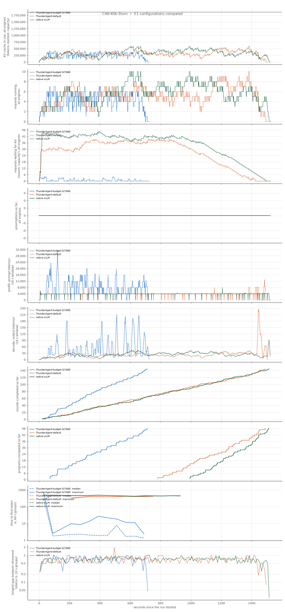
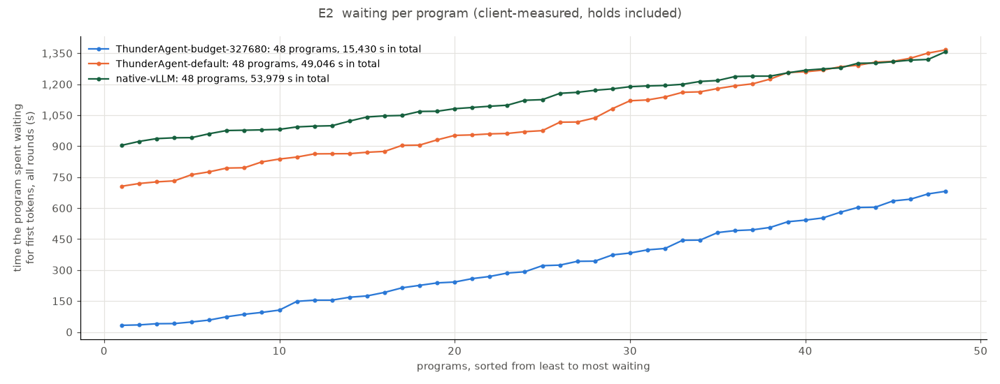

# 35B C48 长上下文的限流层调度预算实验

一个 Qwen3.5-35B-A3B BF16 热实例，TP2，两张 Ascend 卡，RIDE on Ray。48 个 program，约 40k 初始上下文。物理 KV 容量 913 × 2048
tokens。实验适配器仅将调度器可用额度限制为 160 × 2048 = 327,680 tokens。各配置一次。

| 范围与指标                    |  原生直连 | 默认限流层 | 收紧调度预算 |
| ----------------------------- | --------: | ---------: | -----------: |
| 3 轮完整批次，秒              |   1514.55 |    1492.48 |       713.45 |
| 完整批次 steps/min            |      5.70 |       5.79 |        12.11 |
| 完整批次输出 tokens/s         |     23.80 |      24.15 |        50.52 |
| 完整批次输入 token 缓存复用率 |        0% |      3.92% |       59.59% |
| 完整批次实算 prefill tokens   | 5,849,715 |  5,620,339 |    2,364,019 |
| 16 轮负载前 600 秒，成功步数  |        50 |         54 |          221 |
| 前 600 秒 steps/min           |      5.00 |       5.40 |        22.10 |
| 前 600 秒输出 tokens/s        |     17.55 |      17.27 |        99.42 |

完整批次相对直连加速 **2.12×**，相对默认限流层加速 **2.09×**。每臂完成 144 个请求，共输出 36,046 tokens。用于性能回放的合成文本由 SWE-smith
长度和工具等待派生，每个续轮固定使用直连组的历史。顺序为直连、收紧预算、默认。

在独立的 600 秒窗口中，各臂续接自身输出，按引擎计数的成功步数是直连的 **4.42×**。直连和默认来自同一热实例当天稍早的回放。收紧预算后 11 个 program 完成 16 轮，但只有
18/48 个 program 在窗口内完成首轮。客户端计到 222 次返回，最后一次截止前引擎采样在 599.645 秒，计入 221 次。每臂生成量不同，窗口吞吐不能解释为完整批次加速。

[逐请求记录、冻结输入、预算回执和两组原始统计](../../archive/controller-35b-c48-budget-20261126/) ·
[网站数据](../../website-publication/data/controller-35b-c48-budget-20261126.json)

 
