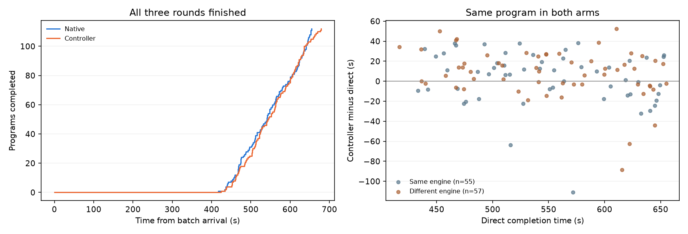
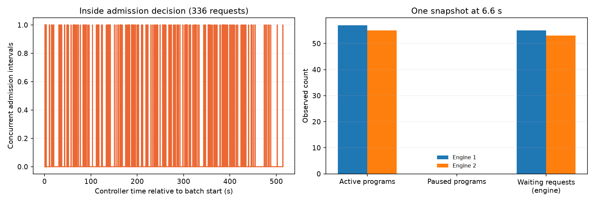
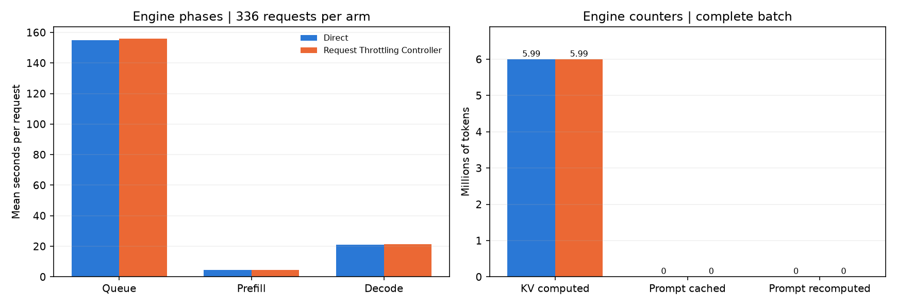
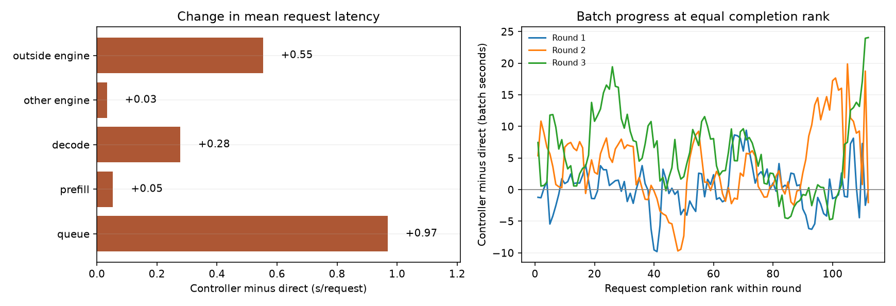

# 35B 双 devbox 多轮回放

同一组 4 张 Ascend 910B2，两个 Qwen3.5-35B-A3B TP2 实例。先跑直连，再跑 RIDE 托管的默认限流层，每臂一次。冻结 56 条 SWE-smith
轨迹的三轮窗口，每条派生两个 program。每个 program 用本臂真实输出续接。此次采集使用限流层仓库回放器和历史 RIDE local 部署。

| 指标                         |    直连 |    限流 |
| ---------------------------- | ------: | ------: |
| 完整批次耗时 (s)             |  654.91 |  678.96 |
| 生成吞吐 (tokens/s)          |   66.45 |   64.09 |
| program P99 (s)              |  652.87 |  676.82 |
| 请求就绪到响应完成 P99 (s)   |  342.29 |  344.60 |
| 成功请求 / 失败              | 336 / 0 | 336 / 0 |
| 输出 tokens                  |  43,516 |  43,516 |
| prefix_cache_hits_total 增量 |       0 |       0 |

整批增加 24.05 秒（3.67%）。限流日志中暂停与恢复均为 0。两臂内的跨轮输入继承均有 224 次匹配。固定顺序的一次配对只能描述该负载下的观测。

[冻结输入与逐请求记录](../../archive/myc-b1-delay-managed-pair-1125-r2/) ·
[计数器、分位数与原件 SHA-256](../../website-publication/data/controller-35b-two-devbox-20261125.json)。公开逐请求记录省略内网端点。计时从
program 到达至末轮响应完成。

  

