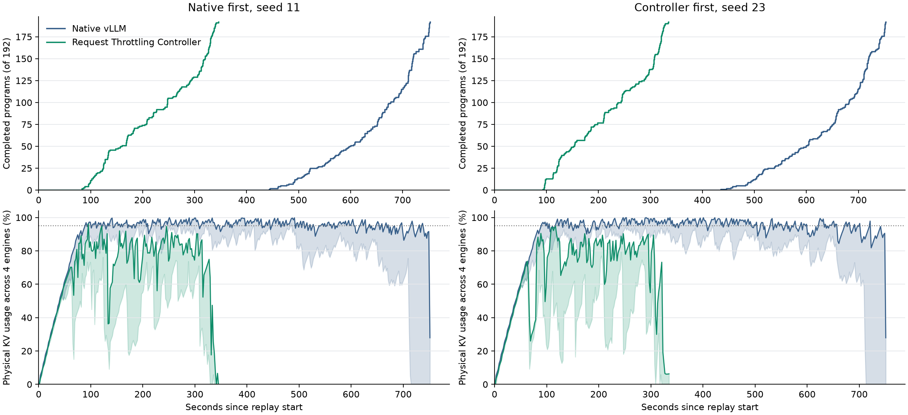

# 9455 四节点高并发限流层配对实验

四张 RTX A6000、192 个并发 program，在原生 vLLM 四个副本逐卡达到物理 KV 压力门槛的工况下，限流层将完整批次耗时从 752.59 秒降到 346.17
秒（2.17×）。交换运行顺序后，耗时从 752.69 秒降到 334.87 秒（2.25×）。四组各完成 576/576 个请求。两对都有首轮首 token 延迟上尾增加，后续轮次的首 token
延迟下降。

## 实验设置

- 四台节点各一张 RTX A6000，在同一 RIDE RayCluster 上运行四个 Qwen2.5-7B-Instruct TP1 副本。引擎为 vLLM
  `v0.30.1rc1.dev535+gd2125ea68`，BF16、最大上下文 32,768 tokens、每副本最大调度序列 64、GPU 内存使用率配置
  0.90，开启原生前缀缓存。四个副本的物理 KV 容量分别为 454,928、454,928、457,072、457,072 tokens，合计 1,824,000 tokens。
- 原生组由 Benchmark 直连 vLLM，program 固定路由。限流组路径为客户端 → 限流层 → 模型，RIDE 托管限流层，使用冻结的 ThunderAgent
  调度器。Benchmark 业务请求与限流层业务等待均使用 `-1`。本轮在隔离运行副本中补齐 TP1 部署、四端点检查和 Job
  激活，版本和参数见[归档](#%E8%AF%81%E6%8D%AE%E5%92%8C%E5%A4%8D%E7%AE%97)。
- 每组 192 个 program、每个 3 轮，压测使用同一份 SWE-smith 派生轨迹计划、合成工具间隔和每 program 独立缓存盐。首轮 prompt 为 20,004–26,876
  tokens。每组引擎合计接收 13,782,800 个输入 tokens、生成 51,047 个输出 tokens。续轮继承本组上轮实际输出。两对第 1/2/3 轮逐 program
  prompt token 哈希匹配数分别为 192/182/126 和 192/183/141，每轮分母 192。
- 完整批次窗口由 Benchmark 回放开始到全部请求完成，排除模型启动和预跑。失败请求为 0/576，吞吐以全窗口计，TTFT 从请求发送到首个流式 token，分位数按线性插值计算。

## 性能与物理 KV 压力

| 指标                          |   种子 11 原生 vLLM |         种子 11 限流层 |   种子 23 原生 vLLM |         种子 23 限流层 |
| ----------------------------- | ------------------: | ---------------------: | ------------------: | ---------------------: |
| 完整批次耗时（秒）            |              752.59 |                 346.17 |              752.69 |                 334.87 |
| 完成请求（个）                |                 576 |                    576 |                 576 |                    576 |
| 请求速率（请求/秒）           |                0.77 |                   1.66 |                0.77 |                   1.72 |
| 输出速率（tokens/秒）         |               67.83 |                 147.46 |               67.82 |                 152.44 |
| 请求延迟 P95（秒）            |              354.81 |                 282.91 |              360.59 |                 280.52 |
| 请求延迟 P99（秒）            |              434.63 |                 316.40 |              437.70 |                 304.96 |
| 首轮 TTFT P95（秒）           |              204.74 |                 286.45 |              204.87 |                 276.97 |
| 前缀命中 tokens / 查询 tokens | 23,616 / 13,782,800 | 8,260,784 / 13,782,800 | 23,616 / 13,782,800 | 8,521,504 / 13,782,800 |
| 引擎抢占（次）                |                   2 |                      0 |                   3 |                      0 |

种子 11 先运行原生组，种子 23 先运行限流组。配对耗时分别下降 54.00% 和 55.51%。前缀缓存命中率来自同批采样窗口内引擎计数器增量，分别从 0.17% 提升到 59.94% 和
61.83%。

压力门槛要求原生组每个副本的 `vllm:kv_cache_usage_perc` 至少三个连续采样点达到 95%，目标采样间隔为 2 秒。两个原生组的达标连续样本数为 7–11，逐副本峰值分别为
99.81%、99.70%、99.96%、99.73%，以及 99.96%、100.00%、99.96%、99.91%。

图中下方实线取四副本在每个采样时刻的最高物理 KV 占比，阴影表示同期最低至最高值。

## 证据和复算

- [归档目录](../../archive/controller-9455-a6000-20261128/)包含四组脱敏逐请求回执、四副本采样、配对汇总、终态、压力门槛、限流层恢复批次和[运行来源](../../archive/controller-9455-a6000-20261128/provenance.json)。program
  编号按配对重映射，可在同一配对内逐 program 对齐。引擎样本时钟以各副本首样本为起点。端点、主机标识、内部路径和请求内容留在实验原件中。
- 从仓库根目录执行
  `python3 reports/controller-9455-a6000-20261128/recompute.py`，校验完成数、请求与缓存计数、压力门槛、配对哈希和速度比，并重生成[逐请求分析](../../archive/controller-9455-a6000-20261128/request-analysis.json)。
- 四组完整逐 token 流留在实验集群。公开归档凭可复算请求回执和设备采样支持表中指标。实验覆盖一个模型、一个高压力档和三轮轨迹回放，未测真实工具执行或作答质量。该报告归入限流层实验档案。

[请求控制与调度优化分析](SCHEDULING.md)把首轮体验与续轮缓存收益分别核算，并列出下一轮配对验证的决策和量测点。
