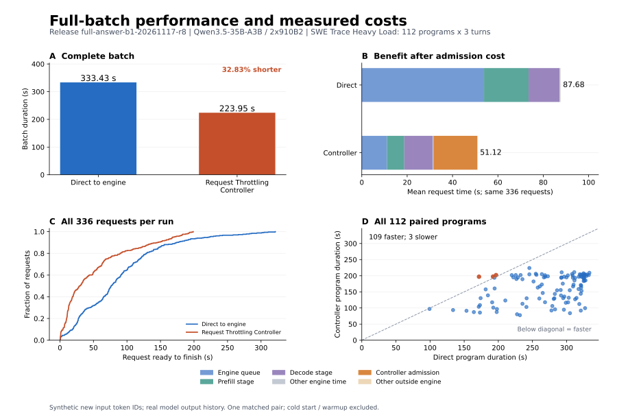
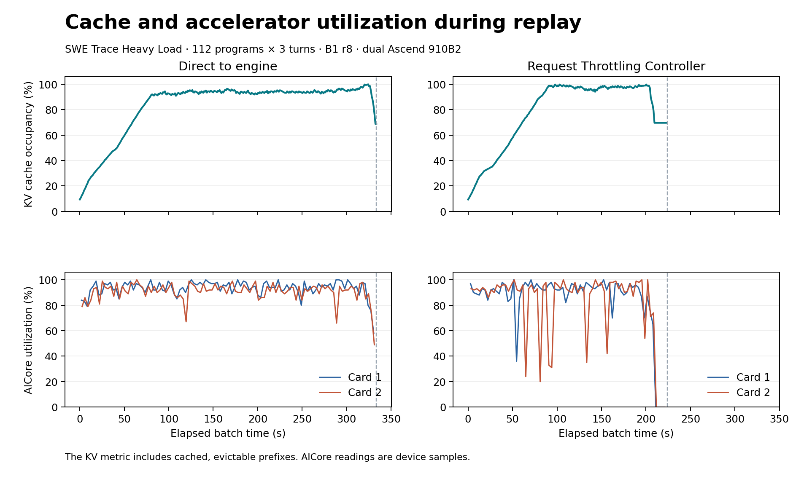

# SWE Trace Heavy Load 第八版请求限流控制器复测

2026 年 11 月 22 日在两张 Ascend 910B2 上使用同一份第八版 B1 引擎配置，分别直连引擎和经过 RIDE 管理的请求限流控制器。每组 112 个三轮程序，336
次请求全部完成，均生成 43,516 输出 token。整批耗时从 333.427 秒降至 223.9513 秒，缩短 **32.83%**。此前同一工况缩短
27.96%。两次均以直连组先运行。[11 月 18 日实验](../controller-r8-20261118/README.md)

| 指标                           |  直连引擎 | 经请求限流控制器 |
| ------------------------------ | --------: | ---------------: |
| 整批耗时（秒）                 |   333.427 |         223.9513 |
| 整批输出吞吐（token/s）        |    130.51 |           194.31 |
| 输入 token 缓存命中率          |    33.02% |           61.48% |
| 224 次续轮中零缓存命中的次数   |       109 |               17 |
| 引擎预填充实际计算 token       | 4,013,521 |        2,308,497 |
| 引擎排队平均时延（秒）         |     53.89 |            11.08 |
| 控制器平均放行等待（秒）       |         — |            19.41 |
| 客户端请求平均时延（秒）       |     87.68 |            51.12 |
| 两张卡采样的 AICore 使用率均值 |    92.16% |           83.63% |

109 个程序更快，3 个更慢。控制器等待已计入客户端时延。AICore 采用正式批次窗口内采样的算术平均，各卡样本量及最大采样间隔见设备统计。[完整批次复算](paired-result.json)
· [逐程序和引擎诊断](paired-diagnostics.json) · [控制器等待证据](controller-aggregate-trace.json) ·
[设备采样统计](paired-device-utilization.json)

## 工况与口径

- Qwen3.5-35B-A3B，BF16，双卡张量并行、两 token 多 token 预测、FULL 执行图。两组共同使用执行上限 36、任务状态驻留数 80、每卡 20 GiB KV
  缓存预算和 4 GiB 主存状态，支持跨轮复用。每组独立冷启并完成 194 条正式预热，冷启和预热在批次计时之外。[运行身份和匹配回执](matched-engine.json)
- 两组各输入 5,992,408 token。续轮继承该组模型的实际输出，336 对请求中的 165 对具有完全相同的提示 token
  序列。工具等待来自原冻结长度与等待模板，程序同时到达。客户端使用非流式 token ID 接口，批次总耗时完整，客户端首 token 和逐 token
  时延缺采集。控制器事件支持同批次放行等待均值，逐请求放行分位数缺少可关联的身份。
- 端到端程序时延包含工具等待，完成率对应回放请求。有效算力、固定上下文和问答评分由对应实验核算。[原始日志及复算来源摘要](source-seals.json)

虚线标出该组批次结束。缓存占用包含可驱逐的已缓存前缀，每张卡的利用率来自正式批次窗口内的设备采样。[曲线取样摘要](figures/resource-timeline-sources.json)
