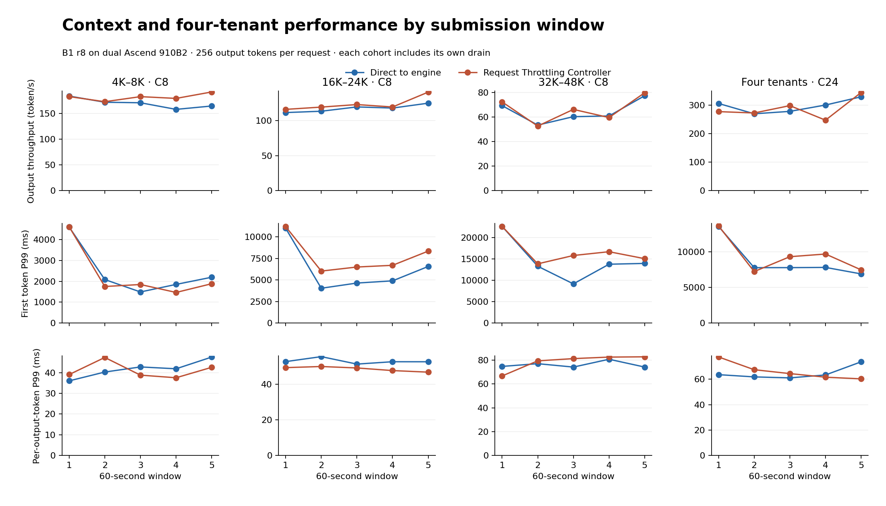

# 第八版请求限流控制器的上下文与四租户配对实测

同一个第八版 B1 引擎分别直连和经过 RIDE 管理的请求限流控制器。使用 Qwen3.5-35B-A3B、BF16 和两张 Ascend 910B2，两组执行上限 36、任务状态驻留数 80，每卡
KV 预算 20 GiB、主存状态 4 GiB。两组独立冷启动并通过统一服务预热，正式时钟从客户端开始。结果与 B0 对第八版 B1
的引擎对比独立。[运行身份和匹配回执](matched-engine.json)

| 工况            | 完成请求 直连 → 控制器 | 输出吞吐 token/s 直连 → 控制器 | 首 token 时延 P99 ms 直连 → 控制器 | 逐 token 时延 P99 ms 直连 → 控制器 |
| --------------- | ---------------------: | -----------------------------: | ---------------------------------: | ---------------------------------: |
| 4K–8K，并发 8   |              231 → 240 |                191.70 → 202.93 |                4,209.14 → 4,224.03 |                      43.03 → 41.94 |
| 16K–24K，并发 8 |              164 → 171 |                137.44 → 143.34 |              10,929.27 → 11,119.18 |                      54.14 → 49.53 |
| 32K–48K，并发 8 |              100 → 101 |                  82.72 → 82.40 |              22,621.49 → 22,168.39 |                      80.75 → 82.84 |
| 四租户，并发 24 |              430 → 429 |                356.96 → 357.02 |              12,793.61 → 12,604.43 |                      63.36 → 66.67 |

每阶段预热 60 秒，正式提交 300 秒并等待排空，输出固定 256 token。原始五份 Terminal-Bench 公开任务历史在三档上下文中的 15
个输入均经过原始摘要及实际分词核验。两组均按请求隔离缓存。控制器组每次请求完成后释放程序，闭环吞吐包含释放成本。两组分别完成 925、941
条正式请求，全部成功。[全阶段及逐租户指标](paired-context.json)

短、中上下文吞吐分别增加约 5.86% 和 4.29%。长上下文和四租户吞吐接近，首 token 和逐 token
的尾部时延各有变化。每组按五个提交窗口分别保留请求量、各自排空后的吞吐、时延和租户指标；整阶段统计从首条提交到最后一条完成。设备利用率来自两张卡的正式阶段时钟采样。[原始归档摘要](source-seals.json)

