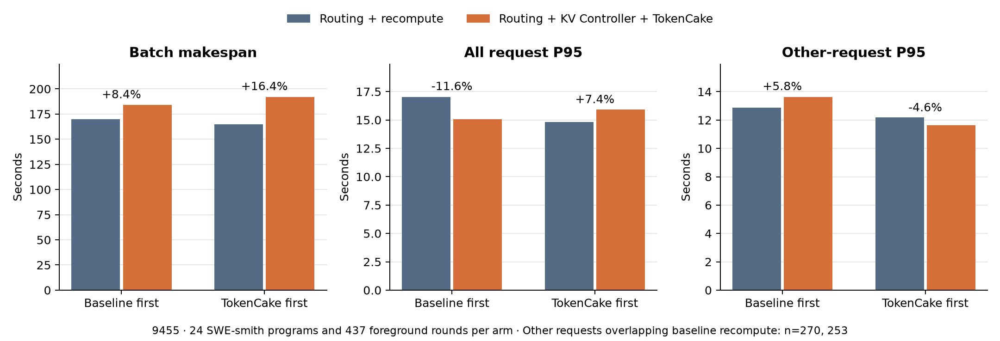

# KV Controller on SWE-smith

The controlled experiments used two NVIDIA RTX A6000 cards, two Qwen2.5-0.5B-Instruct replicas, and
a fixed 24-program SWE-smith replay with all programs arriving together. Both arms in each pair
completed all 437 foreground calls. The baseline used cache-aware routing and simple background
recompute.

## Selective prewarming

During a tool wait, the controller uses the target replica's current load and the length of the
reusable prefix to decide whether to run a background prefill. A continuation benefits when it
arrives on that same replica and the prepared cache is still present. A probe of 73 background
prewarms found 15 observable incremental continuation hits. Across 12 matched prompts that gained
from prewarming, the median gain was 5,856 cache-hit tokens and the median prefill time saving was
76.6 ms.

| 24-program comparison | Batch makespan | All-request P95 | P95 for other requests overlapping baseline prewarming |
| --------------------- | -------------: | --------------: | -----------------------------------------------------: |
| Baseline first        |         −1.51% |          −14.1% |                                                 −17.3% |
| Candidate first       |         −2.07% |           −3.9% |                                                 −24.8% |

The P95 subset uses the same request identities within each pair. One of three 8-program pairs
regressed on makespan. The 24-program gains cover two orders of the same workload and await
replication with independent inputs.

## TokenCake integration

In separate pairs, the same routing policy used official TokenCake scheduling and CPU KV storage in
place of background recompute. A smaller two-turn test completed 12 programs and verified 119 saved
blocks, 93.6 MB transferred in each direction and 7,616 external cache-hit tokens. The adapter uses
the common RIDE lifecycle interface and the KV Controller's backend extension point.

| 24-program comparison |              Batch makespan | All-request P95 | P95 for other requests overlapping baseline prewarming | Total engine-computed prefill tokens |
| --------------------- | --------------------------: | --------------: | -----------------------------------------------------: | -----------------------------------: |
| Baseline first        |  170.04 → 184.25 s (+8.36%) |         −11.61% |                                                 +5.83% |                              −20.41% |
| Candidate first       | 165.03 → 192.05 s (+16.37%) |          +7.44% |                                                 −4.60% |                              −23.86% |

Prefill totals include the baseline's background work. The same program finished last in both pairs,
and its cumulative request time increased. This experiment changes scheduling, offload, and
background preparation together. Standalone offload attribution and standard Mod installation and
rollback remain pending.

Engine source:
[TokenCake commit 1901ebf](https://github.com/pku-lemonade/TokenCake/tree/1901ebf31fdf63590148e61d5c2f65e9fb7ec010),
with vLLM 0.22.0 binaries and RIDE 0.3.6.
