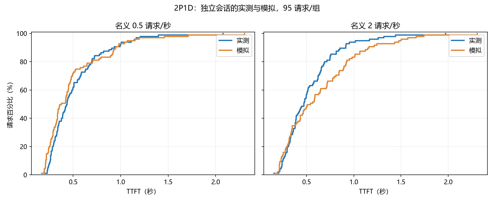
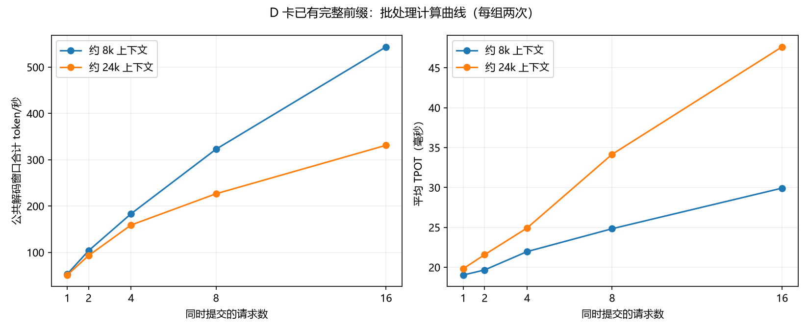

# 多节点模拟器标定：2026-10-27

本轮实测使用 ascend81 两卡作 P0/P1，ascend91 单卡作 D0，即 2P1D。模型为 Qwen2.5-7B-Instruct BF16、TP1；图执行、连续批处理、并发上限 128；P/D token budget 为 8192/2048。CPU 池为每 P 8 GiB、D 16 GiB；实际 NPU KV 页数为 P 每卡 5804、D 5905，约 39.68/40.37 GiB。

完成 71 个有效条件、509 个请求。包含冷热对照、4/8/16 请求汇入 D、恢复与解码交叠、D 已驻留缓存的 1/2/4/8/16 并发，以及全部 32 个标定输入的共享前缀重放。95 个测试输入来自另外 8 个会话，分别按名义 0.5/2 请求每秒重放；保留会话内完成依赖。

逐步计算记录确认 509/509 请求在 D 的首次实际计算前具备完整的可复用块前缀。P 本地保存 ACK 与跨节点发现之间存在发布窗口，本轮增加有界发现等待并记录截止事件；最初诊断批次单独保留。

## 验证误差

|名义请求/秒|实测平均 TTFT|模拟平均 TTFT|均值偏差|逐请求 MAE|逐请求 MAPE|实测/模拟 p95|实测/模拟 p99|
|---:|---:|---:|---:|---:|---:|---:|---:|
|0.5|0.520s|0.499s|-3.9%|0.083s|15.5%|1.144/1.151s|2.079/2.306s|
|2|0.535s|0.644s|+20.4%|0.158s|28.3%|1.166/1.503s|1.972/2.306s|

平均端到端耗时：

- 0.5 请求/秒：实测 3.060s，模拟 3.051s，偏差 -0.30%。
- 2 请求/秒：实测 3.871s，模拟 3.868s，偏差 -0.08%。



## 观察与模型边界

链路容量微基准的四 QP 持续吞吐为 90.95–91.63 Gb/s。完整运行中的 RDMA 获取与 CPU→NPU 恢复分别计时；大量碎片缓存恢复可达秒级，而远端获取通常短得多。网络、缓存恢复排队和计算必须分别建模。

高负载验证中平均端到端耗时吻合，但 TTFT 仍偏高，说明恢复、计算及其交叠的请求级时序仍有近似。后续应同时报告分段耗时、误差与敏感性，不能只用平均端到端耗时判断精度。每组 95 请求的 p99 等于最大值，尾部统计仍需更多独立重复。

误差抵消需要特别区分：2 请求每秒时，模拟平均 TTFT 高估约 109 ms，首 token 之后的生成阶段低估约 112 ms，两者抵消后才得到近乎相同的平均 E2E。当前模型更适合带误差范围的趋势比较，尚不足以宣称请求级时序已经精确。

运行资源观测：0.5/2 请求每秒的验证窗口内，D 的 AICore 采样平均约 61%/72%，峰值 81%/92%；P 在 16 请求汇入条件下峰值达到 100%。P 在共享前缀重放中只计算较短增量，低频采样下平均占用很低；不能据此判断整条推理路径未使用 NPU。两端无 OOM。



模拟代码支持调整工作负载、固定/泊松/自定义到达轨迹、输出长度、会话依赖、P/D 数量、路由、FCFS/短请求优先、并发、token budget、CPU/NPU 缓存、共享 NIC、模型进程 CPU 预算及指定的主机内存带宽。工作负载只包含时间、长度及前缀身份；观测延迟只用于单独比较。

改变 P/D 数量、图执行方式、模型、设备、TP 或进入显存抢占区域时，需要匹配标定或明确记录外推。本轮直接验证的是 2P1D，图执行 Qwen2.5-7B BF16；当前计算特征越界会在输出 coverage 中列明。CPU 预算尚未完整覆盖 native copy worker 的 CPU 时间；主机内存 memcpy 只是共享带宽的容量代理。RDMA 采用容量与队列模型，未刻画交换机分组、ECN/PFC 或重传机制。

## 文件

- `profile-final/profile.json`：组件成本、CPU 成本、覆盖范围与验证误差。
- `profile-final/validation.json`：逐请求实测与预测。
- `profile-final/handoff-audit.json`：509 请求的 D 首次计算位置。
- `snapshot-shared32/`：完整条件记录、服务日志及调度/连接器轨迹。
- `snapshot-final/resources/`：原始 CPU、内存、NPU、RDMA 计数器观测。
- `environment-81.json`、`environment-91.json`：实际启动命令、版本和关键文件身份。
- `network-capacity.json`、`host-memory-*.json`：独立链路及主机内存容量微基准。
- `snapshot-campaign/`：发现窗口修正前的诊断数据。
- `runtime-bundle.tar.gz`：实际连接器、遥测、运行器、native 扩展及服务二进制快照。
- 源码：PegaFlow `scripts/issue23/pd_multinode_simulator.py`、`prepare_multinode_profile.py`、`prepare_pd_workload.py`。

实验专用模型和 native 服务已停止；工作区容器未执行关闭。


## GitHub 交付文件

原始压缩包按小于 1 MiB 的分片保存在 `raw/`，对应完整包的大小和摘要见
`raw-archives.json`。恢复到一个新的目录：

```bash
python restore_raw.py --output /absolute/new/captures
```

恢复后按报告中的包内相对路径读取。大于分片阈值的单个 JSON 以 `.json.gz` 保存。
`provenance/` 下的 Python 原件使用 `.py.snapshot` 后缀，保留采集时字节。
原始测量、模拟预测和诊断失败分别保留；该报告属于研究记录。
