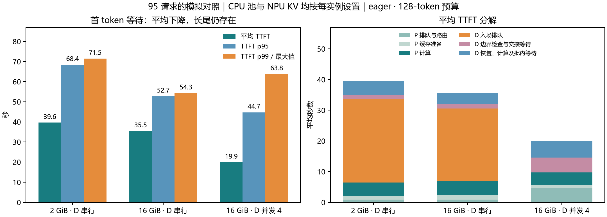

# CPU 缓存扩容与 D 连续批处理模拟

2026-10-27。沿用原 95 条请求、8 个会话、2P2D、Qwen2.5-7B-Instruct 的输入和标定，重新推演缓存驻留、恢复边界、排队及完成时刻。16 GiB
配置下，容量淘汰消失，D 的补算量显著下降；并发 4 进一步降低平均 TTFT，同时仍存在较慢的个别请求。

## 配置与方法

- 每个 P 保持串行；每个 D 的最大活动请求数分别为 1 或 4，采用连续批处理。每步优先服务 decode，剩余 token 预算用于 prefill；总预算为 128，沿用 eager 配置。
- CPU 缓存池与 NPU KV 分别按每实例设为 2 或 16 GiB。16 GiB 场景共 4 个实例，每个实例拥有独立 CPU 池和独立 NPU KV 预算。
- 保留原基线的会话固定 P/D 路由、名义到达时间、同会话前序请求完成依赖，以及原初始缓存内容。扩容增加容量，初始缓存内容保持一致。
- 所有场景重新计算缓存命中与 D 恢复边界。使用原预实验冻结服务模型，目标实验的逐请求耗时仅用于上一阶段的验证。
- D 并发实现将整次请求的软件互斥锁改为单次交接和 engine step 的互斥。P 端仍保留整次 API 的锁。因此，D 并发场景仍可能等待 P 端释放缓存访问锁。
- D 首 token 前的恢复、固定开销和补算，保留原拟合总成本，按剩余输入 token 分摊到 step；混合 step 的这部分工作相加。decode 的批处理比率来自单机实测 eager128
  曲线。
- 主结果假定 decode 成本中 25% 随请求数相加，其余部分共享批处理收益。另测 0% 与 50% 作为敏感性分析。这一比例是模型假设，完整连接器并发下的恢复与计算重叠尚待标定。

## 结果

下表均为模拟结果。TTFT 起点是请求名义到达与会话前序完成时间的较大值；全部完成时间相对实验起点。

| 每实例 CPU 池 / NPU KV | D 并发上限 | 平均 TTFT | TTFT p95 | TTFT p99 | 全部完成 |
| ---------------------- | ---------: | --------: | -------: | -------: | -------: |
| 2 / 2 GiB              |          1 |   39.62 s |  68.40 s |  71.50 s | 736.49 s |
| 16 / 16 GiB            |          1 |   35.46 s |  52.71 s |  54.30 s | 642.02 s |
| 16 / 16 GiB            |          4 |   19.90 s |  44.73 s |  63.78 s | 539.48 s |

95 个样本按 nearest-rank 计算时，p99 等于最大值。它受单条请求影响很大。

相对 2 GiB 串行模拟，16 GiB 并发 4 的平均 TTFT 下降 49.8%，p95 下降 34.6%，p99 下降 10.8%，全部完成时间缩短 26.7%。相对同为 16 GiB
的串行组，平均 TTFT 下降 43.9%，p95 下降 15.1%，但 p99 上升 17.5%。



### 缓存容量改善了什么

D 的补算总量从 473,958 token 降至 5,990 token，减少 98.7%。16 GiB 场景中，95 条请求都恢复了可用的完整块前缀，每条仅剩末尾 1–128
token，合计复用输入的 99.36%。CPU 池容量淘汰次数为 0。

此前关注的 `feal-differential-cryptanalysis:12`，2 GiB 串行模拟在 D 端只恢复 5 块、640 token；16 GiB 并发模拟恢复 180
块、23,040 token，仅剩 63 token。其 TTFT 从 67.86 s 降至 31.10 s。该行比较的是本轮模型的两个场景。

16 GiB 并发场景中，CPU 池峰值约为 P0 4.12、P1 3.25、D0 4.55、D1 3.60 GiB；NPU KV 完整活动请求预留峰值约为 1.34、1.12、4.04、2.30
GiB。再把 CPU 池增至每实例 32 GiB、NPU KV 保持 16 GiB，TTFT、完成时间、命中量及 CPU 峰值均与 16 GiB 场景相同。这一工作负载下，继续扩容已没有收益。

### 剩余瓶颈与长尾

平均 TTFT 中，D 入场排队从 27.06 s 降至 0；等待则更多地分布到 P 端和 D 内部：

| 平均耗时                           | 2 GiB 串行 | 16 GiB 并发 4 |
| ---------------------------------- | ---------: | ------------: |
| P 排队与路由                       |     0.91 s |        4.64 s |
| P 缓存准备                         |     1.05 s |        0.88 s |
| P 计算                             |     4.51 s |        4.24 s |
| D 入场排队                         |    27.06 s |        0.00 s |
| D 边界检查、交接及 API 入场等待    |     1.33 s |        4.86 s |
| D 恢复、计算及批内等待，到首 token |     4.75 s |        5.28 s |

并发组最慢请求为 `distribution-search:13`，TTFT 63.78 s。P 入场前等待约 13.42 s，P 缓存准备 0.52 s，P 计算 9.42 s，P 完成至 D
API 入场约 12.92 s，D API 入场至首 token约 27.50 s。该请求已经恢复全部 153 块、19,584 token，仅剩 103
token。因此，这条长尾来自排队、交接互斥和批内服务干扰。

生成阶段也有吞吐与单请求延迟的权衡。首 token 后生成剩余 127 token 的平均时间，从串行的 7.63 s 增至并发的 14.94 s；按每请求
`(完成时间−首 token 时间)/127` 计算，平均 TPOT 从 60.1 增至 117.6 ms。这里的 TPOT 是请求内平均间隔，不能用它推导逐 token 间隔分布。

P→D 实际模拟搬运量约 7.25 GiB；交接等待还包含软件锁和控制开销。该模拟结果没有建立网络拥塞是剩余主瓶颈的证据。

### 敏感性与适用范围

decode 的不可共享比例设为 0%、25%、50% 时，平均 TTFT 为 20.53、19.90、20.21 s，p95 为 48.71、44.73、50.08 s，p99 为
59.03、63.78、59.18 s，全部完成时间为 488.75、539.48、607.84 s。时间变化还会改变会话后续到达和路由选择，所以个别延迟分位数不必单调。

较稳定的判断是：扩容消除了本模型中的容量淘汰，并发改善平均等待与总完成时间；准确的 p99、TPOT 和并发恢复开销仍需实测。原串行模型对实测 B-before 的平均 TTFT 偏差约
+11.3%，p99 约 −5.1%；这不能作为并发模型的误差界限。

本轮运行原会话固定路由基线，没有重新评估 Tailguard 优化调度的处理组，调度收益需要在相同并发与缓存容量下另作对照。

## 文件与复现

- `summary.json`：各组统计、平均分段与最慢请求。
- `per-request.csv`：各组逐请求 TTFT、E2E、路由及 D 复用量。
- `serial2.json.gz`、`serial16.json.gz`、`batch16.json.gz`：三组完整事件与决策；其余 `batch*.json.gz` 为敏感性及 32 GiB
  对照。
- `inputs/`：数值输入、协议与 eager128 标定曲线。
- `provenance/`：生成本次结果使用的源码快照。
- 源码：PegaFlow 的 `scripts/issue23/pd_capacity_batch_simulator.py`，复用 `pd_serial_simulator.py`
  和仓库冻结策略运行时。

在 PegaFlow 工作区，用本报告目录作为 `<report>`：

```sh
python scripts/issue23/pd_capacity_batch_simulator.py \
  --inputs <report>/inputs \
  --component-profile <report>/inputs/component-profile.json.gz \
  --host-gib 16 --npu-gib 16 --cap 4 --unbatchable 0.25 \
  --output <new-output>.json.gz
```

通过 26 项相关单元测试、Ruff、95 请求因果顺序和 step token/内存预算检查。串行事件循环重构后，原串行基线的 TTFT、E2E、完成时间、命中量与路由计数保持一致。
