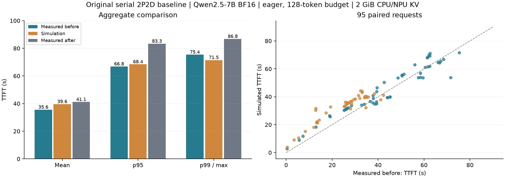

# 原配置 2P2D 串行模拟验证

日期：2026-10-27。范围：原实验基线 B-before/B-after；单次新模拟同时对照两次历史测量。

预测从原始输入、相同初始缓存、原冻结到达轨迹及测试前成本模型出发。路由按原会话绑定规则重新计算，缓存逐块发布/回收，D 恢复边界重新选择。目标请求的实测耗时、命中量和路由不作为世界服务标签。

## 结果

| 指标                   | 原基线第一次实测 | 新模拟 | 原基线第二次实测 |
| ---------------------- | ---------------: | -----: | ---------------: |
| 平均 TTFT（秒）        |            35.58 |  39.62 |            41.13 |
| TTFT p95（秒）         |            66.82 |  68.40 |            83.32 |
| TTFT p99／最大值（秒） |            75.37 |  71.50 |            86.76 |
| 全部完成（秒）         |           725.33 | 736.49 |           849.52 |



左图为组级延迟；右图每点对应一条请求，青色为 D0、橙色为 D1，虚线表示预测与实测完全相同。

逐请求差异见 [per-request.csv](per-request.csv)，完整汇总见 [comparison.json](comparison.json)。

相对 B-before，逐请求 TTFT 绝对误差均值 5.90 秒，最大 18.61 秒。 相对 B-after，逐请求 TTFT 绝对误差均值 8.35 秒，最大 33.09 秒。

历史阶段时长记账回放另存 `timing-replay-control.json`，误差接近浮点累加量级。该回放使用目标请求自身的实测阶段时长，仅检查时序连接；主表的新预测未使用这些阶段时长。

## 恢复边界与模型范围

`feal-differential-cryptanalysis:12` 在本次基线模拟中重新选择了 5 块；决策时 P/D 可见前缀分别为 5／5 块。其逐候选成本、发布与回收事件保存在
prediction.json.gz。该数字由模拟状态产生，并非固定历史恢复量。

本轮保持原来的每卡串行、CPU 池与 NPU KV 各 2 GiB、eager、128 token 步预算、P 输出 1／D 输出 128。仍保留原实验的 D 补算路径，用于先验证原配置；未施加完整
KV 必须交接的新约束。

原配置的可观察参数和初始原生缓存摘要吻合；底层物理 owner 分组、每块原生发布时间采用近似。控制开销采用此前完成的 380 条记录的聚合均值，不查询目标请求自身的耗时；模拟器在本机消耗的 CPU
时间单独记录，不改变虚拟时钟。单一固定成本模型无法重现两轮实测的端点时变。

原始测试前成本模型没有根据本次验证结果重拟合。D0 的长重算输入超出原冷启动样本支持，预测仍有外推风险。当前组级接近不等于逐请求、缓存回收或新策略已经验收。

附带保留独立32样本重拟合的探索结果：该模型缺少原成本模型中的冷启动点，D0 未复用输入只有 4–121 token，却用于上万 token 重算，明显低估服务时间。见
calibration-support.json 和 exploratory-seed-refit.json.gz；该探索不作为主结果。

## 缓存回收观察

在新模拟中，`feal-differential-cryptanalysis:12` 的 P 完成时已发布 180 块；等待 D 期间，P0 上后续 `fix-git:12` 的写入触发 292
块原生回收，将该请求的源端连续前缀从 180 降为 0，随后只剩重新驻留的共同前缀 5 块。D 开始时 P/D 可见前缀均为 5，因此恢复 5
块是重新决策的结果。该链条是当前近似模型中的解释，仍需原实机逐块日志才能确证真实运行中对应的全部原因。

## 复现

在 PegaFlow 仓库根目录执行，R 为本报告目录的本地路径：

```sh
python scripts/issue23/pd_serial_simulator.py --inputs "$R/inputs" --output /tmp/serial-prediction.json.gz
python -m pytest -q scripts/issue23/test_pd_serial_simulator.py
```

本报告是本地 CPU 开发验证；实现位于 PegaFlow scripts/issue23，数值证据位于 benchmark reports。
