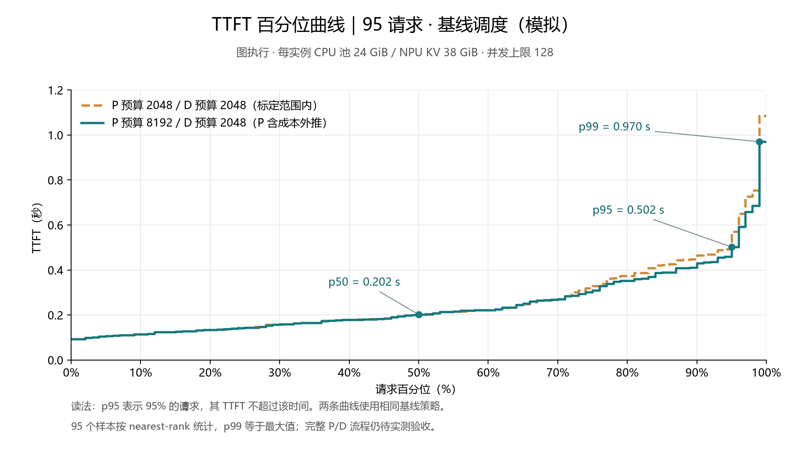

# TTFT 百分位与阶段耗时分析

本分析直接读取同目录保存的两组模拟逐请求结果。主曲线为 P8192/D2048，对照为 P2048/D2048；两组均采用基线调度。

横轴为请求百分位，纵轴为对应 TTFT。主曲线 p50 为 0.202 s、p90 为 0.431 s、p95 为 0.502 s、p99 为 0.970 s。95 个样本按 nearest-rank
计算时，p99 等于最大值。`ttft-percentiles.csv` 保存 0–100 百分位数值，`ttft-percentiles.svg` 为可编辑矢量图。

## 调度方式

这是基线服务场景：每个引擎保留运行中的请求，并按先来先服务从等待队列中准入，执行连续批处理。P/D 配对由会话固定分配，每对负责四个会话。同一会话的下一条请求等待上一条完成。

该场景没有运行 Tailguard 优化调度，也没有使用按预计尾延迟选路、动态会话迁移或布局优化。图中的两条曲线用于比较 P token 预算，不是优化算法的处理组与对照组。

## 平均首 token 耗时

| 阶段                                  |      平均耗时 |
| ------------------------------------- | ------------: |
| P 端缓存准备                          |       0.14 ms |
| P 入场排队                            |       1.28 ms |
| P 计算与结果交付                      |     143.27 ms |
| P 保存到 CPU                          |      25.05 ms |
| D 交接与恢复，包括 RDMA、H2D 及其等待 |      27.69 ms |
| D 入场排队                            |       3.12 ms |
| D 计算到首 token 及交付               |      46.90 ms |
| **合计 TTFT**                         | **247.45 ms** |

P 的计算与结果交付占平均 TTFT 约 58%。这是首 token 延迟的最大组成项，但不意味着 P 的计算资源已经饱和。CPU 保存和 D 交接/恢复合计约 52.74 ms。

最慢请求为 `feal-differential-cryptanalysis:10`，TTFT 为 970 ms：P 入场排队约 62.8 ms、P 计算与交付 612.3 ms、CPU 保存
105.5 ms、D 交接与恢复 139.8 ms、D 入场排队 1.5 ms、D 首 token 服务 48.2 ms。它在 D 端恢复了全部 147 个可恢复块、18,816 token。

## 当前是否测到了资源瓶颈

本轮是低负载场景，尚未测到硬件资源饱和点。请求名义到达速率约为 0.49 req/s，最后一条名义到达时刻为 197.47 s，全部完成为 202.34 s。整轮时长主要随业务输入时间展开。

并发上限虽为每实例 128，实际运行峰值为 P0/P1 各 1、D0/D1 各 3；全系统在途峰值为 6。P、D 入场排队平均合计约 4.40 ms。CPU 和 NPU 缓存均无淘汰，RDMA
FIFO 服务队列等待为 0。

按计算步占用实验时间统计，P0/P1 为约 3.55%/2.78%，D0/D1 为约 47.76%/45.02%。该指标是模型中的调度时间占用，不是硬件 AI Core 利用率。

单请求完整响应的平均耗时为 2.737 s，其中首 token 后生成剩余 127 token 平均为 2.490 s，约占 91%。因此，完整响应时间主要花在 D 的正常生成阶段；这仍不等于 D
出现了饱和排队。

下一步应保持服务配置，增加独立会话与真实请求注入量，观察何时计算、缓存恢复或 RDMA 出现持续排队。优化调度应在相同服务配置和负载下另作对照。

## 数据与边界

`bottleneck-analysis.json` 保留逐段均值、资源占用、RDMA 排队与最慢请求时间线。生成脚本为 PegaFlow 的
`scripts/issue23/render_pd_serving_percentiles.py`，源码快照随本分析保存。

以上均为组件标定支持的模拟。P8192 有计算成本外推，完整两节点连接器、CPU 竞争及异步交接开销仍待实测；本结果不能证明实际网络在更高负载下也不会拥塞。
