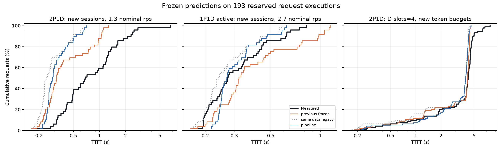
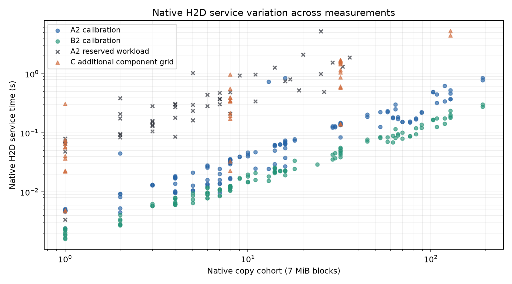

# P/D 模拟器泛化标定与验证（2026-10-27）

本轮提升了解码计算标定、缓存恢复的事件模型和验证覆盖面。新模拟器在两个保留条件上改善了 TTFT 预测，在主配置的新会话条件上退化。因此，这一版本适合有验证记录约束的情景探索，尚未通过通用 TTFT、尾延迟精度验收。

## 资源与数据

- 81 两张 NPU，91 一张 NPU，总计三张 Ascend 910B2。Qwen2.5-7B-Instruct BF16、TP1、graph decode。
- A2：81 上 P0/P1，91 上 D0，2P1D。B2 标定：91 上 P0，81 上 D0/D1，1P2D。B2 保留测试仅使用 D0，D1 加载但闲置，属于实际活跃 1P1D。
- A2/B2 共 120 个运行条件，包含预热；其中 96 个条件、560 次请求执行用于拟合，覆盖 21,218 个计算步和 258 个 native 恢复批次。
- 拟合输入来自 adaptive-rejection-sampler、code-from-image 两个标定会话。覆盖约 8K/15K/24K 上下文、1/4/8/16 路解码、不同缓存大小、合批和计算/恢复重叠。
- 保留验证共 193 次执行：A2/B2 各 49 次，来自四个新会话；C 为原八会话的 95 次请求，改变 token 预算和 D 并发上限。A2/B2 复用了同一组 49 个历史，因此不是 98 个独立历史。总计 144 个独立请求历史。
- C 配置：P token budget 4096、D token budget 1024、D max sequences 4；固定 3 nominal rps，输出 192 tokens。会话有前后依赖，实际到达受到上一轮完成时间约束。

## 实现

1. D 端按照引擎迭代观察查询、异步预取、同轮合批恢复及完成通知；native copy worker 按 FIFO 执行。
2. 显式表达服务器入口开销及共享 CPU、NIC、KV/host cache 资源。
3. 比较解码计算模型、忙时恢复模型和资源能力归一化模型，使用整组角色互换与上下文区间留出验证。
4. 每个运行条件具有相同总拟合权重，避免大量相邻 decode tokens 主导回归。采用非负系数和稳健残差权重。
5. 用两个独立 128-block probe 提供目标端有效恢复能力，probe 不参与恢复系数拟合和 CV 分数。该跨主机验证是带组件标定的迁移，不能解释为新硬件无标定预测。
6. 增加恢复批次范围检查，超出资源标定范围时显式标注外推。40 个相关单元测试通过，新增代码通过 Ruff。

测量流程减少了空轮询中的 NPU event 提交；请求路径采用内存缓冲，完成后写共享盘。native binary 保持原运行版本。保留测试前冻结了模型和代码，记录于 selection-freeze.json。所有性能结果均由该冻结版本产生。

## 独立验证结果

下表的误差按逐请求预测与实测之差计算。正的改善比例表示绝对误差下降。

| 条件 | 请求数 | 旧版 TTFT MAE（ms） | 新版 TTFT MAE（ms） | MAE 改善 | 新版 TTFT MAPE | 新版 E2E MAPE |
|---|---:|---:|---:|---:|---:|---:|
| A2 | 49 | 609 | 736 | -20.8% | 53.8% | 26.8% |
| B2 | 49 | 181 | 70 | +61.3% | 19.2% | 4.7% |
| C | 95 | 873 | 746 | +14.6% | 29.8% | 12.5% |



另外提供同一批新标定数据拟合的旧架构基线。其 A2/B2/C 的 TTFT MAE 分别为 767/74/973 ms，新架构为 736/70/746 ms。架构改进产生部分收益，但仍不能解释 A2 的长尾。

解码计算步的整组交叉验证平均相对误差约 3.6%。恢复服务采用组件能力归一化后，整组交叉验证平均相对误差从约 109% 降至约 22.8%。这是组件层面的结果，不能替代整请求验证。D 的首 token 计算步仍有较大误差，记录在 profile 的 fit_selection 中。

## 尚未解决的误差

A2 最慢请求实际 TTFT 为 6.585 秒，预测为 0.543 秒。该请求恢复 25 块缓存，客户端观察的 load 完成约 6.001 秒；native 实际 H2D 服务约 5.234 秒，其中约 5.230 秒在 stream synchronize 等待，描述符构建和 API 提交仅数毫秒。实际传输块数与预测一致，当前证据指向恢复服务耗时，不能归因于 D 大量重算。

A2 保留测试期间，容器平均 CPU 约 1.09 核、峰值约 1.87 核；相对 4 核配额没有持续打满。现有采样不能完全排除短时调度干扰，但不足以支持 CPU 配额耗尽解释。

为检查这一现象，又完成了 C 上 12 个计算/恢复重叠条件、3 个独立恢复 probe，共 63 次标定请求。它们在冻结验证之后采集，未用于该冻结模型的系数和模型选择。相同 128 块独立恢复在早期 A2 probe 中约 0.465–0.527 秒，在后续 C probe 中约 4.462–5.293 秒；后者在 native 服务期间没有计算步重叠。用一个固定“计算忙时倍数”不能解释这类变化。



91 上额外的独立 Torch H2D probe：32 MiB 连续拷贝热态约 2.1–2.4 ms；拆为 256 个 128 KiB 块，pinned host memory 约 7.8–8.1 ms。它与 native 恢复路径不同，不能直接替代其参数；它表明不能把 native 路径观察到的低有效带宽直接当成物理链路带宽。

目前仍需定位 native Ascend 恢复路径的状态、内存布局、IPC/stream 与同步等待行为。当前证据没有证明其中某一个是根因。C 的 p95/p99 TTFT 实测为 6.333/7.732 秒，预测为 4.434/4.562 秒，尾部仍明显低估；A2/B2 各 49 次、C 95 次请求的 p99 都等于样本最大值，尾部稳定性需要更多独立样本。

## 使用范围与后续工作

模型与硬件、执行模式匹配且组件服务稳定时，可用于研究并发、到达速率、上下文长度和路由变化。当前不能据此承诺任意 P/D 数量或任意配置的高精度。完整 2P2D 尚未实测；NPU 内存抢占和交换机包级拥塞也不在已验证范围。

优先做 native copy 的小型受控基准：保持缓存对象和内存句柄相同，分别变化连续/散布布局、描述符数量、计算是否重叠，并观察 cleanup 和长时间运行前后的变化。定位或量化这部分状态变化后再更新恢复模型，使用全新会话验证。保留当前失败记录，避免根据这次异常回调一个固定倍数。

## 文件

- profile-selected-v2.json、selection-freeze.json：冻结模型及选择记录。
- validation-A2、validation-B2、validation-C：纯输入 workload/config、三种预测、逐请求误差和完整前缀 handoff 审计。
- calibration-*-normalized.json.gz、heldout-*-normalized.json.gz：规范化计算步、native 恢复批次及请求分段。
- *raw.tar.gz、calibration-A2.tar.gz、calibration-B2.tar.gz、resources-and-direct-copy.tar.gz：原始请求、调度、连接器、native 日志和资源遥测。
- provenance：本次使用的模拟器、拟合、测量和分析代码。
- validation-status.json：条件验证状态。C 一个恢复批次按请求拆分时存在一块差额，批次总字节以 native 日志为准，该拆分未用于冻结模型拟合。

固定轨迹 revision：3f5b93ff1c5ea84b2c94cf479d0c942227191b4a；新会话为 bn-fit-modify、break-filter-js、build-cython-ext、build-pmars。输入使用 Qwen2.5 chat template、add_generation_prompt=True，包含当前 agent step 之前的完整可见历史。


## GitHub 交付文件

原始压缩包按小于 1 MiB 的分片保存在 `raw/`，对应完整包的大小和摘要见
`raw-archives.json`。恢复到一个新的目录：

```bash
python restore_raw.py --output /absolute/new/captures
```

恢复后按报告中的包内相对路径读取。大于分片阈值的单个 JSON 以 `.json.gz` 保存。
`provenance/` 下的 Python 原件使用 `.py.snapshot` 后缀，保留采集时字节。
原始测量、模拟预测和诊断失败分别保留；该报告属于研究记录。
