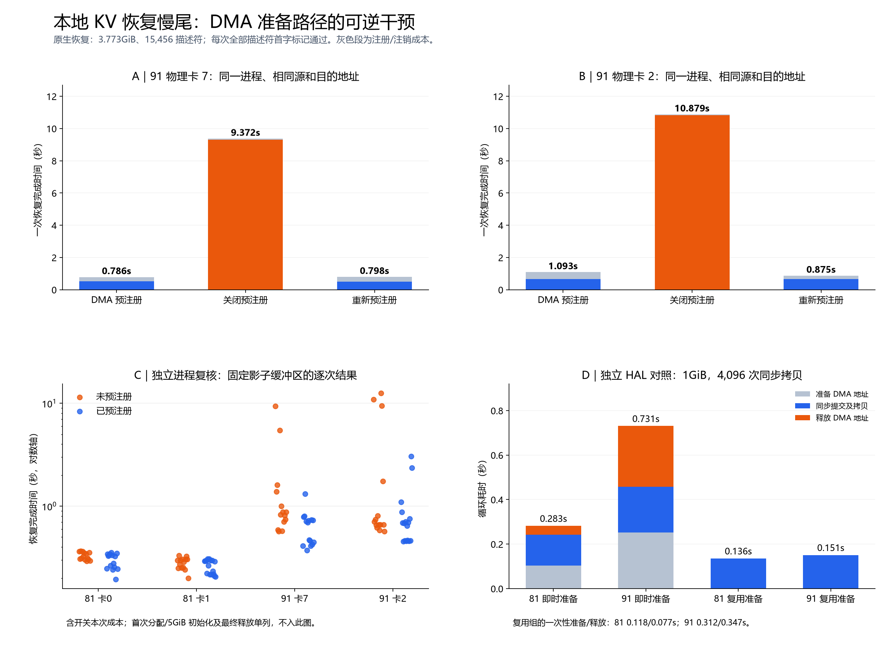

# 本地缓存恢复慢尾：DMA 内存准备路径的因果对照

2026-11-11，两个双卡容器内的续查。先读本报告，再沿原件和分析脚本复算。

后续 [相同地址的描述符复用与提交路径对照](DIRECT-DMA-20261111.md)补充 88 次恢复， 继续定位本报告保留的“预注册后仍慢”例外，并保留旁路完整成本较高的结果。

## 已确认的原因及证据边界

**在当前慢宿主机上，主机内存的 DMA 准备状态是恢复慢尾的一个已验证、可逆的因果因素。** 同一原生进程保持同一块 CPU 源内存、同一组 NPU 目的地址、相同数据和 15,456
个拷贝描述符， 仅切换 `HOST_MEM_MAP_DMA` 预注册，恢复时间能在约 9～11 秒和约 1 秒之间往返变化。 两张物理卡均复现；正常宿主机的两张卡变化明显较小。

追加的随机顺序复测中，91 的 8 个配对有 7 个预注册更快，配对耗时比的中位数为 0.691。 **同时保留一个反例：已注册路径仍出现 3.057 / 2.354 秒。**
因此，这里确认的是一个可控的重要原因，尚不能把预注册称为全部波动的完整解释或稳定修复。

通俗地说，数据已经在 D 端 CPU 内存中，但 NPU 不能直接把普通 CPU 地址当作 DMA 地址使用。 驱动需要准备设备可访问的内存映射，再完成搬运。我们的干预是提前准备并保留这个状态。
结果说明，过去看到的大段“同步等待”，至少有一类主要受这条主机侧准备路径影响， 不能按传输字节数除以链路带宽解释，也不能把整个等待算成硬件正在搬数据。

**尚未唯一确定的是准备路径内部的具体慢点。** 两宿主机的 IOMMU 配置存在明显差别， 但本轮没有独立切换宿主机 IOMMU，也没有函数级内核采集。 因此，结论可以到“DMA
准备状态改变恢复性能”这一层；不能进一步把某个 IOMMU 函数、 内核锁、映射失效机制或所有历史长尾认定为已逐一证明的缺陷。



## 环境与固定条件

| 项目                | 81                                                                 | 91                                                           |
| ------------------- | ------------------------------------------------------------------ | ------------------------------------------------------------ |
| 工作区              | hust-zsx-81                                                        | hust-zsx-91                                                  |
| 宿主机              | host-192-168-0-4                                                   | host-192-168-0-2                                             |
| 本阶段逻辑卡→物理卡 | 0→0，1→1                                                           | 0→2，1→7                                                     |
| 对应 NUMA           | 物理0：6；物理1：0                                                 | 物理2：6；物理7：2                                           |
| 硬件                | 2×Ascend 910B2                                                     | 同左                                                         |
| 容器配额            | 8 核 CPU，64GiB RAM                                                | 同左                                                         |
| 内核 / CANN         | 5.15.0-25-generic / 9.1.0                                          | 同左                                                         |
| 用户态驱动库 SHA256 | `0a69928ba6771ee057ee82a02094ac14e7ec85548ef9ac1d2f69dd5b074ab741` | 同左                                                         |
| IOMMU 可读状态      | 0 个 group，class 为空，NPU PCI 无 group 链接                      | 71 个 group；8 张 NPU 均处于 `DMA` domain；16 个 SMMUv3 实例 |

81 在本次资源恢复后更换了物理卡分配；[上一阶段](RESUME-20261111.md)的 5/6 卡结果是另一次分配。 原生服务 SHA256 仍为
`f2d3856a3e14a65e4267e58e26224298da733f8f18d08d51e7f8ff8dcae771a8`。 实际运行身份、启动参数、源文件和观察器身份保存在追加包中。

原生探针固定 96 个 NPU 平面，每平面 512×256KiB，总 NPU 缓冲区 12GiB；CPU 源池 5GiB。 每次恢复 161 个逻辑块，共 **4,051,697,664
字节（3.773GiB）和 15,456 个描述符**。 数据先保存一次，此后源内容固定。每次恢复前清零所有目的标记，再核对全部描述符的首字版本标记。
这验证了每个拷贝位置均被恢复，不等于逐字节核验全部 3.773GiB。

各节点同一时刻只运行一个本轮卡实验，跨节点并行；采用默认调度优先级。 这是本地 CPU→NPU 诊断，计时从原生 load 提交到就绪；完成后的标记读取单列在计时外。 这些耗时不属于模型请求
TTFT，且没有模型计算或远端 RDMA 读取。

## 调查如何收敛

### 1. 复现异常，检查队列与任务类型

3.773GiB 原生恢复的 91 独立进程出现 0.747、5.712、27.161、15.804、21.000 秒。 对应 81 为 0.673、0.672、0.488、0.392、0.672
秒。 任务头观察器确认恢复任务均为类型 17（PCIE DMA），flags=64， 与独立 H2D 对照一致；不存在据此把原生恢复误判为另一种任务类型的依据。

27.161 秒发生在 task_id 30,912～46,367，尚未跨 16 位任务号回绕。 独立程序主动跨越四次回绕，两节点各八次 4GiB H2D 仍约 0.68～1.30 秒。
因此简单的任务号回绕假设不足以解释此慢例。

先前队列记录已将一类慢尾定位到“驱动成功接收后、硬件下发前”的长驻留。 本轮将内核快照缩减到实验拥有的通道文件，降低全局 CPU/中断快照的观测成本。
内核快照仍是离散采样，不能推断连续的硬件空闲时间。

### 2. 从分配布局、在途数量转向 DMA 准备

- 相同 3.773GiB，比较连续目的地址、单次大分配内的跨平面地址、96 次独立分配。 81 稳态约 0.68～0.70 秒；91 为 0.81～3.70
  秒。布局会影响开销，但没有唯一解释严重慢尾。
- 原生路径加入 32 或 512 项在途限制，91 仍出现约 3 秒恢复；没有得到稳定的正常速度。
- 对原生进程公开 DMA 接口加透明计时，未在 payload 路径捕获足以覆盖每项描述符的调用。 因而不能用少量已截获调用的耗时，冒充整个内核准备阶段的精确分解。

接着直接测量 DMA 地址的准备/释放，数据量不作为拷贝负载： 4,096×256KiB，共准备 1GiB 地址、**不搬 payload**，分别保持 1、32、2,048 个句柄在途。 81
六次约 0.138～0.192 秒，91 约 0.495～0.653 秒。 即使没有数据搬运，主机侧准备成本也存在约 3～4 倍差别；但这个小对照本身没有重现 27 秒。

### 3. 独立同步 HAL：将准备与真正提交分开

固定相同 1GiB 源和目的地址、4,096 项，按 A/B/B/A 交叉： A 每项调用 Convert→SubmitSync→Destroy，B 复用提前准备的同一组地址描述符。

| 路径                         | 81，两次（秒） | 91，两次（秒） |
| ---------------------------- | -------------- | -------------- |
| 每次即时准备与释放           | 0.283 / 0.284  | 0.731 / 0.684  |
| 复用已准备的地址，仅提交拷贝 | 0.136 / 0.144  | 0.151 / 0.138  |
| B 的一次性准备 / 最终释放    | 0.118 / 0.077  | 0.312 / 0.347  |

准备好的地址被复用后，两台机器的提交/搬运成本接近；一次性成本仍然真实存在，需随复用次数摊销。 本组为同步 HAL 微基准，每次检查八个分散标记，不能直接当成原生异步恢复的提速倍数。

### 4. 回到原生路径：同一缓冲区可逆切换

先分配一块驱动拥有的 `aclrtMallocHost` 影子缓冲区，将不变的 5GiB 源池复制进去一次。 原生恢复的 H2D 源地址按偏移重定向到该缓冲区，目的地址和任务数保持不变。
随后只在同一影子地址上注册/注销 `HOST_MEM_MAP_DMA`，保持这块内存持续存在。

| 物理卡 | 预注册（秒） | 关闭（秒） | 重新预注册（秒） |
| ------ | ------------ | ---------- | ---------------- |
| 91 卡7 | 0.786        | 9.372      | 0.798            |
| 91 卡2 | 1.093        | 10.879     | 0.875            |
| 81 卡0 | 0.343        | 0.362      | 0.329            |
| 81 卡1 | 0.292        | 0.298      | 0.294            |

上表保留本次开关成本。91 两个“关闭”分别仅花 0.067、0.059 秒注销， 扣除后仍有 9.305、10.820 秒恢复，不能用注销本身解释慢化。 重新注册分别耗时 0.288、0.216
秒；扣除后恢复约 0.509、0.658 秒。 每轮目的标记均先清零，并全部恢复通过；实际 batch 日志中源/目的首地址、分块和字节数的签名保持一致。

另起进程检验首次成本与连续状态：注册前连续恢复、注销后连续恢复、注册后连续恢复。 91 卡7 在未发生首次注册之前已有 1.386 秒恢复；注销后的第二次恢复仍出现 **5.460 秒**，
说明慢化并非仅发生在执行注销的那一次。该次没有注册/注销/分配操作。 同一进程已注册但无需再次注册的一次恢复为 0.371 秒。 91 卡2另一进程六次已注册恢复为 0.455～0.705
秒，未注册为 0.619～0.805 秒。 后者没有再次触发十秒慢尾，说明异常具有状态依赖，不能说关闭后每次都必然慢十秒。

E/F 包中，91 共 15 次可比较的已注册影子恢复，含当次注册成本为 0.371～1.316 秒； 单列准备成本后的残余恢复为 0.371～0.658 秒。其 12 次未注册的连续影子恢复为
0.569～10.879 秒。 这些重复数用于检验机制与稳定性，不作为总体 p99 估计。

### 5. 预先固定分析口径的随机配对复测

每张卡重新启动一个独立进程；仍在同一影子源和目的地址上切换。 每进程 4 个配对，两个配对先开后关、两个先关后开，固定 seed 后随机排列。 每种状态连续恢复两次。每卡共 19
次恢复：预热、影子初始化、16 次配对样本、最终清理。 四卡合计 **76 次**，全部完成并通过全部描述符标记检查。 每节点的两张卡顺序测试，避免两张卡相互制造新竞争；两个节点同时进行。

计划文件在运行前写入。主要指标是每种状态两次**完整完成时间的均值**，保留当次注册/注销成本； 先算每个配对的“已注册均值 ÷ 未注册均值”，再汇报所有配对及其比值中位数。
首次分配/全池初始化和最终释放不属于配对窗口，耗时仍完整保存。

| 节点 | 配对数 | 已注册更快 | 配对比值中位数 | 例外                                   |
| ---- | ------ | ---------- | -------------- | -------------------------------------- |
| 81   | 8      | 7/8        | 0.897          | 一对 0.2652 vs 0.2645 秒，基本相同     |
| 91   | 8      | 7/8        | 0.691          | 一对已注册 2.7058 秒，未注册 0.6151 秒 |

比值中位数不是总体均值下降比例；各配对共用进程和主机，不应当作 16 个完全独立样本做强统计外推。 91 另两对的未注册均值为 6.588、5.590 秒，已注册为 0.576、0.609 秒，
说明大幅改善在随机顺序下再次出现，而非只在此前选出的一个开关序列出现。

合并 E/F/G 同地址连续影子样本，91 已注册 **31 次为 0.371～3.057 秒**， 未注册 **28 次为 0.569～12.518 秒**；前者有两次超过 2 秒、没有超过 5
秒， 后者有五次超过 5 秒。该阈值计数只是本次样本描述，不是预先设定的显著性检验或总体尾概率。 81 对应 31 次已注册为 0.195～0.355 秒、28 次未注册为 0.200～0.367
秒。 图 C 显示所有这些样本，图 A/B 为其中的可逆开关案例。

### 6. 已注册仍慢的例外：进一步拆分

91 物理2的随机进程最后一个配对，已注册的两次分别为 3.057、2.354 秒， 随后切回原始源路径（含影子清理）为 19.713 秒。 这三次均没有新增 CPU 配额限流。对其中第二次
2.354 秒恢复：

| 项目                                  | 实测                 |
| ------------------------------------- | -------------------- |
| 本次重新注册、注销或分配              | 均无                 |
| 31 个 batch API 总墙钟时间            | 2.141 秒             |
| 同一批 batch API 的线程 CPU 时间      | 2.136 秒             |
| 最终 stream 同步                      | 0.190 秒             |
| load 线程运行时间 / 等待 CPU 运行队列 | 2.157 秒 / 0.0008 秒 |

因此该例外主要在提交路径继续消耗时间，并非注册调用本身或线程长时间拿不到 CPU。 线程 CPU 时间接近墙钟时间，与运行时忙轮询等待推进相容，但单凭该数据仍不能区分内部轮询、 驱动转发处理或 DMA
完成变慢。它与前述“没有 CPU 配额限流”的结论一致， 也直接说明仅优化源内存预注册还不足以宣称根治。

全部可逆实验支持 DMA 准备状态的因果影响；这个反例把剩余问题限定在预注册之后仍存在的提交/推进路径。 针对该例外的后续同进程、同地址旁路及队列采样已完成，见
[描述符复用与提交路径对照](DIRECT-DMA-20261111.md)。

## 宿主机差异的解释层级

同版本内核、相同启动参数和用户态 HAL 文件身份下，91 的 NPU 处于 IOMMU `DMA` domain，81 未暴露对应 IOMMU 实例。 Linux 的
[IOMMU group ABI](https://github.com/torvalds/linux/blob/v5.15/Documentation/ABI/testing/sysfs-kernel-iommu_groups)
定义 `DMA` 为经过 IOMMU 翻译的事务；这一配置与 DMA 映射准备成本的差异相吻合。 本报告将它视为有根据的系统性放大因素候选，而非已被独立切换验证的唯一根因。

容器可读的宿主机 `/proc/vmallocinfo` 中，81 没有 `dma_common_pages_remap` 项， 91 有 106,546
项。该计数涵盖宿主机所有相关使用者，不能归为本实验独占、不能单凭计数认定泄漏。 没有修改 IOMMU、宿主机 IRQ、驱动或系统内核状态。

CPU 配额也单列检查：D/E/F/G 的 212 次原生恢复中，211 次无新增 `throttled_usec`； 91 原始源路径的一次 14.143 秒恢复记录了 735,551 微秒增量。
27.161 秒案例及上述两卡可逆开关的关键慢例均为零增量。 因此 CPU 配额能影响个别样本，但不能解释已复现的这类慢尾。 宿主机级调度、IOMMU
内部等待仍可能参与放大效应，当前数据没有将其逐一拆开。

## 对工程修复和模拟器的影响

当前干预是**固定源内容的诊断实现**。它证明提前准备 DMA 状态可改变慢尾，尚不是可直接上线的缓存池实现：

1. 正式缓存会持续写入、淘汰和远端回填，需要保持版本、lease、异步完成及内存生命周期正确。
1. 本轮影子方案多用了 5GiB 主机内存，并发生一次全池 CPU 拷贝；这些成本已单列，不能省略后宣称端到端收益。
1. 两台机器内核为 5.15。
   [驱动 API 说明](https://github.com/hicann/driver/blob/471fa6b09b556cabdb7ed917a8dd2ec25ed0bc6b/pkg_inc/ascend_hal_base.h#L2444-L2494)
   限制在 Linux 5.19 以下为 OS 分配内存注册 DMA。 本轮使用驱动拥有的 `aclrtMallocHost` 内存，注册与匹配的注销均返回成功； 不能直接把相同注册调用加到当前普通
   mmap 源池。
1. 正式跨节点方案还必须通过 RDMA MR 兼容性验收；本轮没有完成此项。

下一步修复应围绕长期保留、可安全复用的 DMA 内存准备状态设计，先验收内存提供方式与 RDMA 注册能否兼容。 若需要固定大小的 DMA 就绪 staging 缓冲区，应显式记录 CPU
拷贝和并发占用成本， 再验证完整保存/恢复、跨请求版本变化及跨节点路径，最后才评估模型 TTFT。

模拟器应区分正常数据搬运与主机内存准备状态，按内存来源、预注册状态、描述符数和运行状态建模。 把历史十几秒异常简单加成一个固定“恢复延迟”，会将系统异常混入正常服务成本，难以泛化。

## 数据、失败记录与复算

本阶段原件追加到以下包，旧包保持原样。D/E/F/G 包共 212 次原生恢复（3,276,672 个首字标记）， 50 项独立 C payload 对照和 18 项不搬 payload 的 DMA
准备对照。 初期两次独立 Convert 对照遗漏输入 `DMA_ADDR.offsetAddr.devid`，在逻辑卡1返回参数错误8； 补齐输入后成功。初期注册 pilot
误用不匹配的注销接口也单独保留； 使用 `halHostUnregisterEx` 及相同 flag 后，两节点 pilot 均成功。失败不计入有效性能对照。

| 包                                                                                        | 主要内容                                                 | SHA256                                                             |
| ----------------------------------------------------------------------------------------- | -------------------------------------------------------- | ------------------------------------------------------------------ |
| [D](raw/container-20261111-d.tar.gz) / [manifest](raw/container-20261111-d-manifest.json) | 32 原生恢复、42 C payload、18 纯准备，以及环境和初期失败 | `8f1393aba24a0410f3a10c64663c631dd4025cbe83c4a66bf1d7ffce6f9e36a2` |
| [E](raw/container-20261111-e.tar.gz) / [manifest](raw/container-20261111-e-manifest.json) | 46 原生影子恢复、8 C 注册开关对照及成功 pilot            | `10d75060416d758aadd1a6cfc5b60e6f0e5e72ee6a44f8865079f297b9b85a8e` |
| [F](raw/container-20261111-f.tar.gz) / [manifest](raw/container-20261111-f-manifest.json) | 58 原生连续状态及跨卡复核；准备/释放成本单列             | `600580e580b4af9686f25e1e3a62d2602ed4b25d09db972e15c79092779510b9` |
| [G](raw/container-20261111-g.tar.gz) / [manifest](raw/container-20261111-g-manifest.json) | 76 次四卡随机配对复测、运行前计划及全部例外              | `42fc87145b355ca380a84e94d70d358ebb51e057b5bdd50195276c8e1bb9fcb0` |

每个包的 manifest 记录成员摘要；实际执行的 Python/C 源码、启动参数、原始日志、运行身份和标记结果均在包内。 可执行文件不随包分发，编译命令及产物摘要单列。所有原生恢复均使用实际
native 服务。

```sh
python analysis/analyze_container_dma_20261111.py /path/to/D /path/to/E /path/to/F /path/to/G --output summary.json
python analysis/plot_container_dma_20261111.py summary.json --font /path/to/CJK-font.ttf --output dma.png
```

[派生汇总](analysis/container-dma-20261111-summary.json)保留逐次总耗时、单列生命周期、残余恢复、 标记及驱动接收数量检查、队列采样、实际指针签名和
CPU 配额变化。 残余恢复为总耗时减去实际计时的生命周期调用，仍包含原生 RPC、调度和完成通知，不能当作纯硬件 DMA 时间。
