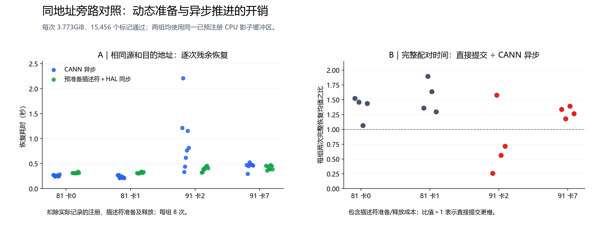

# 相同内存地址下的 DMA 描述符复用与提交路径对照

2026-11-11，接续 [DMA 内存准备的可逆与随机配对实验](CONTAINER-DMA-20261111.md)。

## 结论

**本地恢复慢尾已经收敛到主机侧 DMA 内存/描述符准备及驱动异步下发路径。**
CPU 源内存提前注册能显著改变慢尾；预注册之后仍存在的秒级波动，
在同一进程、同一源与目的地址上，可以通过“保留已准备 DMA 描述符＋直接同步 HAL 提交”这条旁路规避。
在慢例的实际采样点，驱动仍有已接收任务积压，硬件 SQ 却为空；
因此这类延迟不能当成 NPU 正在按固定低带宽搬数据，更不能归为模型或 RDMA 网络耗时。

这是具有多次可逆干预、随机顺序、跨卡和跨宿主机对照的**机制层归因**。
内部到底是哪一个映射、释放、锁或 worker 行为触发慢态，尚未唯一锁定。
IOMMU 的宿主机配置差异是有依据的候选放大因素，当前没有相应的单因素系统配置切换。

**旁路是诊断手段，完整时间并不普遍更快。** 将描述符准备/释放计入后，
91 的 8 个配对仅 3 个直接提交更快，配对比值中位数为 1.223；81 的 8 个配对全部更慢，中位数 1.448。
这说明正常异步路径本来可以更高效，工程目标应是保留其效率并解决异常准备/推进成本。



## 环境与方法

机器、内核、CANN、native 二进制与上一报告一致：81 物理0/1，91 物理2/7，均为 910B2。
各节点两卡顺序运行，两节点并行，默认调度优先级。
正式对照每次仍为 3.773GiB、15,456 个描述符；96 个 NPU 平面、每平面 512×256KiB。

所有两臂样本均使用同一块已预注册的 5GiB 驱动分配影子源内存；源数据固定、NPU 目的位置固定。
每次目的标记清零，再检查全部描述符对应位置。两臂区别：

| 条件 | 执行路径 | 描述符生命周期 |
| --- | --- | --- |
| A，policy29 | 原生 CANN `aclrtMemcpyBatchAsync`，最终 stream 同步 | 保留既有运行时处理 |
| B，policy32 | 先同步已有 stream，逐项 `halMemcpySumbit(...SYNC)`，直接完成 | `drvMemConvertAddr` 准备后跨恢复复用；切回 A 前逐项 Destroy |

每个直接批次在提交前等待原 CANN stream，且同步 HAL 拷贝返回后才返回 native。
固定探针内没有与其他请求重叠的计算。该方式验证固定源内容的恢复，不构成通用并发连接器的实现。

B 同时改变了描述符准备/保留方式和提交队列路径，不能仅凭 A/B 把剩余开销唯一归到其中一个函数。
前一报告的独立同步 HAL A/B/B/A 已单独证明描述符准备/释放有明显成本；本组补足原生进程和实际 IPC 目的地址的控制。

先在两个节点各完成 6 次单块 pilot（每次 24MiB、96 个位置）。随后四张卡各起一个进程，
每卡 4 个随机顺序配对、每臂连续两次；加预热、影子初始化和最终释放，每卡 19 次。
两组先后顺序各占一半，seed 和比较口径在运行前写入计划。
**共 76 次正式大小恢复、12 次 pilot，全部完成；本组全部 CPU `throttled_usec` 增量为零。**

## 正式结果

表中每格 8 次样本，属于 4 个配对中的实际观测范围。已单列影子及描述符生命周期调用，
残余仍包含 stream fence、同步提交、native 调度和完成通知，不等于纯硬件拷贝时间。

| 位置 | A 残余恢复（秒） | B 残余恢复（秒） | 两臂完整时间的说明 |
| --- | --- | --- | --- |
| 81 卡0 | 0.244～0.286 | 0.308～0.338 | B 的准备/释放摊销后仍较慢 |
| 81 卡1 | 0.209～0.275 | 0.309～0.339 | 同上 |
| 91 卡2 | 0.333～2.210 | 0.325～0.460 | A 有秒级慢尾；B 对异常样本更有利 |
| 91 卡7 | 0.295～0.527 | 0.364～0.472 | 该进程 A 大多正常；B 的一次性成本抵消优势 |

按预先口径，每臂两次完整完成时间求均值，再计算 B/A：

| 节点 | 配对数 | B 更快 | B/A 比值中位数 |
| --- | --- | --- | --- |
| 81 | 8 | 0/8 | 1.448 |
| 91 | 8 | 3/8 | 1.223 |

这组结果同时保留了稳定性线索与真实准备成本，不能只摘出 B 最快的约 0.33 秒来报告普遍加速。
配对共用进程和宿主机；重复测量不等于相互独立的生产请求，也不用于推算总体 p99。

## 秒级例外的进一步归因

91 卡2的同进程中，B 的前两次为 0.598、0.330 秒；切回 A 后为 1.385、2.210 秒。
其中第二次 A 没有执行描述符释放、内存注册或影子分配，仍出现以下现象：

- 31 个 CANN batch API 累计 1.959 秒；对应线程 CPU 时间 1.958 秒。
- 完整接收 15,456 项 payload 任务；全部目的标记通过。
- 三个未完成时的硬件 SQ 快照均为 head=tail。
- 中间采样点有 2,047 项驱动已接收、未下发，下一项已驻留约 **0.295 秒**。

硬件快照是离散观测，不能说整个恢复期间硬件持续空闲。
但“积压任务尚未进入硬件，提交线程又在持续占用 CPU”的组合，再次支持准备/下发路径的推进成本。
它与先前纯粹由 `stream synchronize` 推测慢点相比，定位更具体。

同进程末尾切回原始源后，恢复为 **24.642 秒**。其中清理共约 0.881 秒，
单列后仍剩 **23.761 秒**；不能把慢化归为影子释放本身。
另一张卡原始源的预热和末尾分别为 11.384、11.651 秒，而已准备旁路的残余恢复为 0.364～0.472 秒。
相同卡、相同数据量可以达到这些不同速度，固定的硬件搬运能力不足以解释差异。

## 当前证据支持的工程决策

1. 恢复模型应分开记录内存映射/描述符准备、排队下发和硬件完成，避免只对总恢复时间拟合固定带宽。
2. 优先研究可安全长期复用的 DMA 就绪源内存和描述符状态，并减少异常的动态准备/回收。
   正式实现还要验收源内容更新、版本、lease、并发顺序和 RDMA MR 兼容性。
3. 直接同步旁路用于定位成本；其正常条件下的完整效率不足以支持直接替换原异步实现。
4. 若继续定位内层触发点，应使用同进程的三臂对照：CANN 异步、HAL 同步每次准备/释放、HAL 同步复用描述符。
   再与函数级内核采集对齐，区分动态地址管理与 worker 推进；目前不将某个函数或 IOMMU 配置认定为唯一根因。

## 原件与复算

追加 [H 原件](raw/container-20261111-h.tar.gz)及 [manifest](raw/container-20261111-h-manifest.json)，
SHA256 `4817d1e1f8a685918e56dace5cf37a2724a20ff8335279527c0fd3e6bd39d9ce`。
包含 88 次恢复、1,175,808 个位置标记，实际执行源码、编译身份、事前计划、启动/退出及全部 API/通道日志。
源指针重定向和同步 HAL 均只存在于诊断观察器中；生产连接器和模型执行代码在本阶段没有修改。

```sh
python analysis/analyze_direct_dma_20261111.py /path/to/H --output direct-summary.json
python analysis/plot_direct_dma_20261111.py direct-summary.json --font /path/to/CJK-font.ttf --output direct.png
```

[分析汇总](analysis/direct-dma-20261111-summary.json)验证全部目的标记、两臂实际地址/分块签名、
异步的 HAL 接收项数和直接提交的成功拷贝项数，保存所有配对的完整及分项时间、资源增量与队列采样。
D～H 合计 **288 次正式大小恢复及 12 次 pilot**；独立 C 对照另计。
