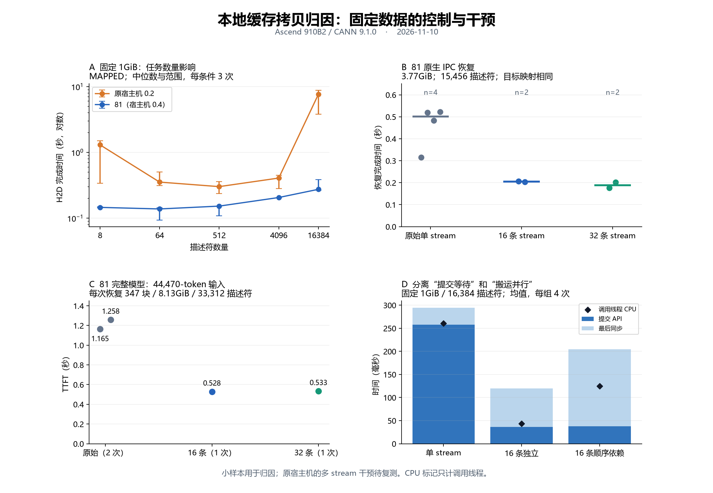

# 任务队列、IPC 与多 stream 干预

本页接续 [跨宿主机归因记录](README.md)。证据固定在 `raw/followup-1837.tar.gz`；
[逐次结果与队列采样摘要](analysis/followup-1837-summary.json)可供复算。

图 A/B/C 保留范围或逐次样本，图 D 按阶段取算术均值。
使用 `python analysis/render_interventions.py --font /path/to/chinese-font` 可从固定摘要重新绘图。

## 结论与可信度

**已确认：小块任务的提交、回收及 stream 组织会显著影响本地 KV 恢复性能。
严重慢尾的宿主机触发条件仍需在原机器上完成干预验证。**

| 问题 | 当前判断 | 依据与边界 |
| --- | --- | --- |
| 是否只是请求随机波动 | 存在系统性影响 | 固定 1GiB 改变描述符数量、相同缓冲区交叉改变 stream 组织，结果随条件变化 |
| 是否必须经过模型、连接器或 RDMA | 不需要 | 独立 CANN 程序复现原机器 17.619s 的慢调用 |
| 是否必须有 IPC 导入 | 不需要；IPC 本身没有在新对照中造成数量级恶化 | 两主机均比较了同一组张量的 owner-before / imported-child / owner-after |
| 是否存在任务资源等待 | 有直接证据 | 在原机器任务申请路径取得的 454 个有效队列快照中，435 个为满队列，容量 2048 |
| 满队列是否足以判定异常 | 不足以 | 81 的对应有效快照也有 10/14 为满队列；正常背压也会出现满队列 |
| 改 stream 组织是否有用 | 81 已通过原生恢复和完整模型对照 | 固定字节量、描述符与目的映射，16/32 stream 减少了耗时；有限交叉样本 |
| 能否宣布原机器几十秒慢尾已修复 | 尚不能 | 原机器在 18:15 被平台停止，干预尚未在该机器执行 |

这里将“定位到任务管理路径”“找到有效性能干预”和“解释原机器为何异常”分开记录。
前两项已有实测支持，第三项仍然开放。

## 1. IPC 与普通 NPU 缓冲区

独立 Python + CANN 控制不启动 PegaFlow server。owner 建立 96 个 NPU 张量平面，先直接拷贝；
随后另一个进程通过实际 NpuIPCWrapper 导入这些张量、执行相同拷贝；子进程退出后 owner 再测。
各阶段各做 3 次 H2D 和 3 次 D2H，共 36 次计时，均成功。数据量、目标块映射与检查方式固定。

- 原机器各阶段主要在约 1.1–2.1s；导入子进程没有出现额外的数量级慢化。
- 81 各阶段约 0.38–0.85s；导入子进程的稳态调用约 0.48–0.50s。
- 独立 C 程序使用自分配 NPU 缓冲区，也能观察主机差异。

这些结果排除了“必须由 IPC 或 PegaFlow 触发”这一必要条件，不代表所有 IPC 几何和生命周期都已验收。

## 2. 满队列采样的含义

对前一快照的 CPU 采样重新统计，仅纳入通过指令布局检查且成功读取 head/tail/capacity 的记录。
判满条件为 `(tail + 1) % capacity == head`。原机器为 435/454，81 为 10/14。
这是**采样落入指定任务申请路径后的条件计数**，不是所有 CPU 时间的占比，也不是独立请求的比例。

原机器的栈、反汇编和有效队列状态共同支持：提交线程反复申请任务资源，队列满时唤醒回收并重试。
公开 runtime 源码也包含任务资源队列的判满、申请失败与回收推进逻辑，参见固定版本的
[task_res.cc](https://github.com/hicann/runtime/blob/ca8a8637a2f539a5dd95e926202a1b4b8e20685b/src/runtime/core/src/task/task_res_manage/task_res.cc)。
它用于辅助理解机制；本轮运行二进制的身份及反汇编仍是运行路径证据，不能把公开源码当作完全一致的带符号构建。

## 3. 同样的 1GiB，同样的 16,384 个描述符，改变 stream 组织

81 上先创建相同的 16 条 stream，再交叉改变实际使用数量。CANN 单次 batch 仍为 512 描述符。
以下是 H2D 的 4 次样本中位数，调用线程 CPU 计时不包括其他 runtime 线程。

| 使用 stream 数 | 提交 API | 最后同步 | 整次搬运 | 调用线程 CPU |
| --- | ---: | ---: | ---: | ---: |
| 1 | 326ms | 46ms | 372ms | 330ms |
| 2 | 159ms | 43ms | 203ms | 163ms |
| 4 | 106ms | 39ms | 147ms | 110ms |
| 8 | 34ms | 93ms | 129ms | 43ms |
| 16 | 37ms | 95ms | 130ms | 45ms |

各列独立取中位数，因此不要求两段中位数精确相加等于总时间中位数。
数据相同，任务数相同；增加 stream 能降低提交方等待，也允许底层搬运有更多并行机会。

进一步加入事件依赖，让下一批必须等待上一批完成。这样 16 条 stream 的数据搬运仍按批顺序执行。
四次交叉样本的总时间中位数为：单 stream 281ms、16 条独立 stream 119ms、16 条有顺序依赖的
stream 204ms；对应提交 API 为约 245ms、35ms、37ms。

**收益不能全部归结为更大的任务资源容量，也不能全部归结为 DMA 并行。**
顺序依赖仍降低了提交等待，但引入额外事件任务与同步成本；独立 stream 的总耗时进一步降低。
事件依赖组多出 32 个 record 和 31 个 wait 操作，不能当作完全相同的设备任务集合。

## 4. CPU 重排打包的对照

另一个控制保持相同源数据和目的映射，将 16,384 次 64KiB 小块搬运改为：CPU 先按目的排列打包，
再做 64 次 16MiB 搬运。每次检查带块编号的数据标记。

81 原始方式约 0.20–0.38s，打包方式约 0.46–0.54s；其中 CPU 打包本身约 0.42s。
减少 DMA 任务数并不自动意味着端到端更快，额外重排成本需要计入。这个版本不适合作为 81 的直接优化。

## 5. 原生 PegaFlow 恢复

使用 161 个块、3.773GiB、15,456 个描述符；相同 IPC 张量与 CPU 源缓存、相同倒序目的块。
所有批次最多 512 描述符。先做一次原始预热，然后交叉运行：

| 顺序 | stream 组织 | 完成时间 |
| --- | --- | ---: |
| 1 | 原始单 stream | 0.316s |
| 2 | 16 条 | 0.206s |
| 3 | 原始单 stream | 0.519s |
| 4 | 32 条 | 0.176s |
| 5 | 原始单 stream | 0.483s |
| 6 | 16 条 | 0.203s |
| 7 | 原始单 stream | 0.523s |
| 8 | 32 条 | 0.201s |

8 次计量与 1 次预热的目标标记检查全部通过。本组使用轻量观察器。

## 6. 完整模型恢复

81 的逻辑设备 0，模型、graph、CPU/NPU KV 池及固定输入保持前述配置。
四个输入先各冷生产一次，再清空 NPU 前缀缓存，交叉运行原始 / 16 条 / 原始 / 32 条。
实验只在私有 native 子进程中加载诊断拦截库，连接器和模型计算代码保持原配置。

| 输入 | 原始，第 1 次 TTFT | 16 条 TTFT | 原始，第 2 次 TTFT | 32 条 TTFT |
| --- | ---: | ---: | ---: | ---: |
| 8,244 tokens | 0.292s | 0.213s | 0.381s | 0.216s |
| 44,470 tokens | 1.165s | 0.528s | 1.258s | 0.533s |

44K 输入每次均恢复 347 块、8,732,540,928 bytes、33,312 描述符。底层恢复完成时间依次为
994.64ms、365.98ms、1097.88ms、372.40ms。Native 日志字段 `bandwidth_gbps` 在这一实现中
按 bytes/秒/1e9 计算；这里按实际字节量和时间解释单位。

12 次请求（4 次冷生产 + 8 次恢复）全部成功，8 次恢复的首 token 与各自冷生产一致。
这是一 token 的功能检查，尚未覆盖完整输出、并发请求及各种层间别名布局。每个多 stream 配置每个
输入只测一次，本轮用于验证干预方向，不估计 p99，也不作为稳定收益比例。

前一模型进程另外完成 9 次大输入重复恢复；61,278-token 的三次请求约 1.89–1.95s。

## 7. 权限、内存与宿主机状态

81 追加了大缓冲的 normal / drop-CAP_IPC_LOCK / normal / drop-CAP_IPC_LOCK 对照。
四次进程都成功申请约 3.77GiB MallocHost，并各完成 6 次搬运；中位数约 0.22–0.25s。
原机器先前的同尺寸申请失败有 driver out-of-memory 日志，而当时宿主机可用内存充足。
这支持继续核查驱动分配条件和物理内存状态，尚未证明它与几十秒慢尾是同一个原因。

两台宿主机已加载的相关内核模块 srcversion 相同，选定环境变量一致。
这些身份核对不能排除运行中的资源状态或硬件路径差异。

平台记录原 `hust-zsx` 容器于 18:15:07 由 `admin` 发起停止，记录的最近使用时间为 18:11:03。
本轮没有拿到更详细的停止原因。36 次 IPC 对照及此前日志已保存；原机器上的打包、多 stream
和顺序依赖干预尚未执行。81 上的本轮模型和 native 服务已正常结束、保存日志。

## 下一步

优先恢复原来能出现严重慢尾的宿主机条件，按以下顺序执行，避免继续堆积健康机器上的阴性对照：

1. 同一进程交叉比较单 stream、16 条独立 stream、16 条有顺序依赖的 stream。
2. 原生 3.77GiB 恢复比较原始、16/32 条、再回到原始；保留目标标记检查。
3. 对慢基线同时采样提交线程和 RT_RECYCLE，核对设备 DMA 时间与主机任务回收进度。
4. 若干预能消除严重慢尾，再用该机器完整模型验证保存和恢复两个方向。

私有 `memory-policy-stripe.so` 是限定在单设备工作线程上的归因原型：首次提交前等待原 stream，
结束时等待所有辅助 stream 后才返回完成。1837 快照中的库仅重定向 H2D；D2H 扩展的独立验收见
[保存方向对照](SAVE-CROSSOVER.md)。工程化还需要处理跨设备、
并发/重叠写入、错误恢复和 stream 生命周期；本次上传的对象是诊断工具与实测证据。
