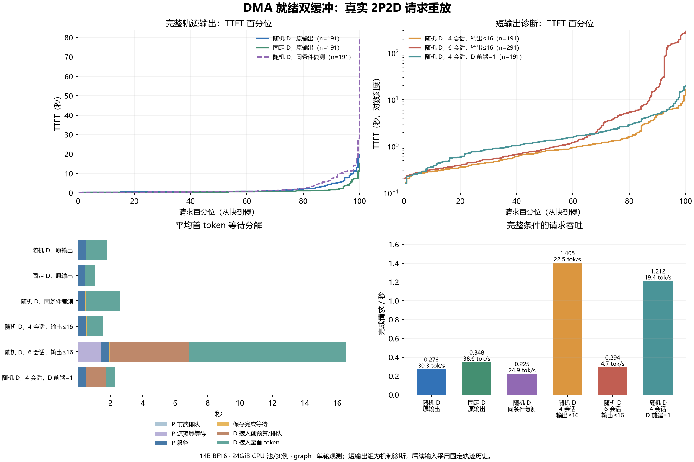

# PegaFlow 缓存恢复优化与实验交接

更新日期：2026-11-11。本文供接手同学直接分析代码、实验和结果；无需先读聊天记录。

## 先看这几件事

我们在调查：为什么同样的 KV 缓存从 CPU 搬进 NPU，有时不到一秒，有时几十秒，甚至导致模型请求超时。 单机、独立拷贝实验已经复现这种慢化，说明它可以发生在模型计算和网络传输之外。

我们使用驱动已有的 DMA 注册能力，新增了一个“提前注册的双中转区”原型。同地址开关对照证明， 提前注册确实能明显改变部分慢例；真实 2P2D 的原四会话负载也已完整跑通。 增加到六会话后，仍出现
128 秒原生恢复，以及缓存申请失败、回退重算和预算排队。当前优化有实际效果，剩余慢尾仍需分析。

现有成果已合并到本仓库：

- [PR #646](https://github.com/vLLM-HUST/vllm-hust-benchmark/pull/646)：归因过程、固定缓冲区对照、实际源码和原件。
- [PR #647](https://github.com/vLLM-HUST/vllm-hust-benchmark/pull/647)：DMA
  中转原型、可变源数据检查、六组真实模型重放和异常分析。
- 81、91 两个工作区已于 11 月 11 日 15:09 停止，数据已下载并成功解包。

## 1. 原系统是什么，我们改了什么

### 原来的代码已经做了内存注册

推理栈是 PegaFlow 连接器与原生服务，加 vLLM/vLLM-Ascend。恢复使用的 CPU 缓存池由 PegaFlow 自己管理， vLLM
的内存分配设置不会自动替外部原生服务更换缓存池实现。

PegaFlow 原来的 Ascend 路径会申请普通系统内存，再调用 `aclrtHostRegister(...ACL_HOST_REGISTER_MAPPED...)`。
这段代码已经存在，并非普通 CPU 内存未经任何注册就直接使用。 源码依据见
[内存分配](https://github.com/vLLM-HUST/pegaflow-hust/blob/1fbf0f2fe73b766db7d2c58a5819798ef17a1ea1/pegaflow-core/src/pinned_mem.rs#L264)
和
[注册函数](https://github.com/vLLM-HUST/pegaflow-hust/blob/1fbf0f2fe73b766db7d2c58a5819798ef17a1ea1/pegaflow-core/src/device/ascend.rs#L467)。

原代码注释记录了一个兼容问题：目标 Ascend/RoCE 平台上，`aclrtMallocHost` 分配的内存在 RDMA 注册时会报 EFAULT，
因此采用普通系统内存再映射的方式，让同一个池同时用于网络传输和 NPU 拷贝。

我们后来额外测试的是 `halHostRegister(...HOST_MEM_MAP_DMA...)` 所准备的状态。
源码中的普通映射注册与本轮额外准备应分别记录；运行库内部也可能处理地址准备，不能把原路径概括为“完全没有 DMA 准备”。 驱动对普通系统内存直接注册 DMA 有内核限制，Linux 5.19
以下不支持这类注册；本机内核为 5.15。 依据见
[驱动接口说明](https://github.com/hicann/driver/blob/471fa6b09b556cabdb7ed917a8dd2ec25ed0bc6b/pkg_inc/ascend_hal_base.h#L2444-L2469)。

### 新增的实验恢复路径

```text
原路径：D 的 CPU 缓存池 → CANN 拷贝 → NPU
新路径：D 的 CPU 缓存池 → CPU 复制到预注册中转区 → CANN 拷贝 → NPU
```

实现见 [restore_dma_staging_20261111.c](tools/restore_dma_staging_20261111.c)。它通过 `LD_PRELOAD` 挂入每个 D
的原生服务，拦截 H2D 批量拷贝调用：

1. 首次使用时，为当前 NPU 申请两块 128MiB、由驱动管理的主机内存，并做 `HOST_MEM_MAP_DMA` 注册。 正式测试前的路径检查已完成这项初始化。
1. 每个批次把当前源数据复制进去，再提交原来的 CANN 批量拷贝。
1. 两块中转区轮换。覆盖一个槽之前，先等待上一轮使用它的拷贝完成。

因此，数据每次更新，内存地址和注册状态反复复用。原有 24GiB RDMA 缓存池保留。 每个 D 额外占用约 256MiB，中转额外增加一次 CPU 复制；两个 D 合计约 512MiB。

实现边界：每原生进程一个 NPU，每批最多 128MiB；中转内存按进程生命周期保留，当前代码用互斥锁保护槽位操作。 原型只改变 CPU→NPU 恢复，NPU→CPU
保存继续使用原路径。生产级的关闭、部分初始化失败清理、错误恢复及并发设计还需完成。 原型和证据在 benchmark 仓库；这套双中转实现尚未合入 PegaFlow 正式缓存池。

### 同时发生的配套变化

| 变化                                       | 用途与分析影响                                                                      |
| ------------------------------------------ | ----------------------------------------------------------------------------------- |
| P 节点改用本地权重、源码和运行目录         | 共享文件系统曾出现 NFS 等待；历史与新测试的存储运行条件有变化                       |
| 实验副本增加显式 `pegaflow.model_identity` | 模型物理路径改变后，保持 P/D 缓存身份一致；要求固定 revision                        |
| P 侧启动 worker                            | 权重加载和 graph 初始化附近同步设备并清理闲置主机锁页缓存；继承原推理计算和采样实现 |
| 分阶段遥测                                 | 记录客户端、调度器、连接器、原生拷贝、中转调用、CPU/NPU、内存和 RDMA 状态           |
| 后四组先排空再重置缓存                     | 待保存、待预取计数归零后清空 GPU APC 和 CPU 缓存                                    |

这些变化均须进入前后比较的解释。实际运行副本和控制器保存在 P 节点原件中。

## 2. 怎么一步步找到 DMA 准备这个因素

| 阶段               | 做了什么                                                | 得到了什么                                                 | 详细入口                                                                                                |
| ------------------ | ------------------------------------------------------- | ---------------------------------------------------------- | ------------------------------------------------------------------------------------------------------- |
| 单机与跨宿主机复现 | 固定缓存，绕开模型与网络，交换卡、地址布局、内存来源    | 本地拷贝自身会慢；同一宿主机内也会变化                     | [初始记录](README.md)、[续测](HOST-RETURN.md)                                                           |
| 调度和队列对照     | 检查 CPU 配额、线程等待、NUMA、IPC、多 stream、在途数量 | 这些因素未稳定消除慢尾；若干严重慢例没有新增 CPU 配额节流  | [异步路径](ASYNC-PATH.md)、[队列](QUEUES.md)、[内核观测](KERNEL-VIEW.md)                                |
| 准备与搬运拆开     | 单独准备 DMA 地址，不搬数据；再比较每次准备和重复利用   | 仅准备就有成本；重复利用能缩小两机器差异                   | [续查](RESUME-20261111.md)、[DMA 对照](CONTAINER-DMA-20261111.md)                                       |
| 同地址开关         | 同一进程、相同源/目标地址与数据，仅切换预注册           | 慢节点两卡均出现可逆的明显改善；随机顺序复测仍有支持及例外 | [DMA 对照](CONTAINER-DMA-20261111.md)                                                                   |
| 提交路径旁路       | 复用描述符，直接同步 HAL 提交，与 CANN 异步交叉比较     | 可减少部分波动，但计入准备/释放后不普遍更快                | [直接 HAL 对照](DIRECT-DMA-20261111.md)                                                                 |
| 可变源检查         | 每次换源数据，再恢复同一组目标位置                      | 两节点各七次版本标记检查全部通过                           | [模型重放报告](MODEL-RERUN-20261111.md#%E6%BA%90%E5%86%85%E5%AE%B9%E6%9B%B4%E6%96%B0%E9%AA%8C%E6%94%B6) |
| 真实负载           | 在 2P2D 中使用双中转原型，重放完整会话                  | 原负载跑通；更重工作集暴露剩余拷贝、分配和排队问题         | [模型重放报告](MODEL-RERUN-20261111.md)                                                                 |

各报告有承接和重复引用，不将其中所有次数直接相加作为独立样本数。 早期单机完整交接保存在
`raw/single-host-initial-report.md.source`，包含最初环境、问题与实验过程。

## 3. 哪些独立对照证明优化有效

原生探针每次恢复 161 块，即 3.773GiB、15,456 个拷贝描述符。下列开关对照保持同一进程、地址与数据：

| 位置        | 预注册 |    关闭 | 再次预注册 |
| ----------- | -----: | ------: | ---------: |
| 91 物理卡 7 | 0.786s |  9.372s |     0.798s |
| 91 物理卡 2 | 1.093s | 10.879s |     0.875s |
| 81 物理卡 0 | 0.343s |  0.362s |     0.329s |
| 81 物理卡 1 | 0.292s |  0.298s |     0.294s |

表内保留对应窗口的注册/注销成本。91 的注销只耗约 0.06 秒，解释不了约十秒的恢复。 随机顺序追加复测中，91 八个配对有七个预注册更快，比值中位数为 0.691；仍有预注册后
3.057s、2.354s 的例外。 81 原本较快，影响较小。可确认预注册状态是可控的影响因素，内部触发慢态的具体函数仍未唯一锁定。

DMA 注册实验中的固定源影子缓冲与后来的可变源双中转原型，是两套不同实现。 真实原型另做了两节点各七次、每次 384MiB 的源内容更新检查，共检查 21,504 个目标版本标记，全部通过。
检查的是每个描述符目标位置的首字标记，不是逐字节核验全部数据，也不是模型答案质量验收。

直接同步 HAL 旁路也单独保留：正式大小 76 次、pilot 12 次。计入全部成本后，91 八个配对仅三个更快，81 八个配对全部更慢。
它用于帮助定位准备/下发成本，不能直接用最快残余耗时代替完整请求收益。

## 4. 真实模型实验的配置和结果

### 配置

| 项目     | 实际设置                                                                                                               |
| -------- | ---------------------------------------------------------------------------------------------------------------------- |
| 部署     | 81 两个 P，91 两个 D；各两张 Ascend 910B2，每卡一个 TP=1 实例                                                          |
| 资源     | 每节点 8 核 CPU、64GiB 主存；默认调度优先级                                                                            |
| 模型     | `/data/shared_upload/Qwen2.5-14B-Instruct-1M-plainrope` 本地变体，BF16                                                 |
| 软件     | vLLM `0.23.0+empty`、vLLM-Ascend `0.23.0`、torch `2.10.0+cpu`、torch-npu `2.10.0.post4`、CANN 9.1.0                    |
| 推理     | graph `FULL_DECODE_ONLY`、上下文上限 98,304、`max_num_seqs=16`、批 token 预算 8,192、memory utilization 0.90、APC 开启 |
| 缓存     | 128 tokens/块、24MiB/块、196,608 bytes/token；每个原生实例 CPU 池 24GiB                                                |
| 前端预算 | 每 P 在途上限 4、每 D 默认 16；每 P 源预算与每 D 待恢复预算均为 24GiB                                                  |
| 路径     | P 保存完成可见后提交 D；P `save_only`，D `read_write`，D 等待完整前缀查询                                              |
| 网络     | 原速跨节点 RDMA，请求自身产生缓存流量；`mlx5_2`、GID 5                                                                 |
| 到达     | Poisson 名义 3 req/s、seed 17；同会话必须等待上一请求完成                                                              |

软件身份以版本与执行源码快照为准；`0.23.0+empty` 这个版本字符串本身不能证明某个 vllm-hust Git 提交。 每次资源重分配后的物理卡号、NUMA
和网络地址需要重新读取，表中的角色布局不代表永久硬件绑定。

数据来自 `TIGER-Lab/SWE-Next-SFT-Trajectories`，固定 revision `e378a60ddd7050fe9519a31a4d41d4872eeec6ac`。
四个完整会话为 `swenext-1566/1662/2695/3517`，共 191 请求；六会话增加 `swenext-1374/1868`，共 291 请求。
保留每个会话从短到长的全部步骤。输入始终采用固定参考轨迹历史，后续输入不使用本轮生成的答案续写。 原输出组按参考答案 token 数生成；短输出组取 `min(参考长度,16)`。

### 六组完整结果

TTFT 指请求满足会话依赖后，到首 token 返回；不含等待同会话上一轮结束的时间。 名义 3 req/s 不是实际持续吞吐，闭环会话依赖会压低实际提交速率。

| 条件                                 | 成功/计划 |  总时长 | 平均 TTFT |      p95 |      p99 |
| ------------------------------------ | --------: | ------: | --------: | -------: | -------: |
| 随机 D，原输出                       |   191/191 | 699.11s |    1.794s |   7.714s |  18.331s |
| 固定 D，原输出                       |   191/191 | 548.11s |    1.033s |   3.825s |  11.345s |
| 随机 D，原输出复测                   |   191/191 | 849.31s |    2.586s |  11.237s |  28.139s |
| 随机 D，四会话，短输出               |   191/191 | 135.98s |    1.555s |   6.382s |  12.277s |
| 随机 D，六会话，短输出               |   291/291 | 991.14s |   16.544s | 156.102s | 264.751s |
| 随机 D，四会话，短输出，D 前端在途 1 |   191/191 | 157.65s |    2.282s |   7.292s |  18.833s |

共 1,246 条正式请求，全部返回成功；四条启动路径检查另计。按上表顺序执行，每个条件只有一轮，随机原输出有一次同条件重复。 固定 D
是路由对照，改变缓存复用、负载和后续推进顺序；本轮没有对其做独立随机重复的策略验收。 完整输出三组各生成 21,167 tokens；短输出组应独立分析。



限制 D 前端在途数后，进入 D 后的平均等待从 0.984s 降到 0.537s，但入口等待从 0.023s 增至 1.234s，整体反而更慢。
这项干预提示同卡任务重叠值得分析，但不支持直接把模型服务改成串行。

### 与历史中断轮比较

历史同负载计划 191 条：148 成功、1 失败、42 取消。下表只比较前后共同成功、请求及 P/D 身份匹配的 148 条：

| 指标      |     历史 | 本轮随机首次 | 本轮随机复测 |
| --------- | -------: | -----------: | -----------: |
| 平均 TTFT |   4.385s |       1.643s |       2.307s |
| p50       |   0.641s |       0.698s |       0.624s |
| p95       |  15.932s |       6.300s |      11.237s |
| p99       | 105.140s |      13.131s |      14.341s |

这批共同成功请求的平均等待减少约 47%～63%，p99 减少约 86%～88%；普通请求的中位数变化小。 它是跨日期、条件成功样本的观测比较，包含中转、存储运行条件和状态变化。
预注册本身的因果证据来自前面的同地址开关对照；这张模型表不能单独量出它的纯收益。 完整 191 条的新 p99 为 18.331/28.139 秒，与表中 148 条的 p99 是不同样本范围。

## 5. 接手分析时最重要的四条异常

完整请求 ID 均可在 [逐请求表](analysis/cache-and-transfer.csv)和 [异常关联](analysis/model-replay-anomalies.json)定位。

### 原输出复测 0185：大部分时间还没开始恢复

输入 48,966 tokens，TTFT 79.629s。D 接入后等 73.160s 才开始恢复；恢复 181 块、4.242GiB，原生任务 5.242s。
期间其他长请求仍在生成。引擎启用了完整输入长度的 KV 接纳预留；现有调度轨迹没有逐次分配失败原因， 因此“GPU KV 接纳限制”是与时间线相符的候选解释，尚未唯一确认。不能把 79
秒全部算成本地拷贝。

### 六会话 0214：已注册后仍有 128 秒原生恢复

输入 56,980 tokens，TTFT 156.809s，D 实际只计算 20 个输入 token。 原生恢复 445 块、10.430GiB，耗时 128.083s；连接器观测到完成为
133.096s。 匹配的 84 个 H2D 批次与原生任务字节数完全一致：CPU staging 区段 3.521s，槽位等待/事件管理 123.806s，batch 提交 0.158s。
原生最后一次 stream 同步另计 0.584s。

同窗口 CPU 配额节流计数只增加约 0.079s，内存 PSI 停顿累计未增加，无法解释约两分钟等待。 D0 另一 stream 有一次 86.048s 同步；模型调度出现约
90.046s、39.779s 的连续空档。 这些现象相互重叠，尚不能据此确定谁阻塞了谁。 该请求相关的 RDMA 获取累计约 2.596s，与 128 秒本地恢复不是同一项耗时。

连接器默认恢复超时仍是 120 秒，但检测由轮询推进：先看是否完成，未完成才检查超时。 轮询被推迟后，可能把已超过 120 秒、但此时已经完成的任务记为成功。因此 1,246 条成功不代表每次恢复都在
120 秒内。

### 六会话 0226：缓存申请失败，D 重算完整输入

远端获取 458 块时 slab 申请失败，D 最后计算了全部 58,677 个输入 token，TTFT 143.042s。 六会话共记录六条
`Pinned memory pool exhausted`，其他五个正式条件没有相应原生告警。 该例日志显示申请 10.7GiB、已用 7.0GiB、总额 24.0GiB；还需核对在途
lease、slab 占用和 NUMA 分配约束， 不能只用“总额减已用”解释可分配空间。

### 六会话 0238：上游排队和本地慢拷贝叠加

TTFT 287.653s，其中进入 D 前已经等待约 190 秒。原生恢复另花 49.305s，其中事件区段 44.686s。 整组六会话的平均 P 源预算等待 1.401s、D 接入前预算/排队
4.839s、进入 D 到首 token 9.713s。 这说明慢恢复会占住资源，造成其他请求和上游一起排队。

## 6. 计时应该怎样读

- 客户端 TTFT 包含 P 服务、保存可见性、预算、D 接纳、恢复与剩余计算。
- 连接器 `load_completed.duration_ms` 包含原生排队、恢复和完成轮询，不等于硬件纯搬运。
- 原生 `Load task completed` 是单个拷贝任务的实际服务窗口；同节点并行活动仍可能影响它。
- 原生 `api_us` 在本轮包含挂入的中转实现，不能把它全部解释为 CANN 内部单一函数耗时。
- `slot_wait_and_event_ns` 合并了等待、销毁和创建事件；下一轮应分别计时。
- `cpu_copy_ns` 区段还含重定向指针数组的申请，主要工作是 CPU staging 复制。
- 原生 RDMA 获取与 H2D 恢复量不同：有本地命中、重复获取及后续未恢复的缓存。
- NPU 原件记录过 AI Core 100% 的活动样本，但单个样本不代表整轮平均利用率，采样覆盖也不是所有条件等长。

## 7. 全部成果从哪里读

| 需要什么                                                         | 仓库入口                                                                                                                                    |
| ---------------------------------------------------------------- | ------------------------------------------------------------------------------------------------------------------------------------------- |
| 从早期复现开始看完整过程                                         | 本目录各阶段 Markdown；建议依次读 README、CONTAINER-DMA、DIRECT-DMA、MODEL-RERUN                                                            |
| DMA 双中转代码                                                   | `tools/restore_dma_staging_20261111.c`；实际执行 C/共享库也在 D 原件中                                                                      |
| 启动期主机缓存处理                                               | `tools/dma_startup_worker_20261111.py`；执行版本在 P 原件中                                                                                 |
| 固定缓冲区与独立接口实验                                         | `raw/checkpoint-*`、`host-return-*`、`async-path-*`、`queue-driver-*`、`kernel-view-*`、`resume-*`、`container-*`                           |
| 源内容更新检查                                                   | `raw/acceptance-20261111.tar.gz`                                                                                                            |
| 历史中断轮                                                       | `raw/long-pd-20261109-final-appendix.tar.gz`                                                                                                |
| 启动失败和初期路径诊断                                           | `raw/startup-P-20261111.tar.gz`                                                                                                             |
| 本轮 P 侧请求、输入、计划、控制器、三版运行器、Python 源码和遥测 | `raw/replay-P-20261111.tar.gz`                                                                                                              |
| 本轮 D 侧原生/模型日志、中转调用、调度源码快照、环境和遥测       | `raw/replay-D-20261111.tar.gz`                                                                                                              |
| 冻结包大小与校验和                                               | 各原件旁的 `*-manifest.json`；早期集合另有顶层 manifest                                                                                     |
| 请求分段、缓存与网络、原生任务、异常关联                         | `analysis/model-replay-summary.json`、`transfer-summary.json`、`cache-and-transfer.csv`、`native-loads.json`、`model-replay-anomalies.json` |
| 可运行的复算代码                                                 | `analysis/analyze_dma_*_20261111.py`、`unpack_dma_replay_20261111.py`、`plot_dma_replay_20261111.py`                                        |
| 服务器停止确认                                                   | `analysis/workspace-stop-verification.json`                                                                                                 |

启动诊断也保留了失败：P 的 NFS 等待、模型目录改变造成缓存身份不同、graph 初始化时主机锁页申请失败， 以及 P 服务重启后首次 RDMA 读取使用旧握手、回退重算的记录。四条启动 HTTP
检查完成不代表四条首次 DMA 读取都成功； 这些记录独立于六组正式统计，详见
[完整重放报告](MODEL-RERUN-20261111.md#%E5%90%AF%E5%8A%A8%E4%B8%8E%E8%B7%AF%E5%BE%84%E6%A3%80%E6%9F%A5%E4%B8%AD%E5%8F%91%E7%8E%B0%E7%9A%84%E9%97%AE%E9%A2%98)。

### 在普通电脑上复算

模型权重不在归档里；输入轨迹、模型元数据和实际执行代码在包内。仅分析已有数据无需申请 NPU。 使用 Python 3.12，将下列三个归档复制进一个新目录 `$VIEW`：

```text
replay-P-20261111.tar.gz
replay-D-20261111.tar.gz
acceptance-20261111.tar.gz
```

在本报告目录执行：

```bash
python analysis/unpack_dma_replay_20261111.py "$VIEW"
python analysis/analyze_dma_cache_20261111.py "$VIEW"
python analysis/analyze_dma_replay_20261111.py "$VIEW"
python analysis/analyze_dma_anomalies_20261111.py "$VIEW"
python analysis/plot_dma_replay_20261111.py "$VIEW" --font /path/to/chinese-font.ttf
```

绘图依赖 Matplotlib，其他上述分析使用标准库。输出位于 `$VIEW/analysis/`。 如需复算历史共同成功样本，在解开历史包后给
`analyze_dma_replay_20261111.py` 增加
`--baseline /path/to/runs/random-numa-4sessions-rps3-s17/requests.jsonl`。
输入、控制器、实际服务命令和编译/运行记录可沿原件继续检查；各包保留实际路径，换机器重跑时需要调整部署路径和设备身份。

## 8. 接下来最值得分析的工作

1. 用现有日志关联 0214 的事件等待、另一 stream 同步、模型调度空档和 D2H 保存，先画同一时间轴； 下一次实测分别计时事件的等待、销毁、创建，判断 124 秒具体发生在哪一步。
1. 核对六次缓存分配失败前的实际 pool/slab/lease 占用及 NUMA 选择，解释为什么表面可用空间仍不能满足申请。
1. 在模型接纳处记录实际空闲与预留 KV 块、被推迟的理由，解决 0185 那种“查询已准备但迟迟不开始恢复”的可观测性缺口。
1. 将复制在途数的干预与模型前端并发分开，交错重复相同负载，同时统计入口等待和内部服务时间。
1. 验证完成轮询延迟与超时检测，统一“请求成功”和“恢复按时完成”的验收口径。
1. 若工程化双中转方案，在 PegaFlow 仓库处理内存生命周期、错误清理、RDMA 兼容和保存/恢复版本正确性。

原研究还包括 P/D 共享 CPU 缓存时的网络争用，以及用于配置探索的模拟器。 现有观测显示，本地恢复、缓存接纳和分配失败足以主导本轮尾延迟；网络研究与模拟器应把这些成本分别建模。
前期模拟器成果可从 [四卡标定](../pegaflow-four-card-calibration-20261029/README.md) 和
[原生调度适配](../pegaflow-native-scheduler-20261109/README.md)继续阅读。
