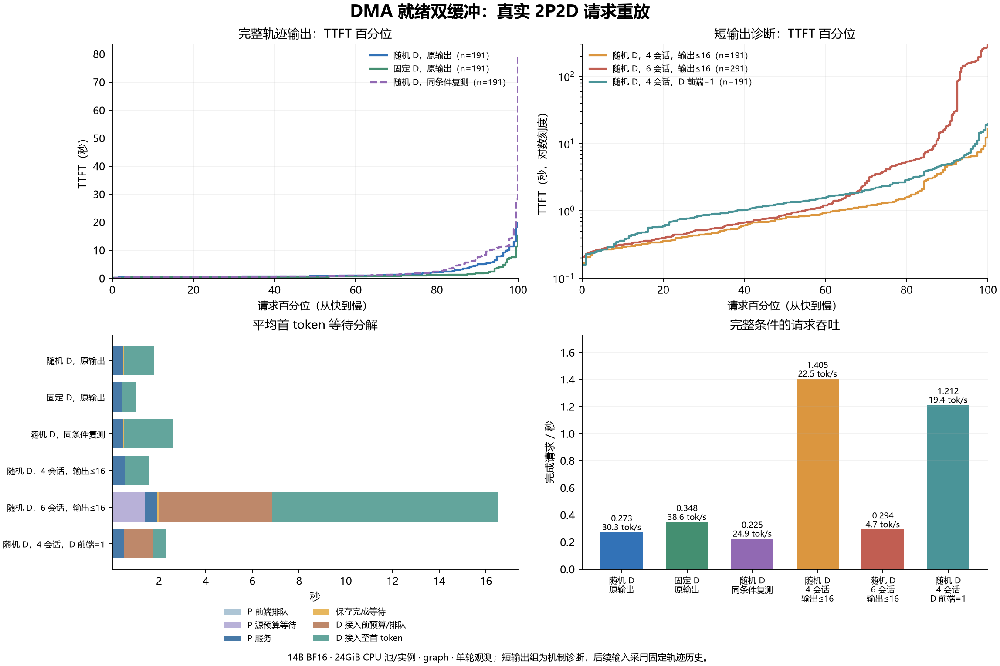

# DMA 就绪缓冲区原型与真实 P/D 重放

2026-11-11，接续 [DMA 准备归因](CONTAINER-DMA-20261111.md)及 [同地址提交路径对照](DIRECT-DMA-20261111.md)。

**六组真实 2P2D 重放共 1,246 条正式请求，全部成功。原先中断的四会话负载已经跑通，但更重负载下仍有严重慢尾。** 随机 D 的首次四会话组记录到 177 次原生拷贝完成，最长 7.903
秒；增加到六会话后，一次原生恢复达到 128.083 秒。 因此，DMA 就绪缓冲区缓解了已测四会话负载的问题，还需要继续处理任务重叠、缓存接纳和完成等待。

## 本轮要验证什么

此前的 14B 两节点实验曾因 D 端恢复超过 120 秒而中止。本轮将 DMA 就绪缓冲区用于 真实、持续更新的缓存，重放原来的四个完整会话，检查超时是否仍会出现，并记录完整请求性能。

## 原型怎样工作

[实际执行的 C 源码](tools/restore_dma_staging_20261111.c)通过 `LD_PRELOAD` 挂入每个 D 原生服务。 原生服务保存原有 24GiB RDMA
缓存池，另外准备两个 128MiB 的主机缓冲槽：

1. 首次 H2D 调用时，使用 `aclrtMallocHost` 分配缓冲槽，执行 `halHostRegister(...HOST_MEM_MAP_DMA)`。
   初始化事件单独记录；主实验在路径检查后使用已经初始化的缓冲槽。
1. 每次恢复都从当前缓存内容复制到缓冲槽，再由原来的 CANN batch API 搬入 NPU。
1. 再次使用某个槽前，等待其上一次异步拷贝的完成事件，保证内容不会被提前覆盖。

提前保留的是 DMA 可用的缓冲区和注册状态；每条请求的数据仍须重新复制、提交。 因此本方案还引入了 CPU 复制、双缓冲在途上限和事件等待，完整重放不能视为单个注册开关的纯因果对照。
遥测分别记录这些成本。原生单批最多 128MiB，每个服务仅使用一个 NPU；D2H 保存保持原路径。

采用独立缓冲槽，是为了同时保留原有 CPU 池的 RDMA 注册兼容性。这是实验原型；生产连接器的 实现、配置接口及生命周期验收应在 PegaFlow 仓库中独立完成。

## 配置和请求

| 项目       | 本轮设置                                                                                                                   |
| ---------- | -------------------------------------------------------------------------------------------------------------------------- |
| 节点       | 81 两个 P；91 两个 D，各两张 Ascend 910B2，每卡一个 TP=1 实例                                                              |
| 资源       | 每节点 8 核 CPU、64GiB 主存                                                                                                |
| 模型       | 共享目录的 `Qwen2.5-14B-Instruct-1M-plainrope` 本地变体，BF16                                                              |
| 运行环境   | vLLM `0.23.0+empty`、vLLM-Ascend `0.23.0`、torch `2.10.0+cpu`、torch-npu `2.10.0.post4`、CANN 9.1.0                        |
| 推理       | `FULL_DECODE_ONLY` graph，最大上下文 98,304，`max_num_seqs=16`，批 token 预算 8,192，NPU memory utilization 0.90，APC 开启 |
| KV         | 128 tokens/块，196,608 bytes/token，每块 24MiB；每个原生实例 CPU 池 24GiB                                                  |
| 路径       | P `save_only`，D `read_write`；P 保存完成通知后提交 D；D 开启完整前缀等待                                                  |
| 前端       | 每 P 最多 4 请求、每 D 最多 16 请求，P 源预算与每 D 待恢复预算均为 24GiB                                                   |
| 到达和依赖 | Poisson 名义 3 req/s，seed 17；同会话等前一请求完成后才推进                                                                |
| 网络       | `mlx5_2` / GID 5，原速跨节点 RDMA，请求自身产生缓存流量                                                                    |

输入来自 `TIGER-Lab/SWE-Next-SFT-Trajectories`，revision
`e378a60ddd7050fe9519a31a4d41d4872eeec6ac`。原配置选择四个最长完整会话
`swenext-1566`、`swenext-1662`、`swenext-2695`、`swenext-3517`，共 191 请求，保留由短到长的全部步骤。
输入采用固定轨迹历史；原输出组按参考输出的 token 数生成，随后输入继续采用固定轨迹。 这属于推理性能回放，不是执行代理任务的成功率测试。

闭环会话依赖限制实际提交速度，因此名义 3 req/s 不能当成持续服务吞吐。 下表的 TTFT 从请求满足会话依赖、具备提交条件时开始，到收到首 token 为止。

## 完整输出的重放结果

| 条件               | 成功/计划 |  总时长 | 平均 TTFT |    p50 |     p95 |     p99 | 输出 tok/s |
| ------------------ | --------: | ------: | --------: | -----: | ------: | ------: | ---------: |
| 随机 D             |   191/191 | 699.11s |    1.794s | 0.753s |  7.714s | 18.331s |      30.28 |
| 固定 D             |   191/191 | 548.11s |    1.033s | 0.519s |  3.825s | 11.345s |      38.62 |
| 随机 D，同条件复测 |   191/191 | 849.31s |    2.586s | 0.681s | 11.237s | 28.139s |      24.92 |

两组均生成 21,167 个输出 token。当前是一次固定顺序的真实观测；固定 D 同时影响缓存复用、负载分配及请求推进， 这张表不构成对某个调度算法的独立因果验收。历史中断轮只保留了 148
个成功样本，不用它与新完整样本直接计算总体 p99 加速比。

两次随机组的 P/D 分配、请求内容、输出目标、速率及 seed 相同，每轮重新清空 GPU APC 和 CPU 缓存。
复测前还确认四个实例待保存、待预取计数归零。相同种子固定的是分配和名义到达，真实完成顺序、缓存驻留和设备状态仍会变化。 两轮 p99 相差约 9.81
秒，提示单轮尾延迟和单个路由对照的结论应谨慎解释。

## 补充的三组机制诊断

为增加有效观测，另测三组。输入继续使用完整会话的全部步骤，每次输出上限为 `min(参考输出长度,16)`。 四会话仍为 191 请求；六会话增加
`swenext-1374`、`swenext-1868`，共 291 请求。 最后一组将每个 D 的前端在途上限从 16 改为 1；引擎 `max_num_seqs=16` 保持不变。
原输出组与短输出组应分别比较，不能用短输出的请求吞吐代替原工作负载吞吐。

| 短输出条件        | 成功/计划 |  总时长 | 平均 TTFT |    p50 |      p95 |      p99 | 请求/s |
| ----------------- | --------: | ------: | --------: | -----: | -------: | -------: | -----: |
| 四会话，D 前端 16 |   191/191 | 135.98s |    1.555s | 0.812s |   6.382s |  12.277s |  1.405 |
| 六会话，D 前端 16 |   291/291 | 991.14s |   16.544s | 0.879s | 156.102s | 264.751s |  0.294 |
| 四会话，D 前端 1  |   191/191 | 157.65s |    2.282s | 1.328s |   7.292s |  18.833s |  1.212 |

六组顺序为：随机原输出、固定 D 原输出、随机原输出复测、四会话短输出、六会话短输出、四会话 D 前端 1。 后四组每轮先排空待保存/预取，再重置缓存。六组共 1,246/1,246
成功，失败和取消均为零。 前置四条路径检查独立于正式样本。



### 平均时间究竟花在哪里

下表各列可相加得到平均 TTFT。D 接入前等待包含前端信号量及待恢复预算；D 接入至首 token 内部还包含查询、接纳、原生排队、恢复和少量剩余计算。

| 条件                     | P 源预算 | P 服务 | 保存可见性 | D 接入前等待 | D 接入至首 token |
| ------------------------ | -------: | -----: | ---------: | -----------: | ---------------: |
| 随机，原输出             | \<0.001s | 0.475s |     0.027s |       0.001s |           1.291s |
| 固定 D，原输出           | \<0.001s | 0.409s |     0.019s |     \<0.001s |           0.605s |
| 随机，原输出复测         | \<0.001s | 0.463s |     0.021s |       0.017s |           2.084s |
| 四会话，短输出           | \<0.001s | 0.521s |     0.027s |       0.023s |           0.984s |
| 六会话，短输出           |   1.401s | 0.535s |     0.056s |       4.839s |           9.713s |
| 四会话，短输出，D 前端 1 | \<0.001s | 0.490s |     0.021s |       1.234s |           0.537s |

P 前端排队各组均小于 0.001 秒。六会话的 D 接入前等待几乎全部来自 24GiB 待恢复预算， 同时 P 源预算也开始等待。说明长请求占住缓存和预算后，会将压力传回上游。

限制 D 在途数后，D 接入至首 token 均值从 0.984 秒缩短到 0.537 秒，但接入前等待从 0.023 秒升至 1.234 秒， 总体 TTFT
和吞吐都变差。这是观察任务重叠的诊断干预，不能据此推荐生产串行化。 各轮完成时刻不同，也改变后续远端获取量和缓存驻留；这轮只提供机制线索。

### 缓存和网络是否真的参与

六组 P、D 调度轨迹均覆盖全部请求。四会话的总输入为 4,291,545 tokens，P 实际计算 218,713，D 实际计算 12,122； 其中包括未满块尾部。六会话总输入为
6,493,104，P 计算 313,776，D 计算 304,177。 六会话增加了 D 重算，但不能将这轮长尾全部归因于重算。

| 条件                     | 跨节点获取量 | 原生 H2D 恢复次数 | 原生恢复最长耗时 |
| ------------------------ | -----------: | ----------------: | ---------------: |
| 随机，原输出             |    86.930GiB |               177 |           7.903s |
| 固定 D，原输出           |    37.547GiB |               168 |          10.177s |
| 随机，原输出复测         |    82.219GiB |               174 |          14.510s |
| 四会话，短输出           |   161.320GiB |               175 |           4.460s |
| 六会话，短输出           |   384.797GiB |               262 |         128.083s |
| 四会话，短输出，D 前端 1 |   141.773GiB |               180 |           3.576s |

获取量来自原生 RDMA fetch 日志，H2D 次数来自原生完成记录；二者是不同阶段，存在重复获取、本地命中和后续未恢复的缓存， 不能相互替代。六会话每请求 RDMA 获取时间之和的 p99 为
1.722 秒，最大 2.596 秒， 远小于该组 TTFT 的 p99 264.751 秒。这批观测不支持把主要长尾解释为 RDMA 链路传输不足。

## 三种不同的慢请求

逐项原件关联和阶段计数见 [异常分析](analysis/model-replay-anomalies.json)。原生任务按节点、块数、提交/完成窗口匹配， 下述 H2D
批次字节数与对应原生任务完全一致。不能将请求 TTFT、连接器回调时长、原生拷贝和 RDMA 耗时混为一项。

### 1. 很慢，但主要还没开始恢复

原输出复测 `0185` 输入 48,966 tokens，TTFT 为 79.629 秒。D 接入后等待 73.160 秒才提交恢复； 随后恢复 181 块，即 4.242GiB，原生任务
5.242 秒、连接器回调 5.246 秒。 调度轨迹显示等待期间其他长请求仍在生成，该请求计算进度为零，直到其中一个完成后才获准恢复。 引擎采用
`scheduler_reserve_full_isl=True`；KV 接纳限制与这一时间线相符，但现有轨迹未逐次记录分配失败原因， 不能将这 73 秒唯一归于某一个内部分支。

### 2. 已经恢复，槽位完成等待仍很慢

原输出复测 `0110` 恢复 278 块、6.516GiB，原生耗时 14.510 秒。 对应 53 个 staging 批次：CPU 复制 2.303 秒、槽位完成等待及事件管理 12.093
秒、batch 提交 0.098 秒。 因此仍有较长成本发生在已注册缓冲区复用之前。事件区段包含 `aclrtSynchronizeEvent`、`aclrtDestroyEvent`、
`aclrtCreateEvent`；当前计时尚未将三者分开，不能只凭区段总时间认定某个具体 API。

### 3. 六会话将剩余慢尾放大到两分钟

六会话 `0214` 输入 56,980 tokens，TTFT 156.809 秒；D 实际只计算 20 个输入 token。 连接器恢复回调为 133.096 秒，其中匹配的原生任务恢复 445
块、10.430GiB，耗时 128.083 秒。 84 个 staging 批次合计：

- CPU 复制 3.521 秒；
- 槽位完成等待及事件管理 123.806 秒；
- batch 提交 0.158 秒；
- 原生最后的 stream 同步 0.584 秒。

同一回调窗口内，容器 CPU quota 的 `throttled_usec` 只增加 79,421 微秒，内存 PSI 累计停顿未增加。 这些计数解释不了约 124
秒的事件区段；不能因主存占用接近上限就直接认定 CPU 配额耗尽或内存回收。 同期 D0 事件区段合计远高于 D1，但本轮未交换角色或卡位，不能据此将问题固定归于某张卡。

另一条六会话 `0238` 的 TTFT 为 287.653 秒，其中 D 接入前已等待约 190 秒； 进入 D 后原生恢复 49.305 秒，事件区段 44.686
秒。说明前端预算等待与拷贝慢尾会叠加并向其他会话传播。

上述 128 秒任务最终成功，也说明“成功数”不能替代恢复时限验收。连接器保留 120 秒默认设置； `get_finished()` 轮询时先判断
`is_ready()`，只有尚未就绪才检查是否超时。 若轮询被推迟，下一次检查时已就绪的任务仍可能记为成功。原件中的工作器源码保留这一逻辑。

## 当前判断和下一步

这轮补上了真实、可变源缓存的 2P2D 持续重放：四会话的两次随机运行和固定 D 对照均完整完成， 但更重工作集重新放大了事件完成等待，并叠加 GPU KV 接纳、预算及原生排队。 DMA
就绪缓冲区值得继续工程化；这批数据尚不足以宣布恢复慢尾已被全部消除。

下一轮应优先分别计时三个事件 API，关联同卡计算、D2H 保存与 H2D 的设备时间线； 在相同负载内随机交错限制复制在途数的干预，避免将串行模型前端造成的排队误当成改善。
模型接纳应记录实际空闲/预留块和分配失败原因，超时检测也应单独核验。 继续网络瓶颈研究前，应先把这些本地恢复和接纳成本区分清楚。

## 源内容更新验收

在 81、91 的逻辑卡 0 上各运行七次恢复。每次重新保存一个不同版本的源数据，再恢复到同一组 NPU 目标位置。每次 16 块，共 384MiB，涉及 1,536 个 256KiB 描述符。

| 节点 | 恢复次数 | 目标位置标记检查 | 恢复完成等待均值 |  最大值 |
| ---- | -------: | ---------------: | ---------------: | ------: |
| 81   |        7 |  10,752 / 10,752 |           86.3ms | 100.0ms |
| 91   |        7 |  10,752 / 10,752 |          130.9ms | 147.4ms |

两节点的七个版本均通过检查，源首标记依次为 2031、3062、4093、5124、6155、7186、8217。
检查覆盖每个描述符目标位置的标记；上述时间为客户端记录的恢复完成等待，未包含随后的标记检查。 这组结果验证持续更新的源数据能够经过缓冲槽恢复；真实模型的请求性能由完整重放另行给出。

原件见 [验收包](raw/acceptance-20261111.tar.gz)及
[manifest](raw/acceptance-20261111-manifest.json)，包含实际源码、编译命令、服务参数、 逐次操作、目标标记和资源采样。分析入口为
[analyze_dma_replay_20261111.py](analysis/analyze_dma_replay_20261111.py)。

## 启动与路径检查中发现的问题

91 在正式请求提交前重启。81 随后出现共享文件访问阻塞：实验控制进程、P 的保存完成通知路径， 以及模型加载进程曾停在 `nfs_wait_bit_killable`。P 的 HTTP
健康检查当时仍可返回 200。 本轮将 81 的控制器、源码、遥测、保存通知和同一份权重复制到本地存储，保留启动记录及复制记录。

模型目录改变后，首次两条 8,244-token 路径检查发现 D 的缓存命中为零，且没有 H2D staging 调用。 连接器的 namespace 将模型目录计入身份；P、D
的物理路径差异导致缓存不能互认。 这两条记录属于配置诊断，不作为 DMA 恢复性能样本。

实验副本为此增加显式 `pegaflow.model_identity`：P 在本地加载权重，并用原目录作为缓存身份； 同时要求固定的
`pegaflow.model_revision`。布局、精度、块大小及其他 namespace 隔离因素继续参与哈希。 实际执行的源文件和参数随模型重放原件保存。主实验使用修正身份后的跨节点路径。

P0 后来还出现过 graph 初始化期间的 `aclrtMallocHostWithCfg` / 207001 主机锁页申请失败，随后 81 容器重启。 重启前最后一次 cgroup 采样的 OOM
计数为零，不能用重启后被重置的计数认定重启原因。 当前一代按“native0+model0，再 native1+model1”顺序启动；P 的启动 worker 在权重加载后及 graph 初始化前后
同步设备并回收闲置 Torch 主机锁页缓存，记录实际回收量。第一次加载后可见回收仅约 0.2MiB，不能将先前失败归因于大量闲置 Torch 缓存。 实际源码见
[启动 worker](tools/dma_startup_worker_20261111.py)；模型计算和采样逻辑继承原实现。

四条前置检查的 HTTP 请求均完成，但其中 P1 的两条首次远端读取分别出现 `remote memory not found in handshake snapshot` 和 send
completion `status=12 / vendor=129`，随后回退重算。 这与源服务重启后保留旧 RDMA 握手/连接状态相符；日志单独保留，未当成成功 DMA 恢复样本。
后续主测试已记录到来自 P0、P1 的实际 RDMA 读取及 H2D 恢复，需按请求区分远端恢复、本地缓存命中和重算。 前置检查仅要求两个 D 的总体 H2D
计数增长，未能保证四条路径的每条首次读取成功；该检查边界一并保留。

此前启动和路径诊断的原件见 [P 启动包](raw/startup-P-20261111.tar.gz)及
[manifest](raw/startup-P-20261111-manifest.json)。

此前中断实验的原件另存为 [2026-11-09 原包](raw/long-pd-20261109-final-appendix.tar.gz)及
[manifest](raw/long-pd-20261109-final-appendix-manifest.json)。其中第三轮计划 191 条，成功 148 条、 失败 1 条、取消 42
条。其成功样本的延迟不能当成完整负载的基线分布。

## 原件和复算方法

- [P 节点原件](raw/replay-P-20261111.tar.gz)及 [manifest](raw/replay-P-20261111-manifest.json)：
  六组正式请求、前置路径检查、计划、输入轨迹、配置、三版实际运行器、控制器、实际 Python 源码、P 调度及资源日志、模型元数据。
- [D 节点原件](raw/replay-D-20261111.tar.gz)及 [manifest](raw/replay-D-20261111-manifest.json)：
  两卡原生和模型调用、DMA 双缓冲源码及共享库、查询/恢复事件、调度轨迹、运行包版本与调度器源码快照、资源和 NPU 采样。
- [请求分段摘要](analysis/model-replay-summary.json)、[缓存与传输摘要](analysis/transfer-summary.json)、
  [逐请求明细](analysis/cache-and-transfer.csv)、[原生任务](analysis/native-loads.json)、
  [异常逐项关联](analysis/model-replay-anomalies.json)。

原件覆盖启动、预热及正式实验，应以每轮 manifest 和时钟校准限定统计窗口；全进程累计计数不能直接作为某一条件的指标。 NPU 使用率原件包含常规 `npu-smi info` 及部分后续条件的
5 秒详细采样，观测到 AI Core 100% 的活动样本； 单个高利用率样本不能代表整轮平均值，闭环会话和恢复等待也会产生低利用率时间。 本集合属于 BF16 / v0.23.0
诊断实验，按专题记录保存。

将 P、D、acceptance 三个归档放入一个新的工作目录 `$VIEW`，使用 Python 3.12 在本机复算：

```bash
python analysis/unpack_dma_replay_20261111.py "$VIEW"
python analysis/analyze_dma_cache_20261111.py "$VIEW"
python analysis/analyze_dma_replay_20261111.py "$VIEW"
python analysis/analyze_dma_anomalies_20261111.py "$VIEW"
python analysis/plot_dma_replay_20261111.py "$VIEW" --font /path/to/chinese-font.ttf
```

分析与图表输出到 `$VIEW/analysis/`；绘图依赖 Matplotlib，其余分析使用标准库。
`analyze_dma_replay_20261111.py --baseline /path/to/历史requests.jsonl` 可选地生成 148 个共同成功样本的条件比较，
明确保留历史失败/取消数量，不改变原样本。

全部实验结束、两节点证据下载并解包成功后，已在平台停止两个工作区； [状态回读](analysis/workspace-stop-verification.json)记录两者于 2026-11-11
15:09 均为 `stopped`。
