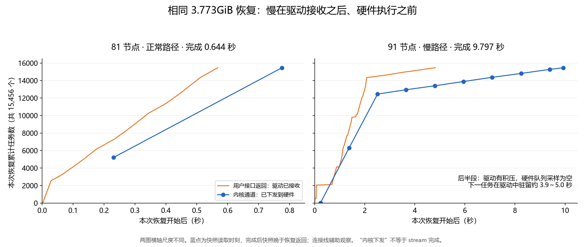

# 缓存恢复慢尾：驱动接收后、硬件下发前的长时间驻留

2026-11-11，81、91 两个双卡容器恢复后的续查。原件分为三个追加包，均为本地恢复诊断。

后续容器内实验见 [DMA 内存准备路径的因果对照](CONTAINER-DMA-20261111.md)： 在相同源/目的地址上可逆切换 DMA 预注册，并通过四卡及随机顺序配对复核其影响。
本页保留此前的队列定位、原件和当时的内核采集方案。

## 结论与证据强度

**已高可信度定位：至少一类严重慢尾发生在主机驱动接收任务之后、向硬件队列下发之前。** 相同 3.773GiB 数据、15,456 个描述符的恢复，81 为 0.644 秒，91 为 9.797
秒。 91 后半段仍有已接收任务积压，但硬件队列的多次采样为空；下一项未下发任务已经等待约 3.9～5.0 秒。 这比仅观测 `stream synchronize`
耗时更进一步：同步是在等待前面的任务，不能把全部同步时间当作 DMA 搬运时间。

**尚未确认的是驱动转发为什么会慢。** 当前容器内的观测不能唯一地区分内核线程调度、驱动函数内部处理、 锁等待或其他底层状态。公开驱动源码提供了可检验的路径，但并未证明与当前已加载二进制逐行匹配。
本报告没有把某个内核函数认定为已确认的缺陷，也没有把任何单一干预宣称为稳定修复。



两图横轴尺度不同。蓝点是实际读取内核通道快照的时刻，完成后快照包含额外采集时间；连线只辅助观察。 每个队列快照并不代表整段时间内硬件队列的连续状态。

## 环境和固定负载

| 项目              | 81                                                                 | 91                 |
| ----------------- | ------------------------------------------------------------------ | ------------------ |
| 工作区            | hust-zsx-81                                                        | hust-zsx-91        |
| 宿主机            | host-192-168-0-4                                                   | host-192-168-0-2   |
| 本次逻辑卡→物理卡 | 0→5，1→6                                                           | 0→2，1→7           |
| NUMA              | 物理5：2；物理6：4                                                 | 物理2：6；物理7：2 |
| 芯片              | 两张 Ascend 910B2                                                  | 两张 Ascend 910B2  |
| 容器 CPU / RAM    | 8 核配额 / 64GiB                                                   | 同左               |
| CANN              | 9.1.0                                                              | 同左               |
| 原生服务 SHA256   | `f2d3856a3e14a65e4267e58e26224298da733f8f18d08d51e7f8ff8dcae771a8` | 同左               |

恢复探针固定 96 个 NPU 平面，每平面 512 块、每块 256KiB；恢复 161 块，即 4,051,697,664 字节。源数据保存一次后重复使用相同源、目的缓冲区。 每次恢复检查全部
15,456 个描述符对应的首字版本标记；这不是逐字节校验整个缓冲区。 运行采用默认调度优先级。这一阶段没有模型执行和网络读取，研究对象是本地 CPU→NPU 路径。

## 实验顺序与结果

本轮完成 34 次原生恢复、118 项独立 C 对照；6 次暂停干预包含在原生恢复中，不另计请求数。 118 项包括 NOP、D2D、H2D 和不同准备历史等对照，不能全部称作缓存恢复请求。

### 1. 四卡复现，并把两个队列的进度对齐

| 位置     | 预热（秒） | 随后四次恢复（秒）            |
| -------- | ---------- | ----------------------------- |
| 81 物理5 | 0.656      | 0.640 / 0.647 / 0.644 / 0.644 |
| 81 物理6 | 0.840      | 0.804 / 0.833 / 0.824 / 0.835 |
| 91 物理2 | 0.969      | 0.834 / 0.826 / 0.919 / 0.922 |
| 91 物理7 | 1.314      | 2.088 / 1.882 / 2.510 / 9.797 |

HAL 的每次成功接收与内核通道累计 `tx` 对齐：每次 15,456 项，五次共 77,280 项， 成功接收位置按深度 2,048 回绕。用绝对累计计数识别尚未下发任务，避免仅由取模后的
head/tail 推测积压。

91 的 9.797 秒案例中：

| 相对恢复开始（秒） | 驱动已接收但未下发 | 下一未下发项已驻留（秒） | 硬件 SQ 采样 |
| ------------------ | ------------------ | ------------------------ | ------------ |
| 5.939              | 1,572              | 3.882                    | head=tail    |
| 7.084              | 1,092              | 4.917                    | head=tail    |
| 8.249              | 647                | 4.993                    | head=tail    |
| 9.391              | 181                | 5.045                    | head=tail    |

这段内核下发速度约每秒 400～500 项。81 同样会积压接近 2,047 项，但下一项的观测驻留仅约 90ms， 全次恢复约 0.64
秒。因此，“队列接近满”本身不是异常判据，要看任务的驻留和推进速度。

34 次原生恢复的 `cpu.stat` 均无新增 `throttled_usec`。这排除了这些案例中容器 CPU 配额耗尽的解释； 宿主机内核线程是否受到调度影响，仍需直接测量。 当前 91
的物理2正常，而历史同宿主机其他卡也出现过慢尾，不能将异常归为一张卡固定的体质或整台机器恒定的带宽。

### 2. 暂停用户进程：积压仍然慢慢下发

只暂停本实验拥有的原生服务约 0.51 秒，保持目标 NPU 缓冲区有效，让内核继续处理已接收任务。 每节点三次干预，均在已有充分积压时执行。

81 的三个停止窗口内，积压均在约 103ms 内观测到排空。 91 三个窗口结束时仍剩 1,375 / 1,419 / 1,081 项；窗口中下发速度分别约 1,252 / 1,223 /
1,881 项/秒。 **去掉本进程的用户态运行，并没有恢复到正常的数万项/秒。** 用户态轮询或提交负载不是这类慢尾的充分解释。 暂停会主动增加完成时间，因此不将暂停组耗时作为性能优化成绩。

### 3. 区分通用命令开销与主机内存搬运

独立 C 程序，固定 16,384 次成功的 HAL 任务提交；三种顺序重复。表中给出三次范围。

| 命令 / 实际数据量     | 81（秒）     | 91（秒）     |
| --------------------- | ------------ | ------------ |
| NOP / 无数据搬运      | 0.056～0.057 | 0.057～0.073 |
| D2D，4KiB/项 / 64MiB  | 0.085～0.085 | 0.085～0.106 |
| D2D，256KiB/项 / 4GiB | 0.085～0.085 | 0.085～0.086 |
| H2D，4KiB/项 / 64MiB  | 0.167～0.231 | 0.316～0.512 |
| H2D，256KiB/项 / 4GiB | 0.471～0.711 | 1.473～1.874 |

通用任务和卡内搬运的差异较小；主机内存参与的路径明显不同。 该结果缩小调查范围，但不能单独解释另一些运行中几十秒的尾部。 每项有数据的 C 对照检查八个分散位置的版本标记，检查强度与原生探针不同。

### 4. 源页准备历史：再次脱离 PegaFlow 复现严重慢尾

固定 4GiB、16,384×256KiB；比较 CPU 全量重写、D2H 写入、D2H 后逐 64 字节读写，三种顺序交叉重复。 81 的九次均为 0.610～0.691 秒。 91 前五次为
1.666～2.112 秒，随后四次为 38.338 / 19.391 / 34.994 / 37.823 秒。 其中 38.338 和 34.994 秒都发生在 CPU 全量重写之后。

严重慢尾能在简单 CANN 程序复现，不要求 IPC、模型、连接器或 RDMA。 “上一轮由设备写过源页”也不是必要条件。

### 5. stream 与主机内存类型

同一进程中交替旧 stream、新 stream：81 的后四项约 0.682～0.686 秒，91 为 1.648～1.974 秒。 这个新进程没有复现前一轮 35～38 秒的基线，因而不能将新
stream 宣称为修复。

1GiB、16,384×64KiB 的等量内存来源对照：

| 来源                       | 81，三次范围（秒） | 91，三次范围（秒） |
| -------------------------- | ------------------ | ------------------ |
| mmap + MAPPED 注册         | 0.271～0.410       | 0.713～0.852       |
| mmap + mlock + MAPPED 注册 | 0.244～0.344       | 0.435～0.680       |
| aclrtMallocHost            | 0.129～0.166       | 0.268～0.436       |

显式锁页成功，smaps 验证了 Locked 大小。三类 VMA 均是 4KiB 页，未使用匿名透明大页； MallocHost 显示为带 `io/pf`
标志的共享映射。这是路径差异的线索，不是已经确认的慢尾根因。

随后扩大至 4GiB、16,384×256KiB，并按同样顺序交替六轮：

- 81 完成全部 18 项，程序退出 0；注册内存约 0.79～1.02 秒，显式锁页约 0.44～0.58 秒，MallocHost 约 0.25～0.28 秒。
- 91 完成八项；显式锁页的一项耗时 **259.906 秒**，驱动 API 提交阶段 172.308 秒，最后同步 87.598 秒，八处标记通过。
- 91 的 MallocHost 前两项分别为 1.284、7.071 秒；第九项尚未完成时触发预设 600 秒 SIGALRM，最终退出 -14。 未完成项不作为成功耗时样本。退出前曾在
  `trs_proc_diable_sq_status` 内核等待点观测到 D 状态；随后进程已消失。

91 整个子进程从启动到退出约 697 秒，包含超过 600 秒截止点后的收尾等待； 这段期间容器 `throttled_usec` 增量仍为 0。不能把截止点后的驱动释放等待合并进一个成功拷贝耗时。

因此显式锁页不能稳定消除严重慢尾；MallocHost 具有正常情况下的成本优势，但现有结果不支持其为稳定修复。

## 采集质量与异常记录

暂停控制器在全部 14 次原生恢复完成后，把采集器收尾误报为 600 秒超时，打断了 API 文件复制。 操作记录及每次 15,456 项标记检查均已完成。两份原始 API
日志仍在容器临时目录，按原字节另存到包 B， 用于补足包 A；原失败记录保留。控制器 v2 修正退出等待，已静态检查，尚未重新运行该版本。

追加 4GiB 对照的启动也保留失败：81 第一次共享可执行文件启动报 errno8；两个 v2 包装器在 Python 解析阶段失败， 未启动测试子进程；81
后以独立可执行文件和修正后的包装器完成。91 使用已成功启动的首轮程序， 没有与另一份重复 NPU 测试重叠。失败包装器不进入有效样本数量。

本轮禁用高频 HAL 队列轮询。内核通道是有限的离散快照，整个快照还包含 CPU/中断采集成本， 不能由其连线推导微秒级 DMA 活动或准确的 worker 调度间隔。

## 下一步：直接区分驱动内部耗时与调度空档

现有实验已覆盖应用层、主机内存准备、锁页、stream、卡内搬运和用户态负载。 继续只增加恢复次数，无法区分剩余两类解释。需要在原慢宿主机上，由管理员做一次与慢拷贝同步的短时内核采集。 准备方案见
[内核采集说明](KERNEL-CAPTURE-20261111.md)。容器当前没有 tracefs/perf 所需能力，尚未执行宿主机探针。

判别标准：若 `trs_hw_sq_send_task` 内部持续慢，向嵌套的通道提交、SQE 填充和缓存刷新定位； 若每次调用内部短、相邻调用之间长，则转向 worker
唤醒和调度。随后才设计针对已确认机制的修复及前后对照。 公开源码中存在 1～4ms 兜底轮询，并不足以直接证明本次延迟来自这一机制。 源码参考为固定版本的
[trs_hw_sqcq.c](https://github.com/hicann/driver/blob/471fa6b09b556cabdb7ed917a8dd2ec25ed0bc6b/src/sdk_driver/trsdrv/trs/trs_core/trs_hw_sqcq.c)，
其作用是提出下一步待验证的分支，而非替代当前二进制的实测。

## 原件与重算

| 包                                                                                  | 内容                                                             | SHA256                                                             |
| ----------------------------------------------------------------------------------- | ---------------------------------------------------------------- | ------------------------------------------------------------------ |
| [A](raw/resume-20261111-a.tar.gz) / [manifest](raw/resume-20261111-a-manifest.json) | 34 原生恢复、30 命令对照、18 源历史对照、环境与原始收尾失败      | `eb796a6d90f53fce3a30e3d908930cb545141b512e58faefdbacc49997fe5229` |
| [B](raw/resume-20261111-b.tar.gz) / [manifest](raw/resume-20261111-b-manifest.json) | 原暂停 API 日志补件、26 stream 对照、18 个 1GiB 内存来源对照     | `b2063970bad4ac7efd2fe33990c05a9a92420dc7bf7e70384eddc3b4b7a2092a` |
| [C](raw/resume-20261111-c.tar.gz) / [manifest](raw/resume-20261111-c-manifest.json) | 26 个完成的 4GiB 对照、91 不完整末项、退出状态、启动失败范围说明 | `0a7e22ee230ace613a3c2e6678aa81a3713cb98a2a62531421b6665573665662` |

将 A、B、C 分别解压至独立目录，按 manifest 核对后：

```sh
python analysis/analyze_resume_20261111.py /path/to/A --supplement /path/to/B --large /path/to/C --output summary.json
python analysis/plot_resume_20261111.py summary.json --font /path/to/CJK-font.ttf --output forwarding.png
```

[派生汇总](analysis/resume-20261111-summary.json)保留逐次结果、HAL 数量检查、暂停窗口和队列驻留计算。
分析使用版本化脚本，原始日志不改写。对应生产代码没有在本阶段做修复改动。
