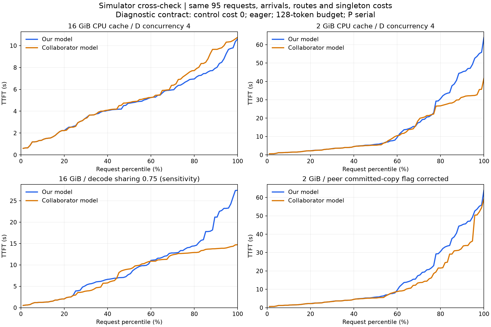

# P/D 模拟器对照报告（2026-10-27）

两份模拟器在统一的基础条件下能够逐请求对齐；差异集中在缓存生命周期及恢复、拷贝与连续批处理的组合处。 16 GiB CPU 缓存、D 四并发的主对照中，我们的平均 TTFT 为 **4.795
秒**，合作者为 **5.101 秒**； p95 为 **9.657 / 10.340 秒**，p99 为 **10.621 / 10.767 秒**。 但逐请求仍有 16/95
条不同，不能只凭接近的平均值和 p99 宣布模拟器已经对齐。

## 1. 比较对象

| 对象           | 固定版本                                                                            | 本次使用的执行模型                                                                          |
| -------------- | ----------------------------------------------------------------------------------- | ------------------------------------------------------------------------------------------- |
| 我们的模拟器   | PegaFlow `main@5a0ac2c4aaa6b6ac82c2092c0e59859c5acfe15d`                            | `scripts/issue23/pd_capacity_batch_simulator.py`                                            |
| 合作者的模拟器 | `feat/issue23-simulator-snapshot-20261027@8fddbd74a1cc131fc61cd48fcc6309d50cd29a21` | `experiments/issue23_strategies/simulate_continuous_batch.py` 的 `BatchSimulation` 执行内核 |

合作者分支包含执行模拟器、缓存/队列预测器、多种调度候选、测试及版本化研究记录。 其保留的策略参考是 TimedMemo-normal-910B2；最新 staged-save 原型仍有未完成的 P
发布、记账及验收工作。 本次选择双方共有的执行范围，固定路由并关闭策略搜索，比较执行模型本身。 因此表中的差额不代表两种优化调度算法的收益。

我们最新的 `pd_serving_simulator.py` 还包含 graph、P/D 连续批处理、NPU APC 与异步交接； 合作者保留模型使用 eager、P 串行，不能直接与此前约
0.25 秒的目标服务流程预测相比。

源码入口：
[我们的容量/批处理模型](https://github.com/vLLM-HUST/pegaflow-hust/blob/5a0ac2c4aaa6b6ac82c2092c0e59859c5acfe15d/scripts/issue23/pd_capacity_batch_simulator.py)、
[合作者执行内核](https://github.com/vLLM-HUST/pegaflow-hust/blob/8fddbd74a1cc131fc61cd48fcc6309d50cd29a21/experiments/issue23_strategies/simulate_continuous_batch.py)、
[合作者研究状态](https://github.com/vLLM-HUST/pegaflow-hust/blob/8fddbd74a1cc131fc61cd48fcc6309d50cd29a21/docs/research/README.md)。

## 2. 如何保证条件一致

最终对照共 **12 组配对条件、24 次完整运行**，每次均处理 95 条请求。本地 CPU 即可运行。 基础六组检验冷缓存/2 GiB/16 GiB 与 D
串行/四并发，另外六组用于拆解具体差异。

| 项目       | 共同约定                                                                                                   |
| ---------- | ---------------------------------------------------------------------------------------------------------- |
| 工作负载   | 原 8 个 Terminal-Bench 会话、95 条请求，同一 token 数、前缀哈希、初始缓存清单及顺序；总输入 940,646 tokens |
| 输入身份   | 原冻结 `4bfa935` 输入包及 isolated32 标定种子；不使用目标请求的实测延迟、命中或路线作标签                  |
| 模型/拓扑  | Qwen2.5-7B-Instruct，BF16，TP1，2P2D                                                                       |
| 到达与会话 | 逐项使用同一到达时间表；同会话下一请求等待上一请求完整完成；名义速率约 0.4903 请求/秒                      |
| 路由       | 会话名排序后按序号 `% 2` 固定到 P0/D0 或 P1/D1；请求数分别为 51 / 44                                       |
| 执行       | P 每实例串行；D 每实例并发 1 或 4；eager；block/token budget 均为 128；P 输出 1，D 输出 128                |
| 内存       | CPU 每实例 2 或 16 GiB；NPU KV 每实例 16 GiB；关闭跨请求 NPU APC                                           |
| 服务耗时   | 基础组共享同一个原始冻结单请求服务函数、restore 分量、decode tail 及方向性拷贝系数                         |
| 批处理成本 | prefill 成本相加；decode = `(1-s) × sum(single) + s × max(single)`；基础组 `s=0`，`s=0.75` 单列敏感性      |
| 控制成本   | 两边均将 RPC、规划和调度器 CPU 的模拟耗时设为 0，以检查执行机制；本机脚本耗时另外记录                      |
| TTFT       | `first − ready`，其中 `ready=max(offered, previous_session_end)`；另保存绝对 first/end、E2E 与全量完成时间 |

这是统一成本下的**执行机制对照**，不是新的真实设备性能预测。 控制成本、路由与批处理成本约定与此前完整实验不同，因此下表不用于替换此前的实测或完整预测值。
冷缓存控制组将输入前缀清空并清空初始缓存，仅用于检验时钟和批处理计算，保留 95 条长度及会话轨迹。

适配层只在独立 Python 进程中设置实验输入、路由及成本函数，原有执行源码均未修改。 缓存发布、回收、lease、恢复阶段和拷贝门控保留各自实现；这些正是本次比较的对象。 D
的源发现范围仍有机制差异：我们从对应 P/本地 D 取边界，合作者原生路径搜索四个实例； P 的源/前缀选择时点也不同：我们在路由时确定，合作者在 P 阶段开始时确定。 16 GiB 主组的 190
个 P/D 阶段所选前缀实际全部相同。

## 3. 主要结果

表内单位均为秒，“我们 / 合作者”按此顺序列出。

| 条件                                  |         平均 TTFT |                p95 |                 p99 | 逐请求 TTFT 平均绝对差 |
| ------------------------------------- | ----------------: | -----------------: | ------------------: | ---------------------: |
| 冷缓存，D 串行                        |   40.050 / 40.050 |    64.686 / 64.686 |     67.420 / 67.420 |                < 1e-12 |
| 冷缓存，D 四并发                      |   25.723 / 25.723 |    53.053 / 53.053 |     56.626 / 56.626 |                < 1e-12 |
| 2 GiB，D 串行                         |   36.232 / 34.174 |    67.354 / 62.413 |     70.112 / 67.420 |                  3.030 |
| 2 GiB，D 四并发                       |   14.986 / 12.189 |    52.610 / 32.370 |     63.890 / 41.633 |                  6.095 |
| 16 GiB，D 串行                        |   30.296 / 30.296 |    47.662 / 47.662 |     49.230 / 49.230 |                < 1e-12 |
| **16 GiB，D 四并发**                  | **4.795 / 5.101** | **9.657 / 10.340** | **10.621 / 10.767** |              **0.461** |
| 16 GiB，D 四并发，decode sharing=0.75 |     9.625 / 8.024 |    23.300 / 14.124 |     27.464 / 14.724 |                  3.471 |



基础时钟、会话依赖、串行执行和无恢复时的四并发计算是对齐的：三个控制场景逐请求误差均在浮点舍入量级。 16 GiB 四并发时，合作者平均 TTFT 比我们高 6.39%，p99 高 1.37%；
但有一条请求相差 6.61 秒，16/95 条超过 1 微秒的对齐容差。 这说明全局分位数相近也可能掩盖不同的请求时间线。

两边在该主组均只需处理 **5,990 个 D 未命中输入 tokens**，累计拷贝 **7.253 GiB**， 全量完成时间均为 **576.419 秒**；平均 E2E 为 **39.438
/ 39.373 秒**。 所以这组差异主要发生在首 token 的排队和发出时机，而非模型认为一边多进行了大量重算。 在不假定 decode 批处理加速的情况下，D 四并发可提前发出首
token，但不会凭空减少整轮 decode 工作量。

sharing=0.75 代表未标定的批处理成本假设。两边的全量完成时间降为 **383.774 / 378.793 秒**， 但各自 TTFT 反而高于 sharing=0 的同模型结果。
会话下一步随前一步完成而释放，执行变快会改变后续请求抵达 P/D 的聚集方式及批次； 因此不能把这条敏感性曲线理解成“真实硬件加速必然损害 TTFT”。它提示需要校准批次时间线，而非只对齐单请求函数。

## 4. 已定位的差异

### 4.1 已完成的副本仍被标为 virtual，会改变缓存回收

合作者默认路径的 `commit_copy()` 直接采用 `copy_package()` 的新 layout， 后者为规划目的把副本标为 `virtual=True`；回收代码排除 virtual
对象。 运行结束时，2 GiB 四并发组的四个实例分别仍有约 **2.00 / 1.74 / 1.96 / 1.96 GiB** virtual 对象。 我们的提交路径会把已完成副本转成实对象。
合作者自己的 staged-save 文档也已指出该问题，并在 opt-in 原型中处理。

只在对照适配层清除“已完成副本”的 virtual 标记，其他参数不变：

| 合作者 2 GiB、D 四并发       | 默认模型 | 实副本对照 |
| ---------------------------- | -------: | ---------: |
| 平均 TTFT                    |   12.189 |     12.259 |
| p95                          |   32.370 |     50.356 |
| p99                          |   41.633 |     59.177 |
| D 未命中 tokens              |  376,934 |    222,054 |
| 累计拷贝 GiB                 |    7.649 |     25.525 |
| 与我们不同的阶段前缀数 / 190 |       73 |         25 |

该修改显著改变了缓存及尾部时间线，是需要先统一的对象生命周期问题。 实副本组仍与我们不同，不能把全部差额都归到这一个标记。
更多命中也不保证更小的尾延迟：副本可回收后，复制/恢复、发布时机和批次顺序会共同变化。

### 4.2 restore 的放置不同，影响其他正在 decode 的请求

我们的容量模型把整段 first-token service（含 restore）摊入剩余 prompt 的 prefill 步； 合作者先执行独占的 restore barrier，再做
prefill。单请求总服务相同，并发时相互等待的位置不同。

16 GiB 主组的 `git-leak-recovery:4` 在两边都于 **83.181 秒**进入 D 阶段， 可见前缀和选择均为 19 块；我们的首 token 于 **84.801
秒**发出，合作者约 **85.807 秒**发出。 这条分歧出现在前缀已经相同的情况下，不能用缓存未命中解释。

将合作者 restore 改为与我们相同的摊销方式，仅用于归因：

| 16 GiB、D 四并发       |   我们 | 合作者默认 restore | 合作者摊销 restore |
| ---------------------- | -----: | -----------------: | -----------------: |
| 平均 TTFT              |  4.795 |              5.101 |              4.906 |
| p95                    |  9.657 |             10.340 |              9.804 |
| p99                    | 10.621 |             10.767 |             10.646 |
| 逐请求 TTFT 平均绝对差 |      — |              0.461 |              0.374 |

差距缩小，但仍有 15 条不同；这项对照只确认阶段放置有影响，不证明摊销方式更符合实际硬件。

### 4.3 其余差异需要按事件对齐

| 机制           | 我们的容量模型                       | 合作者此次默认执行内核                       |
| -------------- | ------------------------------------ | -------------------------------------------- |
| CPU 缓存发布   | 完成的 prefill/decode 块逐步发布     | P/D API 完成后整请求保存                     |
| 并发 lease     | 较粗的保护/所有权近似                | 按 request/operation 绑定物理 allocation     |
| 副本完成       | 转为实对象                           | 保留 virtual；新 staged 原型另行纠正         |
| 拷贝资源       | 取得源/目的软件门及方向链路          | native 路径主要持目的门；受控策略路径不同    |
| CPU 池回收     | 计算中逐块发布可能触发粗粒度回收     | API 结束时批量保存/回收                      |
| P 前缀选择时点 | 路由时                               | P 阶段开始时                                 |
| D 阶段         | restore 计入分块 head                | restore/save barrier 与 compute 分开         |
| 成本标定       | 原冻结单请求函数；批处理可用测量曲线 | isolated32 phase 拟合；decode-sharing 参数化 |

另一个对照将我们的“已本地命中仍查询源门”改为本地处理；本轮结果不变， 因此不能把当前主组差额归给这个门控分支。 将合作者成本切回其自身 phase 拟合后，16 GiB D4 的平均/p95/p99
为 **5.136 / 10.339 / 10.649 秒**； 该点位的成本拟合差异较小，不能据此推断其他上下文长度、到达率或并发度也一样。

## 5. 后续如何对齐

建议保留两套实现，先建立共同契约和逐事件验收，再选择统一的执行内核。 可以把合作者的物理 lease/显式阶段定义与我们的 graph 组件标定、目标服务流程共同纳入规范。 按以下顺序推进：

1. **先统一缓存对象语义。** 明确 allocated/unpublished/published/copy-inflight/leased/reclaimable 状态，
   已完成副本转实对象；P/D 采用相同的块发布时间和 lease 释放点。 先完成 staged-save 原型的 P 发布与记账，再将预测器和执行器接到同一契约。
1. **统一成本和计时口径。** 一份带版本的组件成本表供双方读取； 明确 RPC、CPU 规划、D2H、RDMA、H2D、计算、同步保存的包含关系。
   后续全成本对照要给两边恢复同一份已测控制成本，避免一个计本机规划 wall、另一个计历史均值。
1. **统一事件和仲裁。** 输出共同字段：request/node、enqueue/acquire/start/finish、资源、prefix、payload、 allocation
   ID、lease owner、发布/回收理由、首 token。 固定同一时刻的事件次序、拷贝源/目的门持有时间、方向链路、D admission 与 restore 优先级。
   从两份日志的首个不同事件开始定位；先对齐绝对时间，再比较 ready-to-first。
1. **先通过小型机制案例，再跑这 95 条。** 用单请求、两请求 restore/decode 重叠、共享前缀、
   小池回收、拷贝后回收及租约保护这六类案例；要求同契约下的前缀、分配/回收和事件序列一致，时间仅容许舍入差。 然后复跑冷缓存、16 GiB、2 GiB 三组及
   D1/D4，使用已保存的逐请求差分作为验收。 同一冻结世界下要求 prefix、payload、分配/回收结果完全一致，first/end 的逐请求差异不超过 1 微秒。
1. **接入生产配置及真实标定。** 用单机 NPU 测 P/D 多并发下的 prefill、decode、H2D/D2H 和重叠曲线； 验证实际 vLLM
   admission/块发布行为，再使合作者内核支持 graph、大 token budget、P 批处理及 NPU APC。
   此后才比较统一生产配置下的默认/优化调度；共享系数先保持敏感性参数，直到有对应测量。

第一阶段不需要两节点设备，能先修正生命周期并统一日志；硬件资源优先用于两份模型仍有分歧的并发恢复/计算片段。 不要通过整体乘一个缩放系数来“拟合到相同
p99”：本轮已经看到平均值接近、逐请求时间线仍不同。

## 6. 证据与复现

- [共同契约](contract.json)、[汇总指标](summary.json)、[逐请求配对差分](paired-requests.csv)。
- `runs/*.json.gz` 保存 24 次输出，包含计算步、阶段前缀、缓存事件和最终 virtual 字节数。
- `inputs/` 保存同一输入包、协议和 32 条标定种子。
- `tools/` 保存本次适配层和分析脚本；[manifest](manifest.json) 记录源提交、适配层摘要及验收项。

在对应的两个固定提交 checkout 和 Python 环境中运行，变量分别指向源码及本报告的路径：

```sh
python "$REPORT/tools/compare_pd_simulators.py" \
  --ours "$OURS" --peer "$PEER" --inputs "$REPORT/inputs" \
  --output "$NEW_RUNS"

python "$REPORT/tools/report_pd_simulator_comparison.py" \
  --runs "$NEW_RUNS" --inputs "$REPORT/inputs" --output "$NEW_REPORT"
```

模拟只需 Python 标准库；绘图另需 Matplotlib。输出使用新目录；已完成的相同 case 可续跑。 分析已检查每次 95 条唯一完成、P/D
分配一致、有限且因果的时钟、同会话依赖、每请求两个阶段及 CPU 容量上限， 并要求三个基础控制场景逐请求误差小于 1 ns。 新增的差分计时校验测试及相关串行/批处理测试共 12
项通过，三个新增/分析脚本通过 Ruff。 95 个样本的 nearest-rank p99 等于最大值；当前结果是固定轨迹下的确定性模型对照，不能当作总体 p99 的置信估计。
