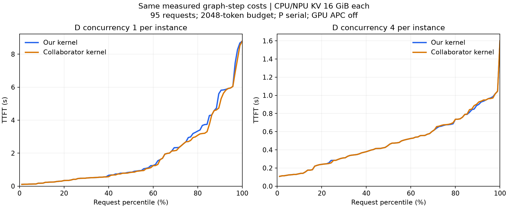

# D 并发、16 GiB、graph 成本下的模拟器对照

在同一份 graph 实测步成本下，D 每实例四并发时，两份执行内核的结果接近： 平均 TTFT 为 **0.493 / 0.495 秒**，p95 为 **0.971 / 0.965 秒**，p99
均为 **1.601 秒**。 下文数字按“我们 / 合作者”排列。

## 共同配置与适配范围

- Qwen2.5-7B-Instruct BF16，2P2D、TP1；沿用同一批 95 个请求、8 个会话、初始 CPU 缓存和到达表。
- CPU 缓存与 NPU KV 均为**每实例 16 GiB**；P 每实例串行，D 并发上限分别测试 1、4。
- graph 计算步使用同一份 910B2 / vLLM-Ascend 0.23.0 标定函数，依据实际 batch 的 prefill/decode tokens、序列数和上下文计费。
- token budget 为 2048，block 为 128；P 输出 1 token，D 输出 128 tokens；会话固定 P/D，下一步等待前一步完整结束。
- CPU 恢复/保存使用同一份 native 组件测量，RDMA 使用同一历史方向性系数；控制器 RPC/规划 CPU 模拟成本均为 0。
- 本轮保留共同的 CPU 缓存恢复流程，GPU APC 关闭。P 批处理、NPU APC、完整异步交接属于另一份目标服务模型。

合作者固定分支 `8fddbd7` 原本使用 eager/128 单请求拟合；本轮通过独立对照适配层接入 graph 成本， 并让两个内核按各自实际 batch
调用相同的步级函数。其原生分支尚未完成完整 graph 服务流程支持。 我们的容量内核也通过同一适配层换为逐 batch graph 计费。 所以这是 **graph
实测成本驱动的离线预测**，并非双节点真实 graph 服务验收。

执行源码仍固定为我们 `5a0ac2c4aaa6b6ac82c2092c0e59859c5acfe15d`、合作者
`8fddbd74a1cc131fc61cd48fcc6309d50cd29a21`； 新适配层冻结在本报告 `tools/` 中。缓存发布、lease、拷贝门控及 restore
的阶段放置保留各自内核实现。

## 结果

所有时间单位为秒。

| 指标                    | D 串行：我们 / 合作者 | D 四并发：我们 / 合作者 |
| ----------------------- | --------------------: | ----------------------: |
| 平均 TTFT               |         1.911 / 1.828 |       **0.493 / 0.495** |
| TTFT p50                |         0.849 / 0.842 |           0.462 / 0.462 |
| TTFT p95                |         6.044 / 6.044 |       **0.971 / 0.965** |
| TTFT p99                |         8.786 / 8.786 |       **1.601 / 1.601** |
| 平均 E2E                |         4.329 / 4.247 |           3.075 / 3.074 |
| 整轮完成时间            |     203.399 / 203.399 |       203.399 / 203.399 |
| 逐请求 TTFT 平均绝对差  |                0.0826 |             **0.00342** |
| 逐请求最大绝对差        |                0.9793 |              **0.1743** |
| 差异超过 1 微秒的请求数 |                 15/95 |                **5/95** |



两边都预测 D 四并发显著降低首 token 排队：相对各自串行结果，平均 TTFT 分别下降约 **74.2% / 72.9%**， p99 均下降约
**81.8%**。该固定轨迹的尾延迟判断一致，但个别请求的时间线仍需对齐。 95 个样本的 nearest-rank p99 等于最大值；本轮不是总体尾分位数的置信估计。

四并发主组的平均值相差约 **0.30%**。D0/D1 实际峰值在两边均为 **4 / 3 个活动请求**， 说明本轮实际用到了并发上限。四个场景的 D 未命中输入均只有 **5,990
tokens**， 两边的整轮完成时间相同；因而主组已经没有此前小缓存池造成的大量 D 重算现象。

整轮时间还包含固定的名义到达轨迹以及 decode；最后一条名义请求在约 197.475 秒到达。 因此首 token 等待降低，并不要求整轮完成时间按相同比例下降。

本轮改变了 graph 步级成本、token budget 和 CPU 保存/恢复组件模型； 与上一轮 eager/128 对照的数字差额不能单独归因为 graph 开关。 此前约 0.25
秒的目标服务模型还启用了 NPU APC、P 批处理及异步交接，配置范围不同。

## 仍需统一的内容

当前差异主要保留在 restore barrier、首 token 发出、CPU 缓存发布和拷贝资源仲裁的时序中。 大容量下结果接近，并不能代替小容量的生命周期验收；合作者默认路径的
committed-copy virtual 标记问题仍需独立处理。

下一步沿用[上一份对齐计划](../pegaflow-simulator-comparison-20261027/README.md)： 先统一缓存对象生命周期和事件日志，再对齐剩余 5
条请求的首个不同事件。 此后将 NPU APC、P 并发和异步交接纳入共同模型，才能比较同一生产服务流程及优化调度。

## 证据和复现

- [共同契约](contract.json)、[汇总](summary.json)、[逐请求差分](paired-requests.csv)。
- `runs/` 为 4 次完整输出；`inputs/` 包含原始输入、标定种子、graph 步成本和 native 组件测量。
- `tools/` 为本轮对照、graph 成本适配及报告脚本。
- 核对了 95 条唯一完成、P/D 分配、时钟、会话因果依赖、每请求两个阶段和 CPU 容量；相关 9 项测试通过，新增脚本通过 Ruff。

```sh
python "$REPORT/tools/compare_pd_simulators.py" \
  --ours "$OURS" --peer "$PEER" --inputs "$REPORT/inputs" \
  --graph-model "$REPORT/inputs/step-cost-model.json" \
  --graph-components "$REPORT/inputs/components.json" --output "$NEW_RUNS"

python "$REPORT/tools/report_pd_graph_comparison.py" \
  --runs "$NEW_RUNS" --inputs "$REPORT/inputs" \
  --graph-model "$REPORT/inputs/step-cost-model.json" \
  --graph-components "$REPORT/inputs/components.json" --output "$NEW_REPORT"
```
