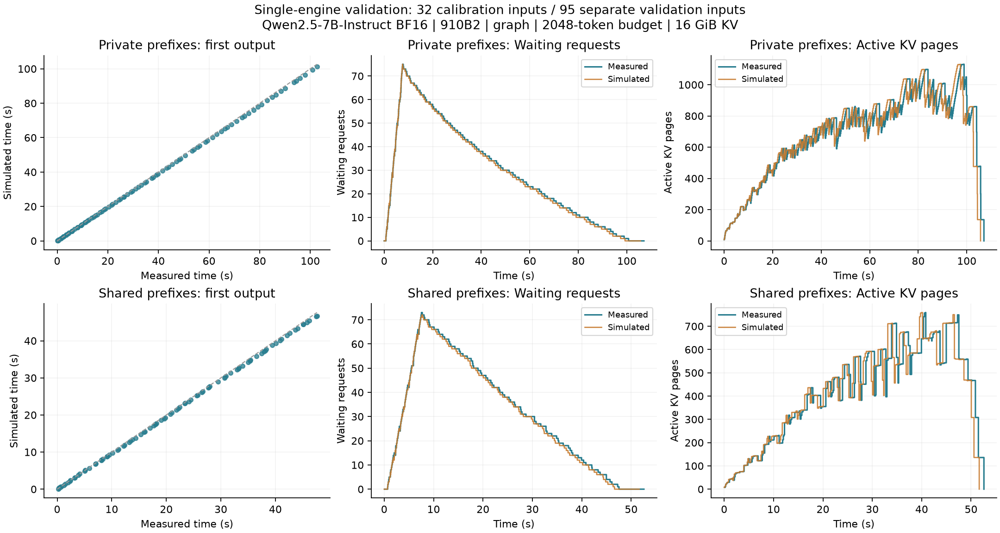

# PegaFlow 单引擎调度模拟：标定与开发验证

日期：2026-10-26。范围：Qwen2.5-7B-Instruct、BF16、单张 Ascend 910B2、图模式、每步 2048 token、最多 8 个运行请求、16 GiB NPU
KV。硬件记录见 [provenance/hardware.json](provenance/hardware.json)。

本阶段将模拟推进到按调度步预测：输入为到达时刻、输入/输出长度、前缀身份和调度配置， 耗时由独立标定的成本模型计算。验证请求自身的首 token 或完成耗时不进入预测器。

## 结果

| 验证工作负载      | 指标      |     实测 |     模拟 | 相对误差 |
| ----------------- | --------- | -------: | -------: | -------: |
| 95 请求，私有前缀 | TTFT 均值 |  33.19 s |  32.47 s |   −2.18% |
| 同上              | TTFT p95  |  87.27 s |  85.80 s |   −1.68% |
| 同上              | 全部完成  | 107.08 s | 105.67 s |   −1.31% |
| 95 请求，共享前缀 | TTFT 均值 |  17.27 s |  16.82 s |   −2.61% |
| 同上              | TTFT p95  |  37.96 s |  37.25 s |   −1.86% |
| 同上              | 全部完成  |  52.61 s |  51.66 s |   −1.81% |

私有/共享两组的活跃 KV 页峰值均准确重现，分别为 1131 和 759 页；每页承载128 token， 对应该模型约 7 MiB KV。共享组接受的前缀命中量均为 **798336
token**。最大等待队列私有组 75→75，共享组73→72。



完整数字见 [summary.json](summary.json)、[私有组验证](private-validation.json) 和
[共享组验证](shared-validation.json)。时间曲线和逐请求误差一起保留，未只比较组均值。

这些是已查看结果的开发验证工作负载，成本拟合按会话隔离；不是盲测。当前两组使用相同的 95 个输入，各执行一次。请求在约 7.5 秒内到达，形成明显排队，用于检查过载期间的动态行为。
它们不代表生产稳态的到达分布。

## 实现与数据边界

- 模拟器：[step_simulator.py](https://github.com/vLLM-HUST/pegaflow-hust/blob/8b7b8a7b8e8020d1f9135d4f7691b46b9dc6c342/scripts/issue23/step_simulator.py)。纯标准库，CPU
  可运行。
- 调度：先处理既有运行请求，再按 FCFS 准入等待请求，共享每步 token 和序列预算。
- KV：按本步实际需要增长物理页，保留一个引擎保留页；前缀页有引用计数，释放后内容可继续驻留， 重用时按空闲队列淘汰。相同前缀在不同请求之间共享，私有缓存域保持隔离。
- 计算：纯解码和含 prefill 的步分别拟合非负成本函数。特征包括 token 数、序列数、 上下文长度和 prefill attention 工作量；另外标定调度间隔与输出交付延迟。
- 策略接口：可改变等待队列的排序、token 预算、运行序列上限，也支持会话前后依赖。 `shortest_remaining` 仅对等待请求按输入加输出 token 数排序，不抢占正在运行的请求。
- 已有验证覆盖 FCFS。其他策略的运行结果是模拟预测，需要对应测量再验证。

标定使用 `adaptive-rejection-sampler` 和 `code-from-image` 的32个固定输入，私有/共享各执行一次，
共64个标定请求实例；4条预热请求另记。成本拟合共1326步：1083步纯decode、241步混合、2步纯prefill。

验证使用另外8个会话的95个输入，两组均未参与成本拟合。输入来自
[`openguardrails/terminal-bench-2.1-deepseek-v4-flash-trajectories`](https://github.com/openguardrails/terminal-bench-2.1-deepseek-v4-flash-trajectories)，
固定revision `3f5b93ff1c5ea84b2c94cf479d0c942227191b4a`，使用Qwen2.5聊天模板与
`add_generation_prompt=True`。原冻结输入由PegaFlow提交
[`4bfa935`](https://github.com/vLLM-HUST/pegaflow-hust/commit/4bfa9351273efc710bceb296ae6f8cbdc31584e6)中的实验准备流程产生。

公开数据包含数值测量、输入长度、链式前缀身份和到达时刻；原始提示词与生成文本没有纳入该数值子集。 原始记录的文件身份见
[source-inventory.json](provenance/source-inventory.json)， 采集代码快照保存在 `provenance/`，用于核对来源。规范化入口为
[prepare_step_evidence.py](https://github.com/vLLM-HUST/pegaflow-hust/blob/8b7b8a7b8e8020d1f9135d4f7691b46b9dc6c342/scripts/issue23/prepare_step_evidence.py)。

`data/*-workload.json.gz`是预测输入；`data/*-observed.json.gz`是测量参照；
`*-prediction.json.gz`是模拟产物，三者分别保存。数值子集足以在CPU上重新拟合、预测和比较。

实现与测试由 PegaFlow 仓库维护，固定源码身份见 [simulator-source.json](provenance/simulator-source.json)。

## CPU 重现

在 PegaFlow 仓库根目录执行。将 `$R` 设为本实验目录的本地绝对路径。数据准备好后，以下命令不需要模型、NPU或网络。

```sh
R=/absolute/path/to/pegaflow-step-simulator-20261026
python scripts/issue23/step_simulator.py fit \
  --steps "$R/data/calibration-steps.jsonl.gz" \
  --metadata "$R/data/calibration-metadata.json" --output /tmp/step-cost.json
python scripts/issue23/step_simulator.py validate \
  --model /tmp/step-cost.json \
  --workload "$R/data/validation-95-shared-workload.json.gz" \
  --observed "$R/data/validation-95-shared-observed.json.gz" \
  --output /tmp/shared-validation.json
python -m pytest -q scripts/issue23/test_step_simulator.py
python scripts/issue23/verify_step_evidence.py --root "$R"
```

Windows PowerShell 使用 `$R` 设置数据目录，并把示例输出目录替换为本地可写目录。 重新生成图表另需Matplotlib：

```sh
python scripts/issue23/render_step_evidence.py --root "$R"
```

等待队列策略的探索示例：

```sh
python scripts/issue23/step_simulator.py simulate \
  --model "$R/cost-model.json" \
  --workload "$R/data/validation-95-shared-workload.json.gz" \
  --policy shortest_remaining --output /tmp/policy-prediction.json.gz
```

## 当前局限

1. 这是单引擎计算、NPU前缀缓存和排队的开发模型。P/D跨节点通信、CPU缓存保存/恢复、 RDMA网络排队未在本模型中标定。
1. 16 GiB标定中没有出现抢占。需要抢占的容量条件会明确报错，避免把未测成本当作零。
1. 纯prefill仅2个标定步；新调度若显著改变混合比例，应补充对应测量。
1. 超过2048 token预算或8路序列的配置需要显式允许外推，输出会标记超出标定范围。
1. 使用实际提交时刻重放输入。改变请求注入方式时，还需要考虑前端调度造成的提交延迟。
1. 测量带有遥测开销，标定与历史验证的CPU竞争环境也有差异；约1%–3%的本轮偏差不是未来工作负载的误差保证。
1. 跨请求前缀身份来自冻结输入。生成后的页按请求隔离，不预测生成内容恰好相同带来的额外共享。

这是独立的研究开发产物；测量、模拟与准入范围按上述声明分别使用。
