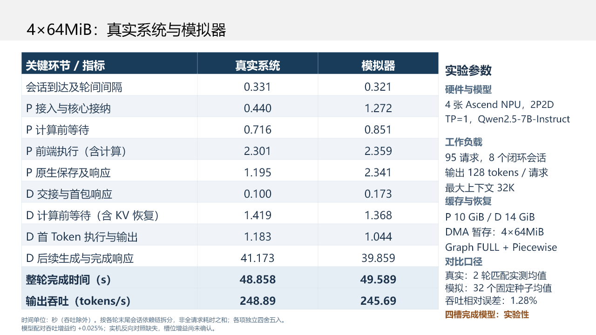

# PegaFlow 吞吐优化与四槽完成模型进展（2026-11-12）

本检查点归档 PR #648 之后的本地研究进展：五项实机优化对照、对应的时间归因、四槽位完成模型、 64 条固定种子仿真及桌面 PPT 第三页的真实/模拟对比。**吞吐是主要指标，TTFT
是次要指标。** 这些是研究实测与模拟器预测，不是官方榜单提交；旧的最佳冻结模型和失败记录均保留。

## 当前结果

| 同输入对照       | 实测输出吞吐变化 | 结论边界                                           |
| ---------------- | ---------------: | -------------------------------------------------- |
| DMA staging 开启 | +9.923%、−0.058% | 状态相关，尚无稳定收益证据                         |
| D 会话亲和       | −5.068%、−3.265% | 跨机 KV 字节减少约 34%，100Gb/s 下吞吐未改善       |
| P 预建 HTTP 线程 |         −11.759% | 仅一对；局部入口改善没有转化为整轮收益             |
| 4×64MiB 暂存槽   | +1.502%、+2.268% | 两个四槽重复共用一个两槽控制；最后反向控制启动失败 |
| D 预建 HTTP 线程 | −0.601%、−5.130% | 两对，尚无吞吐收益                                 |

共保留 18 个完成轮次、1,710 个真实请求，以及一个 0 请求的槽位控制启动失败；两机原始归档共 38 份。 DMA 组与后续组的输入负载族不同，不能跨族直接比较吞吐绝对值。HTTP128
另有一轮诊断，无匹配对照。 吞吐统一为实际输出 token 数除以“最早名义到达至最后 D 完整响应”的整轮时间，包含到达跨度和收尾， 不是饱和最大服务容量。历史报告中仍保留旧窗口的数值，最新口径见
[吞吐复核](throughput-review.txt)及 [验证明细](validation.json)。

## 四槽模型已实现并试跑

两槽为 2×128MiB，四槽为 4×64MiB；每个 native 进程总注册容量均为 256MiB，实际 API 批次最多 64MiB。 模型逐批维护 CPU
暂存、异步提交返回、有序流完成事件、槽位复用等待和最终同步；槽池跨请求保留， 首次分配/注册计入。未设置固定加速倍率，也没有把实测的当前请求剩余时间作为预测输入。

来源是独立两槽 DMA 轮次的 247 次恢复、1,234 个暂存批次。旧计数器只能约束事件完成区间， 本版明确选取流顺序内最晚可行完成时刻，并分离事件 API 残余；这是一种有边界的有效完成模型，
尚未唯一识别物理拷贝引擎或跨 stream 的 load/save 动态争用。相同总注册容量下，初始化费暂保持来源值， 新增注册调用的固定成本未知。

四槽目标实测已被研究者看到，但未用于拟合完成参数；这是回顾性的机制试验，不是盲预测。 只运行一个固定模型，两种槽位各 seed 00–31，全保留，没有筛种子、删慢请求或按分数追加模型。

| 配置             | 模拟吞吐均值（tokens/s） | 对应实测（tokens/s） | 预测误差 |
| ---------------- | -----------------------: | -------------------: | -------: |
| 2×128MiB         |                 245.6291 |             244.2826 |   0.551% |
| 4×64MiB，第 1 轮 |                 245.6894 |             247.9519 |   0.912% |
| 4×64MiB，第 2 轮 |                 245.6894 |             249.8222 |   1.654% |

32 个配对种子的平均吞吐增益仅 **+0.02506%**。所有恢复任务累计的槽位复用等待约 0.372→0.115s， 最终同步等待约
0.970→1.197s，大量等待只是移动位置；这些累计工作量不能直接加到整轮关键路径上。 模型尚未解释硬件观察到的约 1.5%–2.3% 提升，因此仍为实验性，未替换原最佳冻结版本。
相同四槽配置、相同 P1 恢复字节下，CPU 暂存耗时仍为 1.584s 与 0.753s，主机状态变化有待解释。

本次模型对照保留全部 9 个完成的同输入 DA 轮次。8 个结构匹配轮次中，吞吐误差 ≤10% 为 6/8； 两轮 D-affinity 的误差仍约 19.8% 和 21.1%。P
预建线程轮次结构未被该模型支持，单列为诊断。 全部种子的 native load/save/RDMA 字节以及 95/95 请求的 P/D 缓存 token 数匹配；这不等于张量逐位相同，
也不等于所有缓存键或全部精度验收通过。RR 和原主验证组不在本次 64 条 DA 轨迹的验证范围。

旧主验证 v42 的吞吐数值为 6/8 达到 10% 误差，但两组高负载仍高估约 25.6%/25.9%， 缓存/字节/先验的联合科学门槛仍为 0/8。开发集 v48b 的 13/15
不能替代留出验证。 完整结果、失配及边界见 [完成模型报告](completion-model-report.txt)。

## 时间拆分与 PPT



四槽实测两轮均值为 248.89 tokens/s，模拟 32 种子均值为 245.69 tokens/s，均值相对误差 1.28%。
按每轮最后完成会话的依赖链拆分并闭合整轮结束，不跨主机直接相减单调时钟，也不是全请求工作量之和。 **总量接近仍有分项误差抵消：P 接入、保存及响应偏长，D 后续生成偏短。**
[可复算表格与来源哈希](slide3-comparison.json)保留全部轮次和种子；完整 PPT 在分析归档的 `presentation/` 中。

## 归档、校验和复算

[manifest.json](manifest.json)列出所有分片、重组归档和归档成员的大小及 SHA256；每片不超过 900KiB。
原始实机归档保持原字节，包含代码、环境、日志、阶段计时、请求输出和失败尝试；不把失败改写成成功。 `simulator-runtime` 保存实际执行的代码、来源 evidence、冻结
workload、共享资源和运行计划； `fixed64-trajectories` 保存全部预测轨迹；五个 `real-*` 归档保存原始实机证据；
`analysis-and-provenance` 保存分析脚本、结论、候选实现、历史 38 组原件及 PPT。 300GB 的本地搜索历史不在本次快照内，本快照也不替换已有 benchmark
历史归档。 旧状态收据中的容器和目标状态是当时的记录，不代表当前状态。

只校验，不执行任何实验代码：

```powershell
python reports/pegaflow-throughput-staging-20261112/verify.py --scratch E:/CodexData/Temp/pegaflow-checkpoint
```

校验后释放到一个尚不存在的目录；原始实机 `original-run.tar.*` 保持封装，不自动运行其中程序：

```powershell
python reports/pegaflow-throughput-staging-20261112/verify.py --scratch E:/CodexData/Temp/pegaflow-checkpoint --extract-to E:/CodexData/Work/pegaflow-checkpoint-restored
```

在已释放的代码和先验上复跑固定 64 条 CPU 仿真（Python 3.10+、标准库；无需 NPU）：

```powershell
python reports/pegaflow-throughput-staging-20261112/reproduce.py --workspace E:/CodexData/Work/pegaflow-checkpoint-restored --output E:/CodexData/Work/pegaflow-checkpoint-reproduced
```

原执行驱动和分析脚本保留冻结字节，部分仍含 `E:/CodexData` 的原路径；上述新入口负责跨目录复算。 [source/](source/)另提供关键四槽实现的 LF
换行可读副本；执行时原始代码字节保存在 runtime 归档中。 `trajectory-results.json` 为原 64 条轨迹汇总。

后续优先解释已有数据中的主机 CPU 暂存、D 后续生成/调度与高负载吞吐偏差，再考虑需要哪些新观测。 本次发布没有分配或运行 NPU，没有证明稳定四槽因果收益，也没有做物理 RDMA 限速验收。

前置工作见 [PR #648](https://github.com/vLLM-HUST/vllm-hust-benchmark/pull/648)及
[恢复慢尾归因](../pegaflow-restore-causal-20261110/README.md)。
