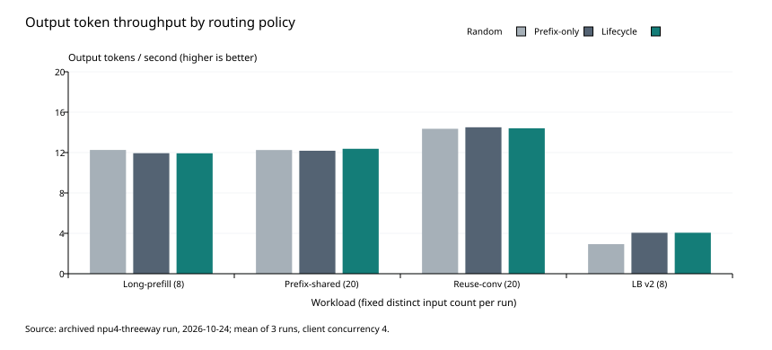
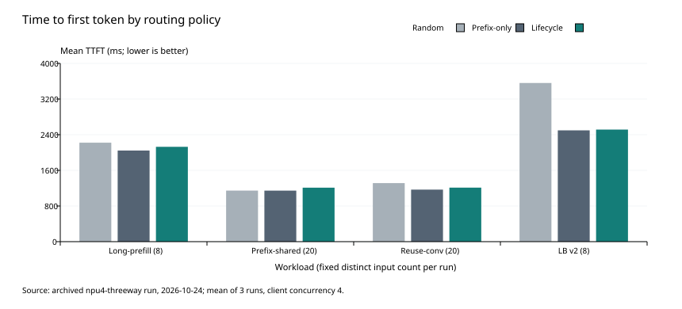

# Qwen3.5-35B-A3B: four-Ascend-NPU, three-policy diagnostic comparison

**Classification: diagnostic fixed-subset experiment using `--enforce-eager`. This is not official
baseline, leaderboard or website-facing evidence. No runtime or algorithm changes are included.**

Requested topology: four TP=2 backends on one eight-card server. Eight-card resources were
unavailable; the permitted fallback uses two independent TP=2 backends on one four-card server. The
eight-card case remains unmeasured.

Read the [Chinese report](REPORT.zh-CN.md), [frozen protocol](protocol.json) and
[audit](audit.json).

## Environment and protocol

- Router revision: `04142b28e4962321c23b0228331745e3297a5378` in
  [vllm-hust-prefix-router](https://github.com/vLLM-HUST/vllm-hust-prefix-router/tree/04142b28e4962321c23b0228331745e3297a5378).
- Four Ascend 910B2 cards, 64GiB each; node0 physical 0/1, node1 physical 2/7. Every backend,
  including node0, is reached through HTTP.
- BF16 Qwen3.5-35B-A3B; vLLM `0.23.0+empty`, vLLM-Ascend `0.23.0.post1`, torch `2.10.0+cpu`,
  torch-npu `2.10.0.post4`.
- TP=2, context 16384, max-num-seqs=4 per backend, max-num-batched-tokens=4096, chunked prefill,
  eager execution, memory fraction 0.85, prefix caching with SHA256, Mamba align mode, 2048-token
  router blocks.
- Closed-loop client concurrency 4. Each policy is repeated three times in rotated order; repetition
  seeds 24001/24002/24003. This is not an offered-RPS or saturation sweep.
- Before each round: idle backends, reset cache, excluded original-data warmups (four requests,
  cap8), new AllBlocksCleared replay evidence from both backends, then a fresh router. Warmup first
  blocks are disjoint from all measured inputs. No reset between the four workload stages of a
  round.
- Same 56 original inputs per round: PAIO long-prefill 8 rows, prefix-shared 20 rows,
  reuse-conversation 20 rows; LongBench v2 8 length-selected full-context questions. No synthetic
  input or context truncation. PAIO row-specific output caps and natural EOS are retained. LongBench
  uses a custom direct-answer template, thinking disabled, cap64; not official full-set evaluation.
- Random forwarding uses the same RouterService/HTTP pools and uniform IID backend selection,
  bypassing fingerprint/scoring/lifecycle; KV subscriptions are retained for common readiness/reset
  checks. It is a benchmark frontend, not a built-in vLLM scheduler. Prefix and Lifecycle use the
  pinned router policies.

Input canonical SHA256: `adcdb992bd58f76b73f96362c69a646dcdad2602c813947c9b9b60fbadad26ca`.
Measurement sampling window: 2026-10-24 12:55:39–15:14:35, UTC+08:00.

## Results

Output tokens/s are arithmetic means of three per-run stage throughputs, calculated from actual
generated token counts. Ranges, TTFT, TPOT and each run's P95 remain in the CSV files. Do not
average run P95s into a claimed pooled P95.

| Fixed workload subset               | Random tok/s | Prefix-only tok/s | Lifecycle tok/s | Lifecycle / Prefix change |
| ----------------------------------- | -----------: | ----------------: | --------------: | ------------------------: |
| PAIO long-prefill                   |       12.259 |            11.937 |          11.927 |                    -0.08% |
| PAIO prefix-shared                  |       12.252 |            12.180 |          12.374 |                    +1.59% |
| PAIO reuse-conv                     |       14.356 |            14.505 |          14.403 |                    -0.70% |
| LongBench v2 (8 selected questions) |        2.929 |             4.056 |           4.059 |                    +0.08% |

- 9/9 rounds, 504/504 measured requests and 504 correlated timing records passed; 36 original-data
  warmups are excluded. There are 56 distinct measured examples, not 504 independent examples.
- 18 new clear-event proofs; no added rejection, fingerprint fallback or terminal accounting
  residue. Archived preemption counter deltas are zero.
- No consistent output-throughput regression is established. Lifecycle PAIO mean TTFT is 3.82–5.79%
  higher than Prefix-only. Small subsets and three repeats do not establish significance.
- Lifecycle choose averages 0.27–0.46ms; its PAIO stream-observer cumulative time is 14.4–23.7ms
  across the full response stream. These wrappers do not measure all CPU/network/queue/backend work
  and cannot attribute the entire TTFT difference.

## Observations and limitations

Prefix-shared has only 18 distinct first 2048-token blocks among 20 requests. Its three-round
hit-token counts are Random 2048/4096/2048, Prefix 2048/2048/4096, Lifecycle 0/2048/2048. All other
selected workload stages have zero observed prefix hits. Dataset reuse labels do not prove
block-level reuse on this model.

Nine Random stages have cache-query counter deltas above unique API input-token totals. Correct
request/admission counts and zero preemption deltas are recorded; the cause of excess lookups
remains unestablished. Preserve the differences in audit.json; do not treat cache lookup counters as
unique input counts.

LongBench v2 answers are not identical across policies/runs: Prefix/Lifecycle each score 3/8 per
round, Random scores 2/8, 3/8, 2/8. One question changes option. This is a small, length-selected,
custom direct-answer subset, not a claim that routing improves reasoning accuracy. Neither full
503-question quality nor the full three 5000-row PAIO datasets were measured.

Candidate optimization work concerns backend queue/first-token attribution, redundant lifecycle
stream-content checks and repeated load scans. No optimization was implemented or retested. Full
eight-card topology and different-load capacity remain unmeasured. Do not promote this eager
diagnostic report into official leaderboard snapshots or treat it as closing the five-benchmark
program in issue #254.

## Files and reproducibility boundary

- `aggregate.csv`, `per-point.csv`, `paired-differences.csv`: derived policy summaries, all 36 stage
  measurements and within-repetition ratios.
- `request-metrics.csv`, `router-timings.csv`: 504 request-level numeric records each, without full
  prompts or generated prose.
- `longbench-answers.csv`: all selected question IDs, gold/predicted options and routes;
  `resource-summary.csv`: discrete physical-card sample summaries.
- `selected-manifest.json`, `protocol.json`, `audit.json`: source IDs, body hashes, budgets,
  protocol, reset/monitor checks and observed limitations.
- `raw-archive-sha256.json`: hashes identifying the 208-file raw archive retained by the
  experimenter. This is not a public download manifest and does not prove remote transfer checksums.
- `checksums.sha256`: hashes of the files submitted in this report directory, excluding the checksum
  file itself.

Original datasets, complete token-ID inputs, raw SSE records, raw reset replay records and
workspace-specific runners are not included. The original archive remains with the experimenter;
this report cannot independently launch or fully reproduce the benchmark. Numeric derivatives
preserve the measured values; no original evidence was edited. No raw datasets, models, tokens, SSH
keys or private endpoints are added.

Data navigation is regenerated in `docs/data-index.json`. This report is stored in the benchmark
repository because prefix-router's organization evidence-custody check rejects benchmark payloads
and measured prose in plugin PRs.

## Publication formatting revision (2026-10-31)

This revision normalizes this directory's publication files to LF line endings, adds the missing
final newline and applies the repository's Markdown formatter. It changes no experimental values,
JSON fields, CSV cells, plot content or raw-archive hash entries. The original submission bytes and
their original checksum inventory remain available at
[commit 73d213e](https://github.com/Adr1anZheng/vllm-hust-benchmark/tree/73d213e436ae5b4d0f8b99edb2ed4d34f714a512/reports/prefix-router-qwen35-tp2-20261024).
The current `checksums.sha256` describes the formatted publication files and supersedes only the
previous publication-file checksum inventory. The retained raw experiment archive is unchanged.
