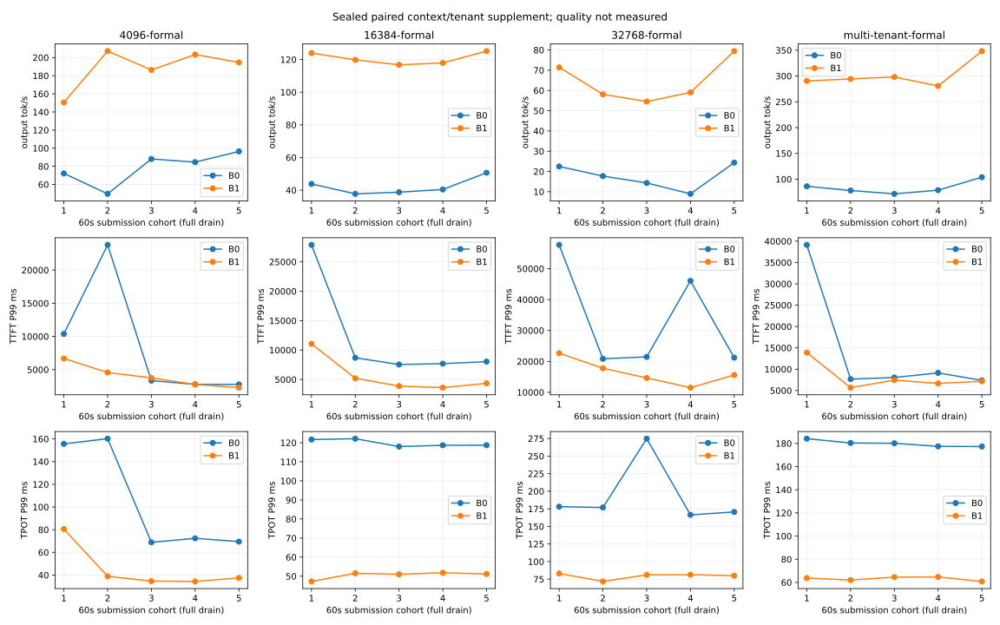

# r8 上下文与四租户配对补测

冻结 r8 与 original018 的四项专项均完成，正式请求零失败。两臂使用 Qwen3.5-35B-A3B、BF16、TP2、两张实测 910B2（物理 1/6）。本报告补充已有固定五项，不重跑原五项推理，不改变冻结运行时。

| 正式工况 | 完成请求 B0 / B1 | 输出吞吐 B0 / B1（token/s） | 吞吐比 | B1 采样利用率 |
| --- | ---: | ---: | ---: | ---: |
| 4K–8K / C8 | 122 / 248 | 101.07 / 209.44 | 2.072× | 64.95% |
| 16K–24K / C8 | 73 / 169 | 59.18 / 140.70 | 2.378× | 85.29% |
| 32K–48K / C8 | 38 / 98 | 30.02 / 82.40 | 2.745× | 94.79% |
| 四租户 / C24 | 157 / 432 | 129.01 / 358.64 | 2.780× | 85.72% |

每阶段先预热 60 秒，再正式提交 300 秒并等待全部请求排空。输出固定 256 token，temperature=0、seed=17、ignore_eos=true。吞吐分母包含排空，TTFT/TPOT 按请求统计。四租户在同费率、同卡数下折算的单位输出 token 成本降低 64.03%。各档 P99 TTFT 和 P99 TPOT 均下降；完整均值、P95/P99、五个提交窗口及各租户分布保留在[机器报告](summary-public-v1.json)，不只报告聚合收益。

输入为预先冻结的五份公开 SWE / Terminal 真实历史：各档使用完整原请求，不裁剪或填充，不按成绩或性能筛选。多个客户端重复这五份历史，不能当作新的独立任务样本。四租户是四个独立客户端队列共享同一引擎与设备，不证明租户安全隔离。本专项不评分任务质量。采样利用率也不等同有效算力；当前有效算力参考认证仍单独进行。

本轮保留原定性的上下文稳定性、高利用率及多租户要求，不事后增加数值门槛，不凭执行完成自动判定四项目标全部达成。原五项结果与旧开发比较的退化记录仍保留各自身份。



[完整原件包](https://github.com/vLLM-HUST/vllm-hust-engine/releases/download/performance-exploration-20261115-r1/r8-context-tenant-pair-20261119-r6-raw.zip)共 54,075,318 字节，SHA256 `650bcfc53532bd29b6a5c38a2549a2a7057f1c7df3b0a62cce98f64a5e4405fe`，上传后下载回验一致。包内保留两臂完整封存清单、原始 SSE、预热、设备采样、配置和权重身份、清理回执、报告及实际执行的 candidate-v12 工具快照。工具是开发源码快照，不能标作正式 Release。

下载并核对上述摘要后可离线复算，不启动模型：

```bash
python reports/r8-context-tenant-20261119/reproduce_publication.py \
  --raw /path/to/r8-context-tenant-pair-20261119-r6-raw.zip \
  --out /path/to/new-context-publication
```

复算入口核对 ZIP 每个成员与两臂完整封存清单，再生成公开指标和原图。配对源汇总 SHA256 为 `7629035f84441dde80293fda25b939072fc052914389e3ccc364bf4620af0308`。正式执行时间为 2026-11-18 UTC；目录日期沿本轮任务标识保留。
