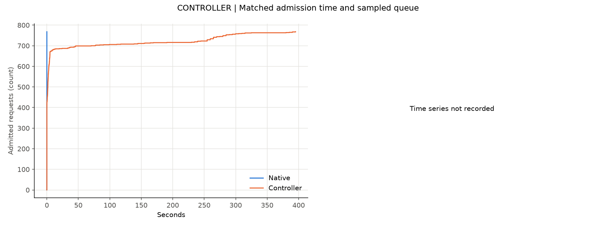
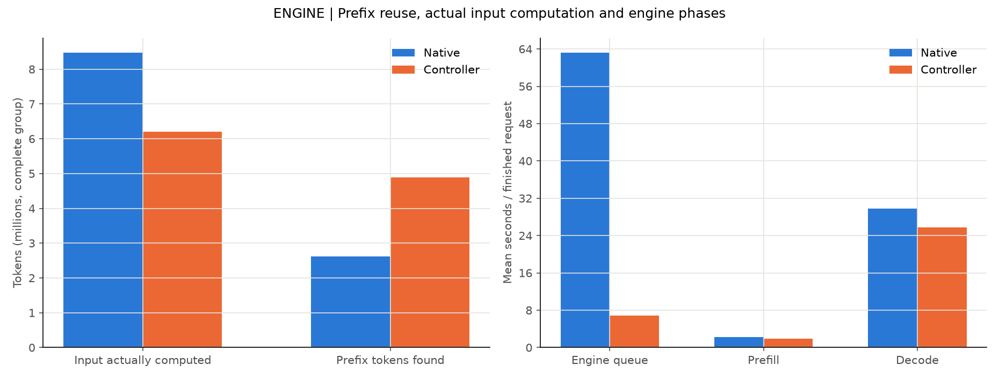
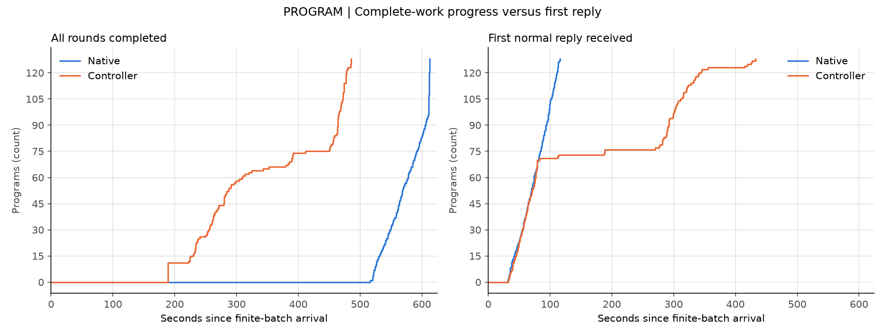
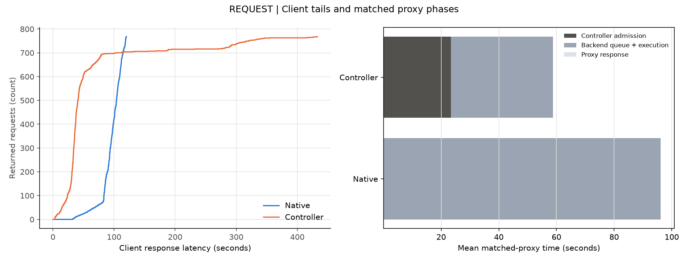

# 完整固定工作对照报告

相同完整固定工作耗时下降20.76%

这是冻结历史的实机回放，不是真实Agent解题完成；一次配对不证明稳定或普遍收益。蓝色为Native，橙色为Controller。

请求链路：会话按依赖发出请求 → Controller准入或等待 → 引擎排队与执行 → 客户端收到回复 → 下一轮。

每组128个会话、各6轮、每次输出64 token；整批同时到达，客户端不设并发上限。
Native：完整会话128，返回768/768，错误0；完整工作耗时612.48秒，客户端p95 117.73秒。
Controller：完整会话128，返回768/768，错误0；完整工作耗时485.33秒，客户端p95 291.26秒。

## 第一层：Controller——等待移到了哪里？

左图按请求关联准入开始和结束，右图为有记录时的待执行会话采样。正常排队不是故障；快照不代表每个调度时刻的原子决策。缺失的时间序列明确保留缺失。

## 第二层：引擎——是否少算了历史？

两组输入和输出一致后，比较实际输入计算量、缓存命中与引擎阶段均值。引擎排队不含全部Controller等待；计数器和直方图是组内增量，不冒充逐请求kernel关联。

## 第三层：会话——完整工作是否更早完成？

左图是完成全部冻结轮次的会话数，是本次性能目标；右图只描述第一次回复。晚拿到首回复不自动算故障。会话开始时间相同，不能从队列中删除晚启动的会话。

## 第四层：请求——平均改善是否伴随长尾代价？

左图保留全部正常返回的客户端延迟，不能用均值掩盖长尾。右图灰色分段表示阶段，只使用成功匹配的同一请求、同一代理时钟；后端时间包含引擎排队、执行与传输，不是纯计算时间。失败与未完成数量另列。

## 证据限制

一次配对回放不能证明稳定或普遍加速。
后端时间包含引擎排队、执行与传输，不是纯kernel时间。
设备和调度器快照不是原子决策，缺失数据不代表零使用。
即使完整工作耗时改善，也必须保留请求排队长尾。

## 重复对照与边界

本结果属于相同128会话×6轮冻结历史、零轮间等待、每请求64输出token的完整工作对照；新生成输出不反馈下一轮，不等于真实Agent解题完成。保留请求长尾恶化，正常排队不作故障。原版调度顺序加1654784/14335静态混合缓存容量适配，无aging、无强制让出、无pause projection；14335不是已证异步物理硬上界。

本轮代理为冷启动EMA，缺完整设备时间序列；不补造观测。

三次各自报告按同一data与reproduction结构保存。远端CI未查询，公开仓pre-commit未运行，不声称通过。公开数据不含原题、答案、历史消息、工具输出或补丁；私有归档SHA见report.json。
