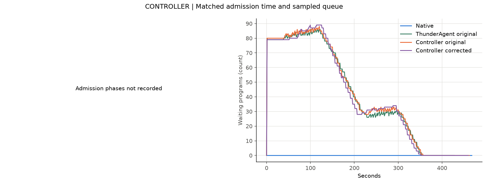
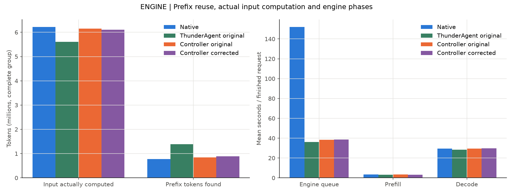
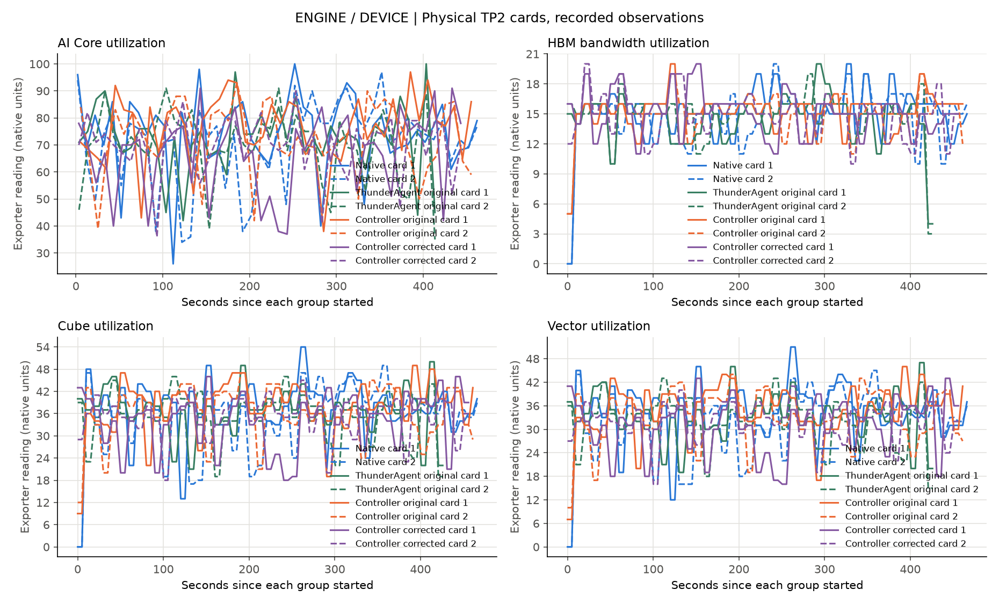
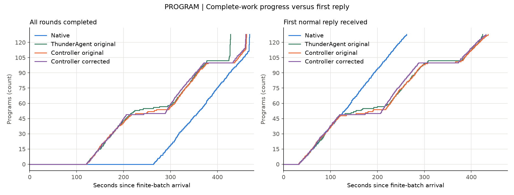
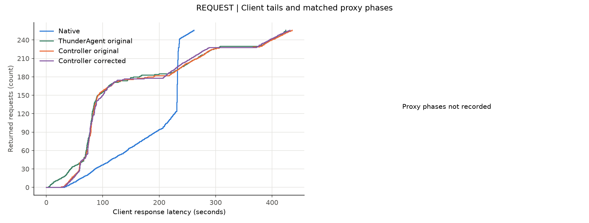

# 完整固定工作对照报告

多组相同完整固定工作已完成，分别核对接入差异与修正效果

这是冻结历史的实机回放，不是真实Agent解题完成；一次配对不证明稳定或普遍收益。各组身份见图例，原版与修正候选分开。

请求链路：会话按依赖发出请求 → Controller准入或等待 → 引擎排队与执行 → 客户端收到回复 → 下一轮。

每组128个会话、各2轮、每次输出64 token；整批同时到达，客户端不设并发上限。
Native：完整会话128，返回256/256，错误0；完整工作耗时468.43秒，客户端p95 236.94秒。
标记/暂停/恢复事件次数：0/0/0；这是所存服务日志内的事件次数，不是独立program数，也不自动等同于测量窗口事件。
ThunderAgent original：完整会话128，返回256/256，错误0；完整工作耗时428.02秒，客户端p95 404.13秒。
标记/暂停/恢复事件次数：98/98/164；这是所存服务日志内的事件次数，不是独立program数，也不自动等同于测量窗口事件。
Controller original：完整会话128，返回256/256，错误0；完整工作耗时461.93秒，客户端p95 405.25秒。
标记/暂停/恢复事件次数：98/98/161；这是所存服务日志内的事件次数，不是独立program数，也不自动等同于测量窗口事件。
Controller corrected：完整会话128，返回256/256，错误0；完整工作耗时460.36秒，客户端p95 400.09秒。
标记/暂停/恢复事件次数：28/28/100；这是所存服务日志内的事件次数，不是独立program数，也不自动等同于测量窗口事件。
Controller original 相对 ThunderAgent original：完整工作耗时增加7.92%。
Controller corrected 相对 Controller original：完整工作耗时下降0.34%。
Controller original 相对 Native：完整工作耗时下降1.39%。
未记录逐请求代理阶段的组保留缺失，不从引擎平均排队推算准入时间。

## 第一层：Controller——等待移到了哪里？

左图按请求关联准入开始和结束，右图为有记录时的待执行会话采样。正常排队不是故障；快照不代表每个调度时刻的原子决策。缺失的时间序列明确保留缺失。

## 第二层：引擎——是否少算了历史？

各组输入和输出一致后，比较实际输入计算量、缓存命中与引擎阶段均值。引擎排队不含全部Controller等待；计数器和直方图是组内增量，不冒充逐请求kernel关联。

## 第二层补充：两张卡的实际设备观测

AI Core使用真实scrape时间去重；其他指标保留查询观测点。单位沿用exporter，不猜换算，不补零。利用率、缓存池占用和总HBM不是同一概念，也不足以单独证明算力或带宽瓶颈。

## 第三层：会话——完整工作是否更早完成？

左图是完成全部冻结轮次的会话数，是本次性能目标；右图只描述第一次回复。晚拿到首回复不自动算故障。会话开始时间相同，不能从队列中删除晚启动的会话。

## 第四层：请求——平均改善是否伴随长尾代价？

左图保留全部正常返回的客户端延迟，不能用均值掩盖长尾。右图灰色分段表示阶段，只使用成功匹配的同一请求、同一代理时钟；后端时间包含引擎排队、执行与传输，不是纯计算时间。失败与未完成数量另列。

## 证据限制

一次配对回放不能证明稳定或普遍加速。
后端时间包含引擎排队、执行与传输，不是纯kernel时间。
设备和调度器快照不是原子决策，缺失数据不代表零使用。
即使完整工作耗时改善，也必须保留请求排队长尾。

## 本次判读与红线

本次单次顺序四组有限工作分别为Native、独立ThunderAgent原版、Controller原版、Controller暂停停止条件修正。原版不启用aging、continuation yield或暂停修正；独立上游直接注册官方HTTP路由，不经产品HTTP包装。共同混合硬件容量1654784/14335、resume7200与HTTP7200参数适配，不能称全默认上游。Native是同传输代理关闭调度，不冒称直连引擎。

修正候选标记98→28，但prefill只减少51200token（约0.83%），完整耗时只改善约0.34%，没有建立明显收益。Controller原版比独立ThunderAgent慢约7.92%；虽然核心来源和CPU HTTP契约一致、未超预注册10%筛查门槛，单次顺序和不同到达/调度交错不能证明完全性能等价，也不能直接归因产品bug。该差异保留为后续接入诊断对象。

四组均0引擎抢占，未复现历史后半程持续高KV/抢占阶段，不能宣称修复真实Agent后半程缓存下降。这是128program各2轮冻结历史、每调用64输出、time0无客户端slot/零工具间隙，新输出不反馈下一冻结输入；不是新Agent解题。两卡与原模型保留，新增四服务已停止。缺逐请求缓存与逐块evict/touch，不伪造缺失阶段。

用户红线：修复SWE-bench Pro实验接入，不得擅改Controller调度算法。此次仅授权单独暂停停止条件候选，不追认此前aging/yield变体，不改写历史结果。

两个干净Python3.11/3.12标准检查均258PASS5SKIP，CLI/buildPASS；skip不算PASS，remoteCI未查，公开precommit未运行。原件单次归档及逐文件SHA通过；一次只读下载中断后恢复，0实验/0collector重提。

软件检查限制：Python3.12初次最终标准检查中，服务启动10秒等待和断开监听0.2秒返回两项失败；不改源码或期限，隔离12项复查通过，随后完整复查结果另存。失败原件保留，偶发原因未确定，不把重验通过写成故障已修复。

## 首个回复之前的准入成员审计

新增只读audit_initial_admission.py从同一已验SHA原件复算：选择全部128program均step1/REASONING的最早快照，并以下一采样时间早于首个客户端返回为采集上界。ThunderAgent原版与Controller原版各48个活跃program，仅29个相同，对称差38个；两组采集界约开始后0.99–2.03秒，首个客户端返回约32.27/32.57秒。初始实际运行集合已经不同，不能将7.92%差异直接解释成后半程暂停或接入实现错误。请求交错、周期相位与HTTP包装路径的各自贡献仍未确定；相同time0输入不是同一有序准入事件。快照非原子，不能由此推出逐块缓存驱逐或已确定唯一根因。

补充仅修改离线审计及本地测试：启动前超时也必须保存UNKNOWN并禁止重提，不能假定子进程已写开始证据；CLI子日志保留后发现回环metrics请求经过系统代理并返回502。pytest只为loopback追加NO_PROXY，不修改产品/主机/远端配置或延长期限，回归同时验证HTTPX与urllib绕过不可用外部代理。完整串行Python3.11/3.12各264PASS5SKIP、CLI/buildPASS；首次失败和中止检查均保留，不计PASS。该路径不解释以前纯ASGI取消监听偶发失败或远端模型性能；remoteCI未查。

## 相同有序事件的CPU语义对照

使用原SHA不变的128program首轮payload，分别按输入顺序和反序，逐个送到原before入口；fixture引擎逐个受控返回，返回后释放并调用原恢复方法。两种顺序各自比较独立官方HTTP与产品HTTP，129个状态快照、完成顺序、转发payload SHA、17来源SHA全部一致，均128正常fixture返回并全部释放。输入顺序准入48个，反序49个，两集合无交集（对称差97）。这证明入口顺序本身足以改变首轮工作集；本条件下未见HTTP包装引入状态语义分叉。

这不是time0性能实验或历史到达重建：不启动周期调度器，固定fixture usage为40prompt+2completion，每次返回即释放；没有真实引擎、工具等待、上下文增长、KV缓存、抢占或模型请求。因此不能量化原7.92%的原因，不证明NPU性能等价或解释历史后半程缓存下降。主性能协议不改，生产代码不改。复现命令从当前源码checkout设置PYTHONPATH=src，运行python -m benchmarks.audit_ordered_http_parity --input <私有归档fixed-inputs-private.json> --input-sha256 45e36ef48d5ad49d116c4a48659c65c5b939135e54a584b6ee54ea0a63fe09d6 --output <新文件>。公开data保留结果摘要/原结果SHA；私有完整轨迹未发布。

软件标准Python3.11/3.12各266PASS5SKIP、CLI/buildPASS；remoteCI未查。未把旧纯ASGI取消监听偶发失败宣称已解决。
