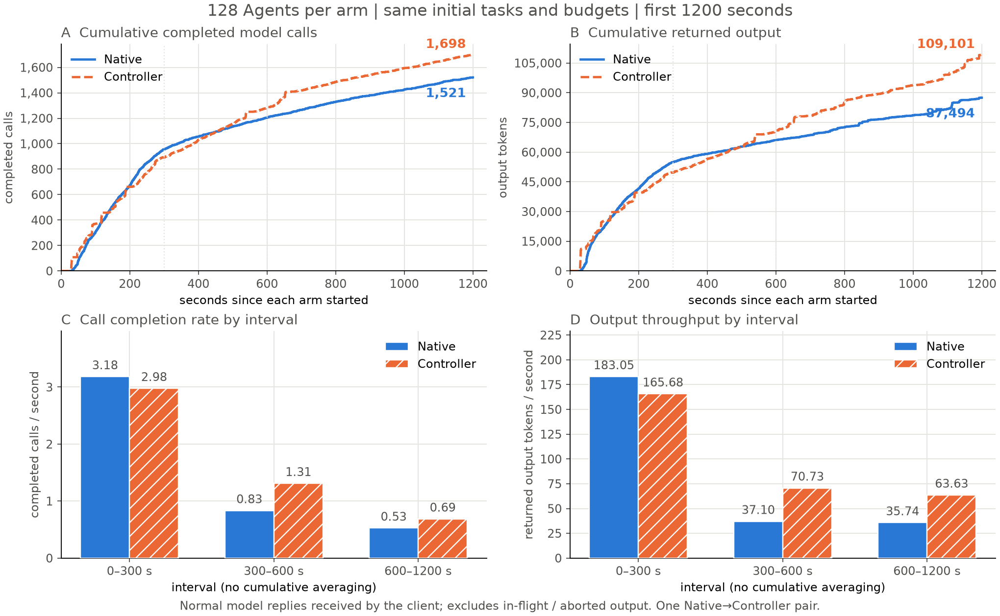
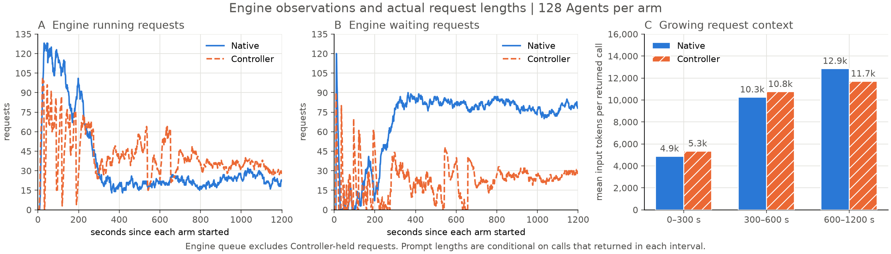

# 128 Agent 同窗口性能对照：1200 秒返回输出吞吐提高 24.7%

本次回到 Native/Controller 引擎性能问题。相同 8 道 SWE-bench Pro V1 NodeBB 初始任务、各 16 个独立副本，两臂各 128 个 Agent 在 time
0 整批到达，客户端无并发上限；各 program 内模型与工具依赖顺序保留。只做一次 Native→Controller 配对。

完整 1200 秒窗口中，Native 完成 1521 次模型调用、返回 87494 输出 tokens；Controller 完成 1698 次、返回 109101 输出
tokens。**本次窗口调用完成量高 11.6%，返回输出吞吐高 24.7%。** 这两个指标不要求 Agent 答对题目。两臂最后均 128 RetryError、0 Submitted；评分
deferred，不记为官方 0 分，也不因此丢弃真实窗口性能数据。

## 相同时间窗口的实际完成量

每格按 Native / Controller 排列。完整调用指客户端已收到正常模型回复；输出量来自回复实际 usage，与独立保存的 trajectory 逐项总数交叉核对。无缺失
usage，无重复 query-return ID，无 JSONL 解析错误。窗口使用每臂最早实际到达的单调时钟对齐；父 batch-start 与其仅相差 2.276 / 1.331 毫秒，独立
epoch 边界计算四个窗口的调用和输出数完全一致。

| 窗口秒 | 完成模型调用 | 返回输出 tokens | 返回输出 tokens/s |
| ------ | ------------ | --------------- | ----------------- |
| 60     | 136 / 189    | 12926 / 15031   | 215.43 / 250.52   |
| 300    | 955 / 893    | 54916 / 49704   | 183.05 / 165.68   |
| 600    | 1205 / 1286  | 66047 / 70923   | 110.08 / 118.20   |
| 1200   | 1521 / 1698  | 87494 / 109101  | 72.91 / 90.92     |

**前 300 秒 Controller 两项低于 Native**，保留该负向结果；不能只选择有利窗口。1200 秒时两臂各有 126 个 program 至少取得一个正常回复、2 个为零；每
program 中位数均 14 次，最大值分别 17/26。整批初始输入相同，生成的后续内容与长度仍会不同，本次完成量差异不能解释成相同逐请求工作量的延迟加速。

## 调度动作与引擎观测

Native 本臂全部增量日志的 Marked/Paused/Resumed 均为 0。Controller 前 1200 秒
Marked=1105，Paused=1086–1087，Resumed=1045–1046；原始日志无逐行时间戳，约 5 秒日志快照只能给出边界范围。这些是事件次数，不能当独立 program
数或相加。含准备与排空的整个 Controller 臂精确增量分别 1105/1087/1046，单独记录，不混成精确窗口值。

两臂窗口实际 KV 峰分别 68.440594% / 62.747525%，引擎抢占均 0。Controller
通过实际暂停/恢复改变准入与同时执行数；较低引擎等待也可能来自等待被移到调度器外，仅此不能证明加速。完成量差异与动作同时出现，但这一对实验不足以独立归因全部差异。

引擎 generation counter 与完整回复输出是两个口径：Native 实际采样区间 1199.653292 秒增加 95321 tokens，79.4571
tokens/s；Controller 1198.922316 秒增加 125712，104.8542 tokens/s。采样起止偏移及计数器增量见
[report.json](report.json)；包含未完整返回的生成工作，不能用它替换上表 1200 秒的客户端返回吞吐。

## 保持的配置与来源

沿用当前 200 步、1200 秒总预算、262144 上下文、4096 最大输出、工具 60 秒；HTTP read=null，其余各 180 秒，下游 900 秒，自动重试
0；temperature=0、seed=0、thinking=false。两臂使用相同任务指令，不因官方答题正确率追加提示或预算。

保留 Qwen3.5-35B-A3B BF16 TP2、Ascend 910B2 两卡、每卡 16 GiB KV、max sequences/图上限 256、batch tokens 4095、APC
与 Mamba align。每臂前后实际两个 worker 的 epoch、有效引擎参数、包与已加载源码一致；没有重启模型。两臂开始前分别排空并重置 prefix cache。固定官方
ThunderAgent 核心经 17 源核对，只以 scheduling_enabled 区分 Native 与 Controller；调度/指标间隔 5 秒、acting weight
1、decay=false。复算实际 256K 模型缓存布局后，沿用账本容量 1654784 / 每 program 缓冲 14335，不用旧代理的 32K 元数据冒充当前引擎长度。

执行入口为维护中的 benchmark runner；源码提交、运行文件与输入 SHA 见 [report.json](report.json)。默认干净仓库检查保持严格；仅显式允许不可变 ARM
镜像原有 Redis 数据路径 `appendonlydir/` 与 `appendonly.aof`。错误 HEAD、tracked 修改或其他额外未跟踪路径仍拒绝。真实 Git 状态测试及相关
26 项通过，pre-commit 通过；未查本次 CI。

## 原件、图表与适用边界

CPU 完整包 35516733 字节、4235 文件，整包和逐文件 SHA256 PASS；哈希见
[report.json](report.json)。保存真实调用事件/轨迹、逐秒引擎观察、官方代理日志增量、实际身份、终态和 256 个独立容器清理回执。模型/NPU
原日志另存独立私有文件，不声称在 CPU 包内。终态引擎 running/waiting/KV 均为 0，模型两卡保留。

- [Native 标准图 PNG](figures/native-window1200/engine_over_time.png) /
  [PDF](figures/native-window1200/engine_over_time.pdf)
- [Controller 标准图 PNG](figures/controller-window1200/engine_over_time.png) /
  [PDF](figures/controller-window1200/engine_over_time.pdf)

两图直接复用原 `plot_swe_bench_pro_engine`→`plot_run.plot_engine` 布局、配色与 10 秒 rate。只绘制各自前 1200 秒的实际样本；KV
轴是混合缓存容量乘占用率的 token 等价估计，不是精确 attention 驻留 tokens。脱敏后的原始窗口指标与来源哈希随图保存；无题目、补丁正文、隐藏测试或私有地址。

首次 r1 在准备期被镜像原有 Redis 未跟踪数据触发 clean-base 拒绝，0 模型请求；失败包 1588056 字节/579 文件已完整保留并验证。修正显式 allowlist
后仅新建一次 r2。辅助只读日志观察器首次语法失败，修复版在 Native 后期与 Controller
全程运行，其额外观测开销未独立标定、两臂启动时刻不对称；主逐秒指标和调用事件始终存在。保留这个限制，不把单对 NC 观察当稳定因果收益证明。

本次完成了真实同窗口性能测量，不以修复正确率为门槛；没有全批 Submitted 完成，也没有完整批次 makespan 加速结论。没有自动再跑 CN、重复批次或预算扫描。

## 完成量在哪里看，后半程为什么慢

上排累计曲线直接来自每个真实 `agent_query_return` 的单调时间戳与 usage；下排对 0–300、300–600、600–1200
秒分别计算增量/区间长度，没有把累计平均值冒充后半程速率。Native 的分段输出吞吐为 183.05→37.10→35.74 Token/s；Controller 为
165.68→70.73→63.63 Token/s。两组后程都慢，Controller 降幅较小；前300秒仍是Native较好。

这张图把吞吐变化与机制观测放在一起。300–600秒，Native引擎平均运行19.64、等待83.14个请求；Controller平均运行39.61、等待22.64。600–1200秒则是22.69/79.21与36.17/24.03。Controller在最后600秒平均还有66.53个program处于paused，不能仅凭引擎等待数减少就宣称总排队缩短。它实际改变了准入，使此阶段留在引擎的运行请求更多，客户端完成量也更高；这是观察到的机制关联，尚非唯一因果证明。

真实返回调用的平均输入长度随阶段增长：Native4877→10252→12855
tokens，Controller5341→10753→11701。前缀缓存命中比例（各阶段计数器增量）Native66.64%→41.97%→31.05%，Controller67.95%→63.49%→42.99%；精确值见diagnosis.json。未命中的lookup
tokens速率两组均约4.7k–5.6k/s。这支持“后续上下文更长、复用下降、重复输入处理与排队加重”的解释，而不支持笼统称KV满、抢占或硬件停止工作。命中指标不是FLOPs/内核耗时的直接测量，精确瓶颈尚不能唯一归因。

按128个Agent各1200秒总时间核算，Native99.86%、Controller99.85%的时间位于模型query调用内，包含代理准入/暂停、引擎队列、计算、传输等；工具执行只占约0.14%/0.15%。因此本轮主要不是项目测试或工具执行拖住；query内部尚缺逐请求分段时间，不能把整段直接叫模型计算时间。具体精确占比由diagnosis.json给出，正文两位小数为近似。

完整窗口返回输出均值为57.524/64.253
tokens/调用；24.7%的输出总量优势同时包含11.6%的完成调用增加和约11.7%的平均回复变长。不能把24.7%直接解释为相同请求内容的调度加速。Controller也不是所有program都更快：前60秒零回复program数27对Native10，前300秒23对Native2；已返回调用中的最长等待Controller908.15秒、Native683.79秒。该最大值仅覆盖已返回调用，剩余调用在1200秒被截断，不能据此给全体请求延迟或公平性保证。

下一步性能问题已经具体化为：后续长上下文阶段，准入是否改善前缀复用及有效运行批量、带来多少完成量，又是否以拖长部分program等待为代价。现有单对NC能显示现象，不能独立消除轨迹内容差异、运行顺序和辅助观察开销的影响。后续对照应保持预算，先补请求进入代理、实际转发、引擎完成、返回客户端的分段关联，再用同输入反向顺序验证；这里没有自动启动新批次。

图表：[完成量 SVG](figures/comparison/completed-work-comparison.svg) ·
[机制 SVG](figures/comparison/engine-and-context-comparison.svg)；完整派生数据：[comparison-data.json](figures/comparison/comparison-data.json)、[diagnosis.json](diagnosis.json)。

## Controller内部行为审计

[内部行为、指标缺口和约2倍预期差距](controller-internals-analysis.md)：新增实际ACTIVE/PAUSED、容量账本、future/shared和动作图，保留未解释的因果边界。
