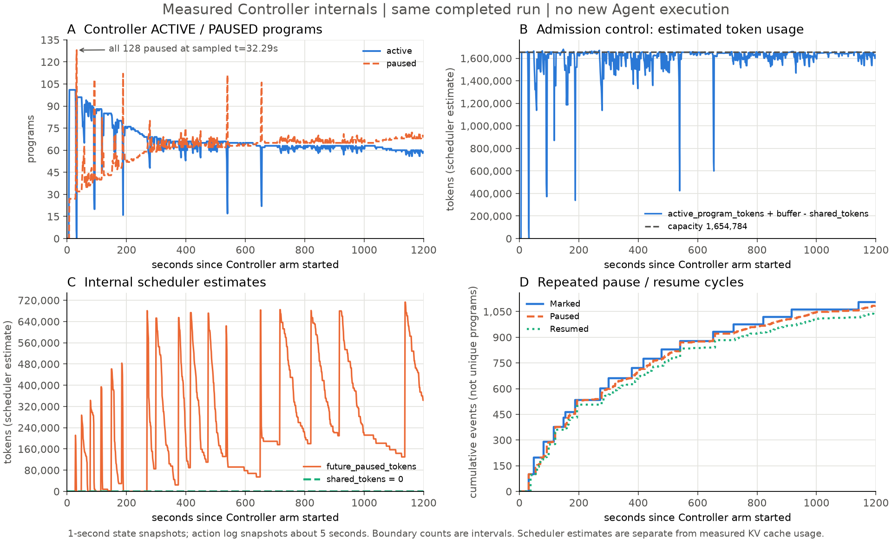

# Controller内部行为与约2倍预期的差距

本轮尚未复现约2倍性能提升。完整窗口调用完成量比值为1.116，返回输出比值为1.247，不能把后者当相同逐请求工作量的调度加速。此前仅展示事件总量和引擎图，不足以解释决策；本次从相同已归档原件补出内部审计，0新增Agent/模型请求。

## 固定源码身份与pause语义

本地官方ThunderAgent的17个文件逐SHA与本轮实际加载清单一致，固定提交7ddc8610270e56d3b109eed8796b3a4360fc67c9。以下发现属于该固定上游执行路径和本轮容量适配，不能说成自行重写策略导致。

pause是program级准入控制，不是引擎中途抢占或立即释放物理KV。ACTING可直接暂停；REASONING先marked，当前回复结束时update_program_after_request立即转ACTING并落实暂停，后续请求等waiting_event。resume重新登记backend并set事件。此前“必须等下一次请求到来才实际pause”的描述不准确，以源码after-response回调为准。引擎preemptions=0与代理pause>0并不矛盾。

Controller整个臂（含准备/排空）Marked1105/Paused1087/Resumed1046；窗口边界分别1105、1086–1087、1045–1046。全臂有128个program被标记、127个有Paused日志、127个有Resumed日志；最大单program16次pause、15次resume。初始新program直接入队也算PAUSED状态，但不一定出现Paused日志，因此不能把全128暂停状态与127个Paused日志误认为矛盾。恢复组日志全臂reasoning1014/new29/acting3，动作绝大部分围绕已有待推理program，而非长工具调用。

## 发现一：轻微超过容量估计触发整组标记

约26.14秒真实快照：active101，paused27，active_program_tokens208232，capacity1654784，buffer_per_program14335。按官方remaining_capacity公式，1654784-(208232+101\*14335)=-1283。随后原日志一次Scheduler
paused/marked101programs；约32.29秒快照active0/paused128。此处数据来自相邻不同采样点，不能冒充同一原子决策快照或逐行精确发生时刻。

源码_pause_until_safe循环条件为remaining_capacity\<0。mark只增加future_paused_tokens，不改变仍登记的active_program_tokens或active_count；remaining_capacity又没有扣除future_paused_tokens，因此仅标记并不能让循环条件转正，循环会继续标记其余REASONING，直至没有候选。实际全臂最大一批101，其后出现96/92/88等批次。已有标记不能重复标记的过滤仍生效，不是同一次循环无限标记同一个program。

这是集中暂停的具体源码解释，需优先进行受控语义修复/消融验证；目前不能定量声称它损失多少吞吐或修复后必达2倍。

## 发现二：共享缓存抵扣未接入该调度路径

两臂逐秒scheduler-diagnostics的shared_tokens全程0。官方BackendState.update_shared_tokens确实定义了按reasoning_program_tokens与物理占用等价值计算抵扣的方法，但固定路由的调度路径没有调用；backend.fetch_metrics也只更新metrics_client。引擎prefix
cache命中确有发生，它与容量估计shared_tokens是不同指标。不能把容量估计0解释成没有prefix
cache复用；也不能未经混合缓存验证直接启用抵扣，避免把Mamba/Attention驻留估计混成物理精确值。

## 发现三：每program预留本身足以迫使128批次限准入

128\*14335=1834880，大于配置容量1654784，尚未计任何上下文token。当前buffer是混合缓存布局推导的保守上界，代价是只要128都登记即必然超容量估计。Native首次剩余容量估计为负快照active128、active
tokens274368，对应remaining=-454464，符合该公式。Controller因此围绕容量估计上限反复限制准入，而实际引擎KV峰62.75%，Native68.44%。

这不证明应任意缩小buffer，也不证明物理KV低就一定没有缓存压力；要核对实际每program Mamba块驻留、Attention舍入与上界余量。不能缩容量/调预留以追求预设正收益。

## 哪些重要metrics之前没有暴露

| 指标                                                                                   | 上游位置/接口                                       | 本轮实际状态                                                                           |
| -------------------------------------------------------------------------------------- | --------------------------------------------------- | -------------------------------------------------------------------------------------- |
| remaining_capacity、active_program_tokens、shared_tokens、future_paused_tokens         | 自有只读/scheduler-diagnostics                      | 已连续采集，之前未画；本次已补图                                                       |
| global_waiting_queue长度、ACTIVE/PAUSED、reasoning/acting、每program token与step_count | /programs、diagnostics、/health                     | 已采集状态及队列，但此前只展示少量平均值；队列等待年龄未采                             |
| reasoning/acting token分项、buffer、capacity_overflow、active_program_tokens_ratio     | 上游JSON /metrics                                   | 原生可提供，未做完整连续采样；部分可从program快照近似重建，跨接口非原子                |
| marked_for_pause每program、paused_at、origin_backend、等待候选顺序                     | Program/PausedInfo内部字段；/health有部分marked聚合 | /programs未输出marked；diagnostics队列未输出paused_at/排序/来源。仅日志能追部分标记    |
| 每轮调度的before/after容量估计、选中/跳过候选及理由、执行耗时、指标数据年龄            | 内部决策过程                                        | 未结构化记录；不能回填成原子决策轨迹                                                   |
| pause_time、prefill_time、decode_time、cached_tokens及step_profiles.csv                | /profiles与ProfileState                             | 本轮profile_enabled=false，没有记录，不能补造                                          |
| request到达代理→放行→引擎排队/首Token→结束→客户端收到                                  | 跨层request关联                                     | 客户端query与tool时间已记录；代理逐请求分段没有打开。非流式不能从首尾回执恢复TTFT/TPOT |
| 公平性：每program暂停总时长、最长连续等待、切换次数/千次完成调用                       | 部分可由状态/动作导出                               | 次数可复算，精确等待缺时间戳；右删失和初始入队必须分开                                 |

上游/metrics是JSON诊断API，不是自动接入Prometheus的Controller指标。当前Grafana主要展示引擎，不能把它当作Controller完整观测面板。上游profile中的prefill_time从放行到首token，也包含引擎排队；非流式转发不触发逐token回调，即使启用profile也不能把默认0当真实prefill/decode耗时。

## 与官方约2倍结果如何对齐

Together官方单节点实例：SGLang+HiCache、8×H100、batch192，吞吐390→803token/s；还有多节点路由收益。本轮一个TP2后端、Qwen3.5混合缓存、两Ascend卡，工具时间极短，没有多个独立backend供迁移，也没有比较工具环境预创建收益。约2倍是该负载上的实测，不是每种部署的理论保证；这些差异不能掩盖上述具体实现/观测问题。

原论文：https://arxiv.org/html/2602.13692v1 ，Together实例：https://www.together.ai/blog/thunderagent
。本轮acting_weight1/decayfalse，工具时间约0.1秒，与长工具等待优化条件亦不同；不擅改冻结参数。

优先顺序应是：把原生统计和逐决策事件接入统一时间线；以实际样本审查mark的未来释放核算及共享抵扣路径；校准混合缓存预留的保守性；然后只改变一个因素做相同预算的受控对照。没有自动热改上游、启用profile、重启模型、调整buffer或追加批次。现阶段既不能归结“硬件不同所以只有25%”，也不能承诺补两行就达到2倍。

额外单位与估计误差缺口：上游`context_len`实际是整个JSON
payload的字符数，并非Token；request前用全局`char_to_token_ratio`估计`total_tokens`，回复后才以usage回写。这个比例及逐请求估计误差没有导出。`reasoning`还包含等待准入和引擎排队，不能当GPU正在运行；`acting`是代理收到回复后的状态，不等同客户端已收到或工具已开始。

## 术语与观测层级

原图使用的“accounting tokens”不是通用性能指标，已删除。主性能报告按标准指标区分：客户端request throughput、output token
throughput、end-to-end latency；Controller admission control、queue length、active/paused program
count、pause duration；引擎running/waiting requests、KV cache usage、prefix cache hit
rate、preemptions；设备NPU utilization、HBM
usage。内部字段active_program_tokens/shared_tokens/future_paused_tokens保留原始源码名，仅作调度器估计，不冒充实测KV cache
usage。TTFT/TPOT本轮没有逐请求观测，不能由非流式首尾时间补造。
