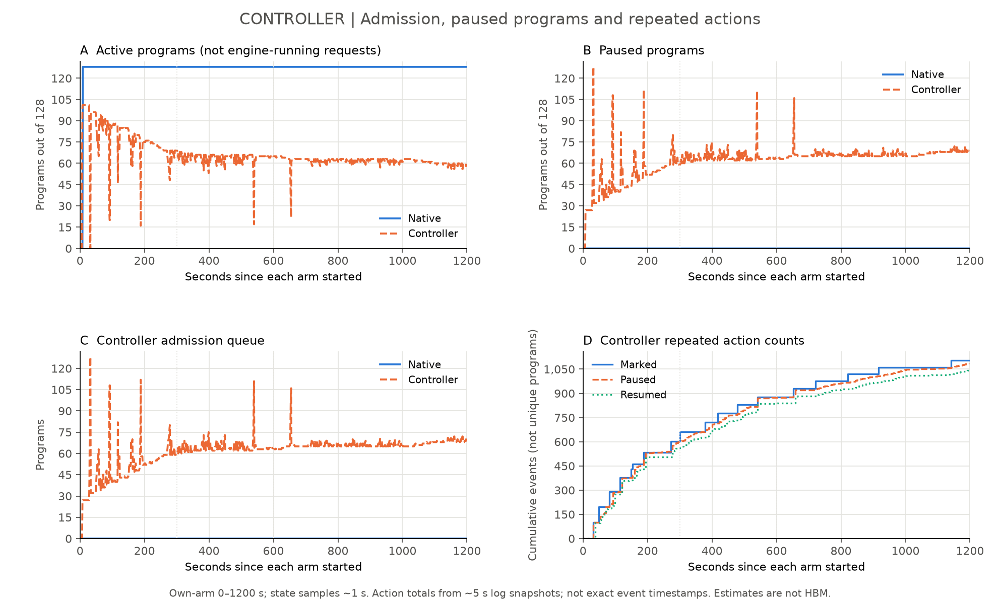
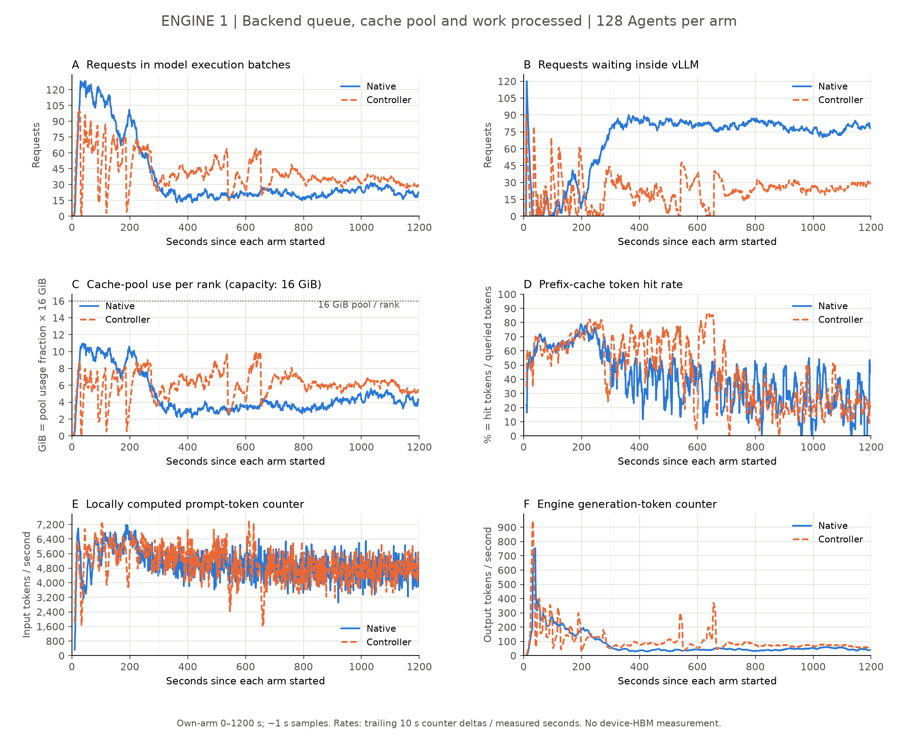
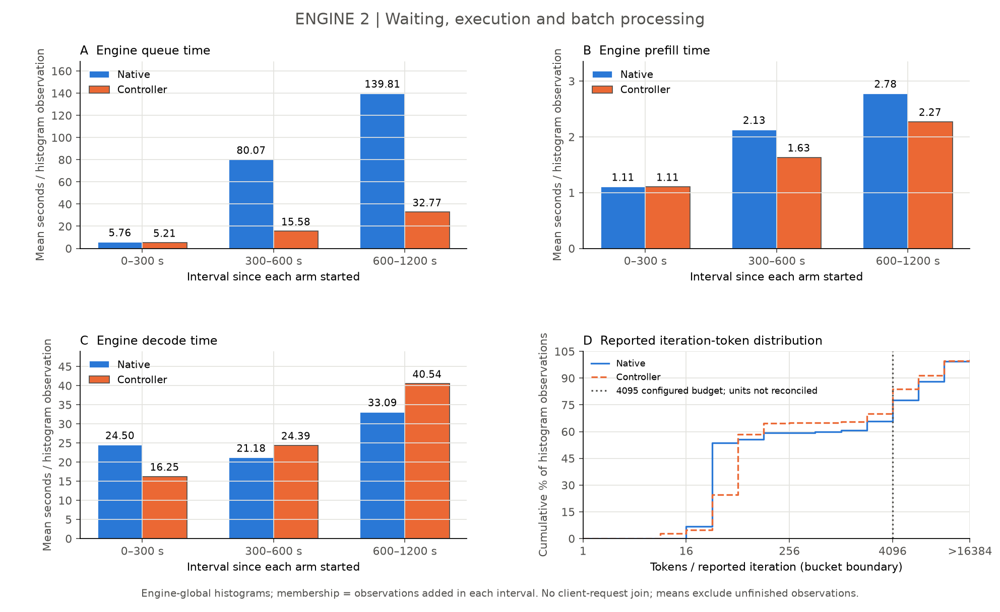
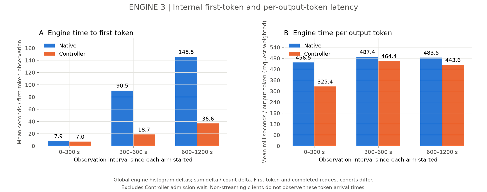
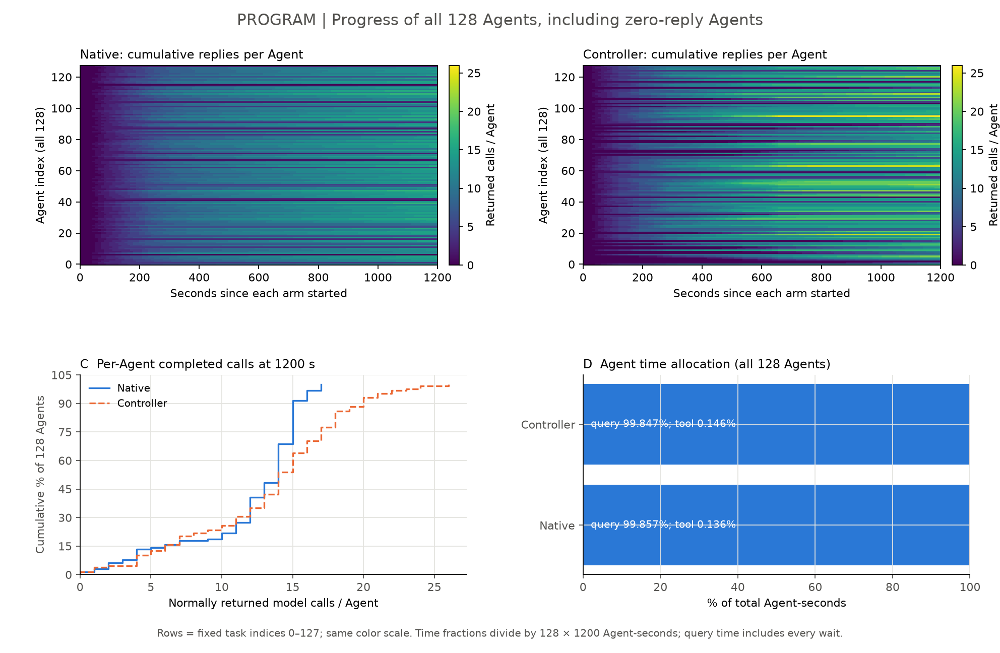
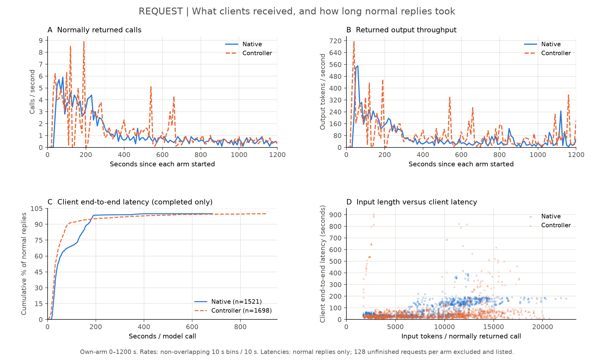
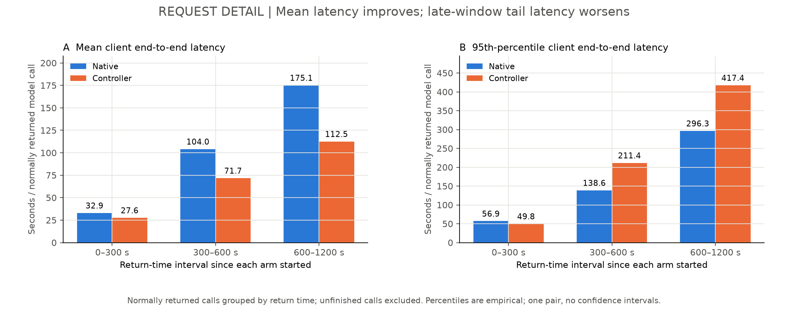

# 128 Agent 性能对照：四层图与瓶颈分析

## 总结

本轮最明显的问题发生在后半程的模型调用路径：Native 的引擎排队显著增长，而非工具执行占住时间。Controller
限制准入后，引擎内排队更短、后半程执行中的请求更多，窗口正常返回调用与输出更多；但一部分等待被移到 Controller，部分请求长尾更差。现在不能宣布 vLLM
达到硬件性能极限，也不能把单次观测当稳定的调度因果收益。

本报告只重新计算已归档数据，未启动任何 Agent、推理、模型或 collector。图导出为 PNG 和 SVG，数值见
[summary.csv](figures/four-layers/summary.csv) 与 [data.json](figures/four-layers/data.json)。

## 实验与统计口径

- 每组 128 个独立 Agent，8 道任务各 16 副本，全部 time0 到达，无客户端并发限制，保留每个 Agent 内部模型调用和工具依赖。
- 同一 TP2 两卡引擎，Native 关闭代理调度，Controller 开启。预算相同：200 步、1200 秒、262144 上下文、4096 输出上限。只有一次
  Native→Controller 顺序对照，无重复置信区间。
- 横轴分别对齐各组最早实际 Agent 到达。Native 从 2026-10-21 08:53:57.739 CST 起；Controller 从 09:15:31.658 CST 起。所有图限定
  0≤t\<1200 秒；热图最后一列仅表示窗口最终累计值。
- 状态约每秒采样；引擎速率使用向后 10 秒的计数器差除以实际秒数；客户端速率使用不重叠 10 秒区间计数除以 10 秒。两种分母在图注分别标明。
- 分段为 0–300、300–600、600–1200
  秒。引擎计数器每段使用段内首末采样的差，全窗口实际覆盖1199.653/1198.922秒；不把采样空隙补造成精确1200秒。状态平均以相邻样本持续时间加权，边界外不外推。
- 引擎直方图均值 = 段末 sum减段初 sum / 段末 count减段初 count，样本按统计进入区间计入，不是按请求发起时间分组，也不包含所有未完成请求。不同指标的直方图观察数可能不同。
- 客户端延迟 = 发起到正常返回，包含代理等待、引擎等待、计算和传输；按返回时间分组。各组窗口末仍有128个调用未返回，延迟分布不包含它们，不能当全体请求延迟保证。
- 蓝色实线 Native，橙色虚线 Controller；柱图沿用相同配色。热图颜色单独表示每个Agent累计返回数，两组使用相同色标。

## 1. Controller：改变了准入，也引入了外部等待

A 是登记为 active 的 program，不等于引擎正在执行的 request；B 为 paused；C 为 Controller 队列；D
是重复调度动作。最后600秒平均约66.43个program暂停，因此不能只看引擎等待减少就宣布总等待减少。动作日志每约5秒收集一次，无法把采样时间当精确发生时刻；图中窗口动作次数在之前已披露的边界范围内。

此前源码与日志核对发现，mark一个尚在推理的program没有立即改变_pause_until_safe循环使用的remaining_capacity，可能继续集中标记其他program。这解释了原日志的大批量标记现象；本报告没有修改策略，也没有量化此问题造成的吞吐损失。暂停状态不是GPU/NPU中途抢占，不能等同释放物理缓存。

## 2. Engine：排队增长，而不是缓存池耗尽；硬件饱和尚缺证据

先看A/B：Native在约300秒后执行批次内请求显著减少、等待增加。再看E/F：两组本地计算输入token的计数速率接近，但Controller后半程生成输出更多。C
是缓存池使用率乘以每rank配置的16GiB，表示池内使用量的等价换算，包含Attention/Mamba混合缓存，**不是整张卡总HBM占用**；峰值约10.95/10.04GiB。没有把两张卡简单相加成为一个可互换的缓存池。D
的分母为10秒内查询的prefix tokens，不是request数，也不是当前缓存块数。

后半程（600–1200秒）时间加权平均：

| 指标                                 |    Native | Controller | 解释                                                |
| ------------------------------------ | --------: | ---------: | --------------------------------------------------- |
| 引擎执行批次中的request              |     22.69 |      36.18 | 是后端观测，不是客户端限并发                        |
| 引擎内等待request                    |     79.22 |      24.03 | 不含Controller外部暂停                              |
| 缓存池平均使用，GiB/rank             | 3.96 / 16 |  6.25 / 16 | 后半程Controller反而占用更多，不能只比较全程峰值    |
| 已进入直方图的请求平均queue time，秒 |    139.81 |      32.77 | 引擎内等待，是本轮最明显差异                        |
| 平均prefill time，秒                 |      2.78 |       2.27 | 调度到首输出的prefill阶段耗时，不是纯设备kernel时间 |
| 平均decode time，秒                  |     33.09 |      40.54 | Controller并未改善所有执行阶段                      |
| 本地计算输入计数速率，tokens/s       |   4741.98 |    4753.45 | 相差约0.24%，不能说硬件计算能力提高了25%            |
| 引擎生成输出计数速率，tokens/s       |     44.89 |      79.17 | 含未完整返回客户端的工作；不是客户端交付吞吐        |

全窗口引擎平均queue
time为45.40/14.25秒，prefill为1.62/1.51秒，decode为25.70/23.99秒。引擎全局完成数与客户端返回数仍差27/28，未逐请求核销，因此这些全局统计只说明引擎层的相关现象，不能逐个归属于客户端正常返回集合。

补齐原始引擎直方图的TTFT（time to first token，首token时间）和TPOT（time per output
token，每输出token时间）。最后600秒，引擎TTFT均值145.53/36.61秒，而每请求加权TPOT均值483.50/443.65毫秒，后者下降约8.2%，远小于首token等待的变化。图采用各自直方图sum/count增量，TTFT观察数与已完成请求数不同；不包含Controller准入等待，也不是非流式客户端可见的逐token到达时间。它进一步支持差异主要体现在引擎等待，而不能证明kernel计算速度提高相同比例。

### vLLM卡在哪里：结论的强弱

1. **直接观察：长上下文阶段有明显的引擎排队压力。** 最后600秒Native平均约79个请求等待，queue
   time增至139.81秒；实际waiting_by_reason中的capacity有记录、deferred为0。capacity是引擎容量等待分类，不能仅凭这个标签细分成KV不足、调度token预算或设备算力不足。
1. **直接观察：本轮不是缓存池持续满且引擎抢占的情形。**
   全窗口缓存使用峰值低于70%、两组preemption增量0；后半程池平均使用约3.96/6.25GiB。低池使用率不等于设备空闲，也不能排除可回收prefix块的驱逐。
1. **有数据支持的解释：Controller改变准入和缓存复用，让近似的本地输入处理量支撑了更多输出。** 全窗口本地计算输入计数约6.006M/6.052M
   tokens，差约0.8%；命中本地缓存的输入计数约5.704M/8.372M，生成输出95,321/125,712。结合后半程active/running/paused曲线，符合准入改变了请求组合和复用的解释。但生成轨迹不同，不能单独把差异归为Controller唯一因果效果。
1. **还不能确定：两张NPU算力、HBM带宽或4095调度token预算是否饱和。**
   连续设备利用率/带宽/实际每轮执行token数缺失。原生iteration_tokens_total直方图已画出，但观察到22.25%/16.19%的观察值落在>4096桶，而配置预算4095；统计聚合单位与真实scheduler
   step尚未核对，不能把该分布直接解释成调度预算使用率。最右点表示>16384桶，不伪造精确取值。FLOPs/read/write估计计数器两组增量均0，不能用0推断硬件空闲。

## 3. Program：收益并不均匀，工具不是主要耗时

上排每一行是同一编号的独立Agent，颜色为截至该时刻正常返回的模型调用数；同一色标允许比较。下排左侧显示1200秒每Agent返回数的分布，右侧按128×1200
Agent秒计算时间占比。模型调用内时间约99.86%/99.85%，工具约0.136%/0.146%。模型调用包含所有等待，不能把99.8%写成设备计算利用率。

两组各有2个Agent始终没有正常回复。Controller部分Agent达到更多轮次，不能由总完成量推出每个Agent都更快。图保留所有128行，不删除零回复或低进展Agent。

## 4. Request：平均延迟改善，长尾没有同步改善

| 正常返回调用的客户端指标   | Native | Controller |
| -------------------------- | -----: | ---------: |
| 1200秒内返回调用数         |   1521 |       1698 |
| 返回输出tokens/s           |  72.91 |      90.92 |
| 平均端到端延迟，秒         |  74.13 |      58.40 |
| p95端到端延迟，秒          | 182.05 |     187.17 |
| 最后600秒返回调用的p95，秒 | 296.30 |     417.37 |
| 1200秒末仍未返回调用数     |    128 |        128 |

p95表示该正常返回集合中95%的调用延迟不超过此值，不是全体请求的保证。Controller均值较好，但尾部没有改善，后半程p95更差；这与“把部分等待移到Controller、不同Agent进展不均匀”的现象一致，尚缺逐请求暂停关联来证明因果。既不能只展示好看的均值，也不能把更长的输出回复当等工作量加速。

## 数据缺口与影响

| 缺什么                                                | 不能回答什么                             | 当前可用替代及其限制                                  |
| ----------------------------------------------------- | ---------------------------------------- | ----------------------------------------------------- |
| 两张卡连续NPU计算利用率、总HBM已用GiB、HBM带宽        | 算力/带宽/总显存是否到极限               | 缓存池及engine队列不能替代设备负载                    |
| 实际scheduler每轮tokens、轮次耗时、kernel/通信profile | 4095预算、计算、访存、TP通信哪个限制执行 | iteration直方图口径未核对；FLOPs/bytes计数器为0不可用 |
| client→proxy→engine逐请求映射                         | 27/28完成差异、每个请求等待发生在哪层    | 客户端注入ID存在，但本轮代理DELIVERY_TRACE为0         |
| 精确pause/resume时间及决策前后原子记录                | 单Agent暂停时长及集中暂停的吞吐损失      | 状态约1秒、动作日志约5秒，只能提供采样范围            |
| 反向顺序重复对照与一致辅助采集                        | 稳定收益、波动及顺序影响                 | 只保留本轮观察，不补造置信区间                        |

当前最有力的结论是：**Controller改变了准入，减少引擎内部排队，并在近似本地输入处理量下获得更多窗口输出；代价是外部暂停和更差的部分长尾。硬件是否饱和、机制净收益和唯一瓶颈仍未证实。**
未改预算、未改策略、未重启或重跑。

## 复算与核对

- 图表全部由原归档的逐秒指标、program状态、动作采样与客户端事件重算。
- 正常返回数/输出总量断言为1521/87494和1698/109101；每段prompt total等于local compute加local cache
  hit；直方图+Inf增量等于count增量，且桶增量非负。
- 数据文件包含分段原始sum/count/bucket增量及采样起止，分位数桶范围不冒充精确分位数；客户端p95用逐调用原始时间算出。
- [输入记录SHA清单](figures/four-layers/source-sha256.json)保留重算来源；原件不改写。[已有逐请求核对](verification/README.md)中的计量差异仍保留。
