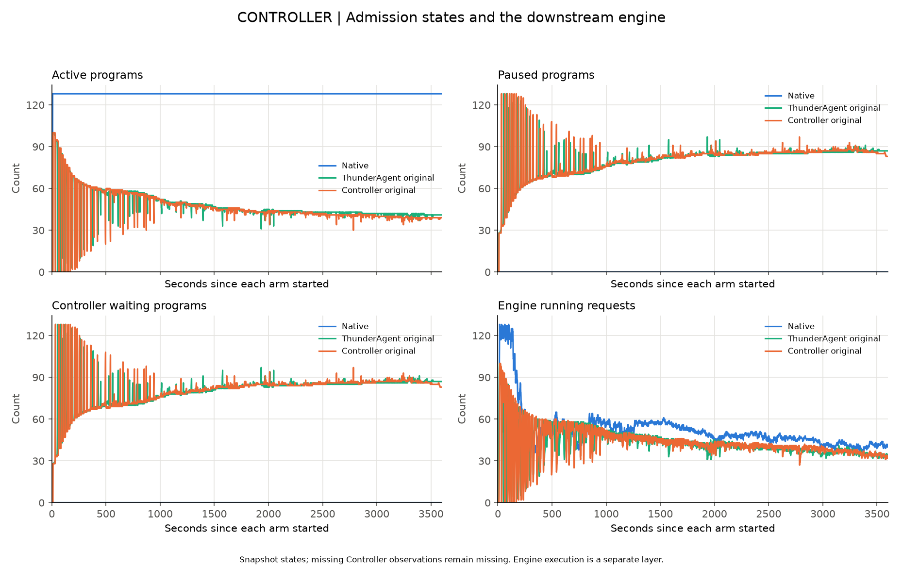
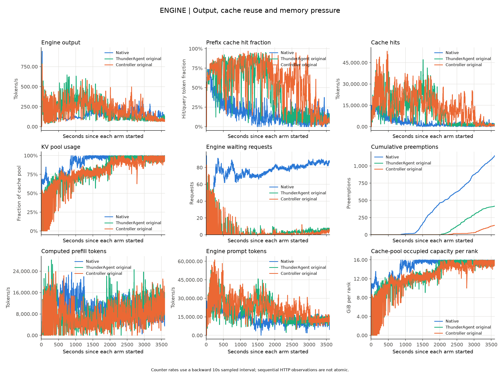
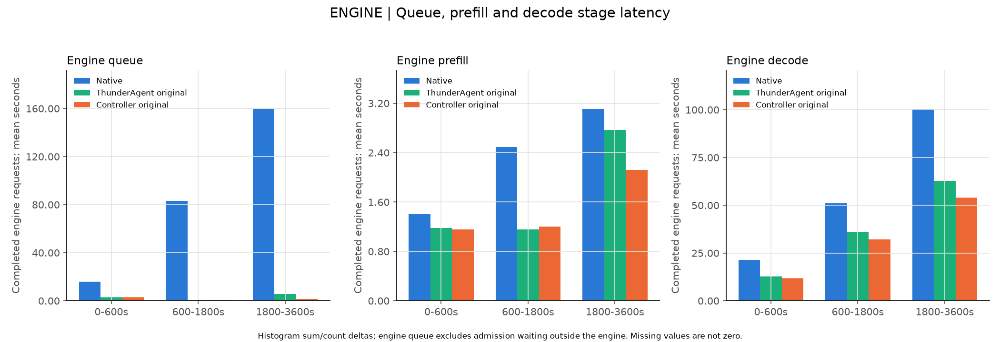
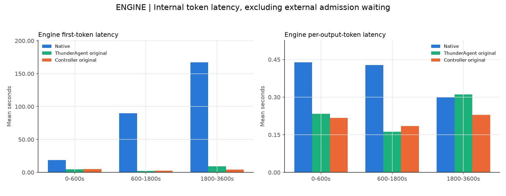
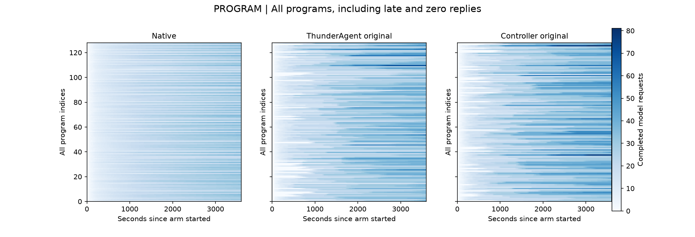
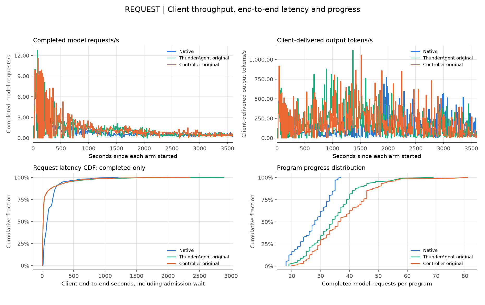
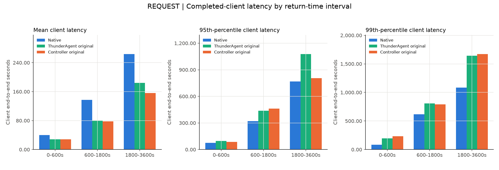
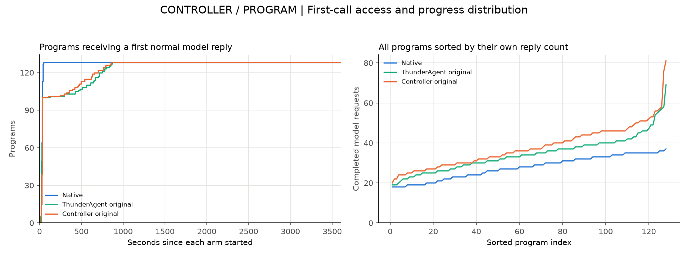
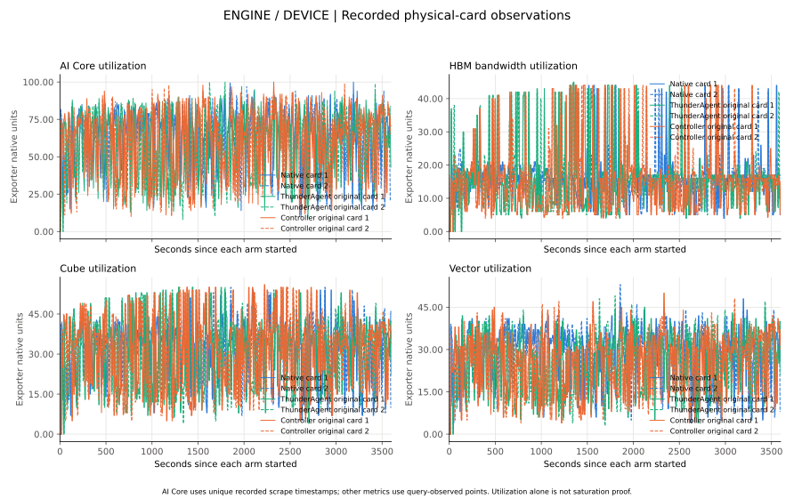

# 真实 SWE-bench Pro：三组一小时系统性能

每组128个独立真实Agent（8题×16副本），整批同时到达，无客户端并发上限；每组测量3600秒。Controller原版引擎输出 **213.32 token/s**，相对Native
**+40.85%**，相对独立ThunderAgent原版 **+7.86%**。这是单轮同协议窗口系统性能，不是完整批次耗时或稳定因果收益。

端到端平均请求延迟Native/ThunderAgent/Controller为 **122.81/82.80/77.10秒**；Controller全小时P95/P99为
**411.27/963.34秒**，高于Native的
**335.63/821.55秒**，该负向结果保留。相对ThunderAgent，Controller全小时P95/P99较低，但30–60分钟P99反而较高；不宣称所有长尾改善。

后半小时缓存命中率Native/ThunderAgent/Controller为11.81%/24.60%/48.41%，抢占800/416/137。三组均有后半程下降，Controller本轮下降较小；仍不能从相似曲线唯一归罪原算法或Controller接入。

引擎输出和客户端交付是不同计量。客户端正常返回请求速率Native/ThunderAgent/Controller为0.988/1.226/1.346
request/s；交付输出为144.79/191.68/207.12 token/s。只统计窗口内正常返回的延迟，未返回单列，不补零。

完整原包6293文件、135311624字节，整包及每成员SHA校验PASS；SHA256
`8ff9d23d03996e4eedb620e2cfdc014615c400a3be1d889d129dc9b35b85e253`。图和数字来自报告源02d7099，计数器使用窗口内实际首末采样，因此与先前边界前采样的初步数值有小差异；原初步证据保留。

原TA收尾180秒排空检查FAILED单列保留，后续独立确认排空才启动Controller；不混入一小时测量或抹去失败。Native和Controller原Ray终态SUCCEEDED。原模型与两卡保留，三组新增代理已精确停止。

# 真实 SWE-bench Pro 三组系统性能

真实SWE-bench Pro中，Native、独立ThunderAgent原版、Controller原版的系统性能如何，后半程缓存变化来自哪里？

各组 3600 秒、每组 128 个真实 Agent program；整批 time0、无客户端 slots。 系统性能独立于解答提交数及质量评分。以下为同预算窗口性能，不是完整批次
makespan。

## 系统链路与统计边界

真实 Agent → Native / 独立 ThunderAgent 原版 / Controller 原版 → 同一模型引擎 → 返回 Agent → 实际工具 → 下一轮。
客户端延迟包含准入等待，按正常返回时间归窗；失败和窗口末未返回保留。引擎聚合直方图不能代替客户端分位数。 计数器使用段内首末实际采样，端点及分母见 summary.csv；非原子顺序采样不外推补齐。

| 组别                  | 窗口末未返回请求 | 窗口内异常请求 |
| --------------------- | ---------------: | -------------: |
| Native                |              128 |              0 |
| ThunderAgent original |              128 |              0 |
| Controller original   |              122 |              0 |

## 同一窗口系统数据

| 组别                  | 阶段秒    | 引擎输出 token/s | 客户端 request/s | 平均延迟 s |   P50 s |    P95 s |    P99 s | 缓存命中率 % |     抢占 |
| --------------------- | --------- | ---------------: | ---------------: | ---------: | ------: | -------: | -------: | -----------: | -------: |
| Native                | 0-600     |          162.709 |            2.823 |     39.693 |  33.061 |   74.345 |   84.897 |       44.841 |    0.000 |
| Native                | 600-1800  |          147.211 |            0.801 |    137.091 |  97.713 |  321.653 |  615.989 |       20.302 |  348.000 |
| Native                | 1800-3600 |          150.171 |            0.500 |    263.997 | 193.866 |  769.213 | 1084.117 |       11.811 |  800.000 |
| Native                | 0-3600    |          151.454 |            0.988 |    122.808 |  79.188 |  335.630 |  821.549 |       23.596 | 1148.000 |
| ThunderAgent original | 0-600     |          228.130 |            3.063 |     28.403 |  17.005 |   97.932 |  196.759 |       70.254 |    0.000 |
| ThunderAgent original | 600-1800  |          301.354 |            1.298 |     80.560 |  10.390 |  437.431 |  807.661 |       76.218 |    0.000 |
| ThunderAgent original | 1800-3600 |          118.718 |            0.566 |    184.438 |  31.539 | 1078.164 | 1643.063 |       24.600 |  416.000 |
| ThunderAgent original | 0-3600    |          197.783 |            1.226 |     82.799 |  17.788 |  429.800 | 1130.919 |       56.449 |  416.000 |
| Controller original   | 0-600     |          224.296 |            3.290 |     28.235 |  19.023 |   85.237 |  231.951 |       72.056 |    0.000 |
| Controller original   | 600-1800  |          278.809 |            1.397 |     78.056 |  11.377 |  462.821 |  790.225 |       77.821 |    0.000 |
| Controller original   | 1800-3600 |          166.039 |            0.664 |    156.416 |  21.865 |  806.021 | 1672.902 |       48.405 |  137.000 |
| Controller original   | 0-3600    |          213.322 |            1.346 |     77.101 |  17.510 |  411.274 |  963.342 |       65.249 |  137.000 |

## CONTROLLER | Admission states and the downstream engine

按各组实际开始对齐。保留所有阶段及程序；状态快照不代表逐事件因果，设备利用率不单独证明硬件饱和。

## ENGINE | Output, cache reuse and memory pressure

按各组实际开始对齐。保留所有阶段及程序；状态快照不代表逐事件因果，设备利用率不单独证明硬件饱和。

## ENGINE | Queue, prefill and decode stage latency

按各组实际开始对齐。保留所有阶段及程序；状态快照不代表逐事件因果，设备利用率不单独证明硬件饱和。

## ENGINE | Internal token latency, excluding external admission waiting

按各组实际开始对齐。保留所有阶段及程序；状态快照不代表逐事件因果，设备利用率不单独证明硬件饱和。

## PROGRAM | All programs, including late and zero replies

按各组实际开始对齐。保留所有阶段及程序；状态快照不代表逐事件因果，设备利用率不单独证明硬件饱和。

## REQUEST | Client throughput, end-to-end latency and progress

按各组实际开始对齐。保留所有阶段及程序；状态快照不代表逐事件因果，设备利用率不单独证明硬件饱和。

## REQUEST | Completed-client latency by return-time interval

按各组实际开始对齐。保留所有阶段及程序；状态快照不代表逐事件因果，设备利用率不单独证明硬件饱和。

## CONTROLLER / PROGRAM | First-call access and progress distribution

按各组实际开始对齐。保留所有阶段及程序；状态快照不代表逐事件因果，设备利用率不单独证明硬件饱和。

## ENGINE / DEVICE | Recorded physical-card observations

按各组实际开始对齐。保留所有阶段及程序；状态快照不代表逐事件因果，设备利用率不单独证明硬件饱和。

## 解释边界

三组真实模型输出会改变后续轨迹、请求长度和工具等待，因此比较的是同协议窗口系统行为。 ThunderAgent 与 Controller
出现相似下降仅支持共同因素，仍需区分原算法、共同适配、容量、引擎和工作负载。 缺少逐块 evict/touch 或逐请求缓存关联时，不把缓存命中变化直接写成已证驱逐因果；异常及收尾超时需结合原件单列。

## 复算与来源

`data/summary.csv.gz`（gzip解压后逐字节一致）为全部分段与完整窗口数据，`data/normal-client-returns.csv.gz`（gzip解压后逐字节一致）为正常返回调用，`data/source-sha256.json`为778件输入来源SHA。`reproduction/`保留版本化生成源码；原始题面、工具内容、代码补丁及服务地址不公开。解答提交及质量不作系统性能门槛。
