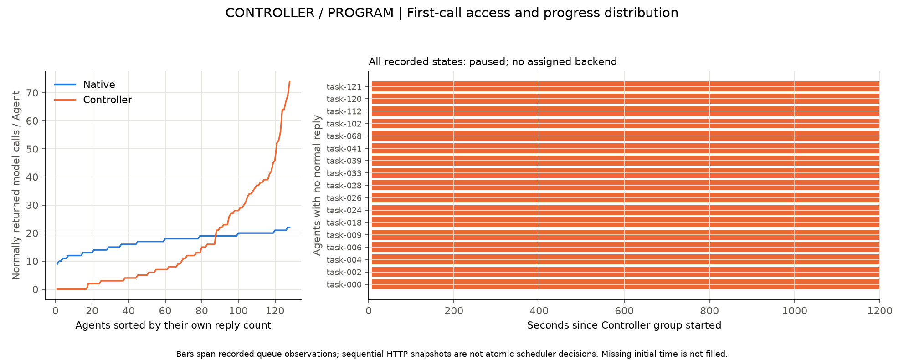
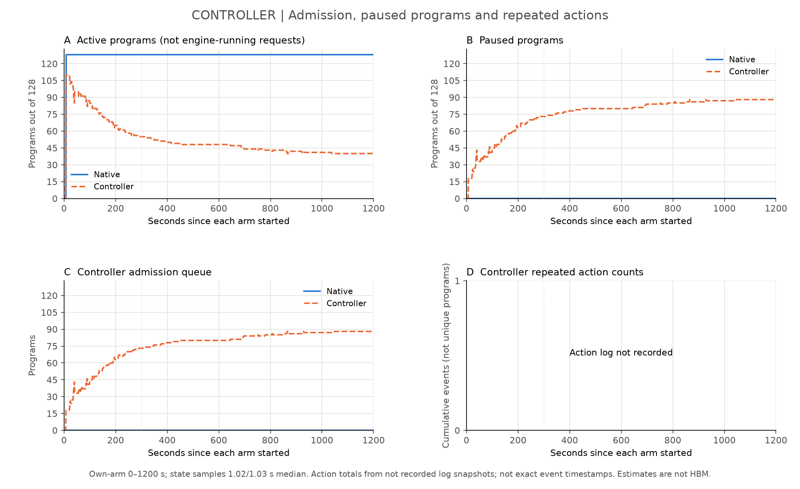
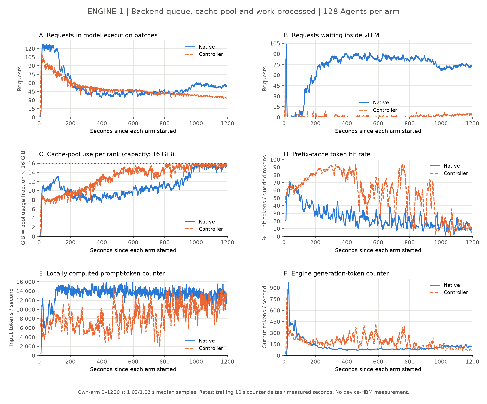
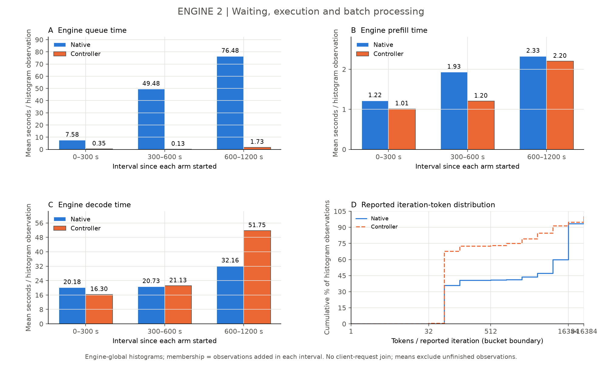
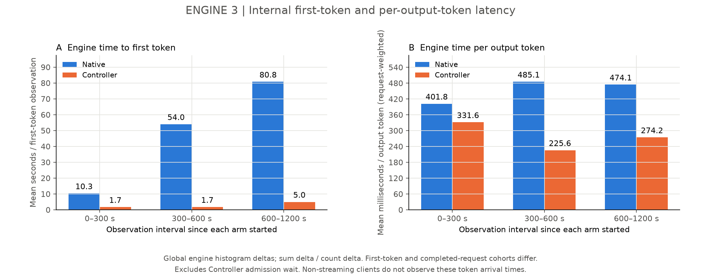
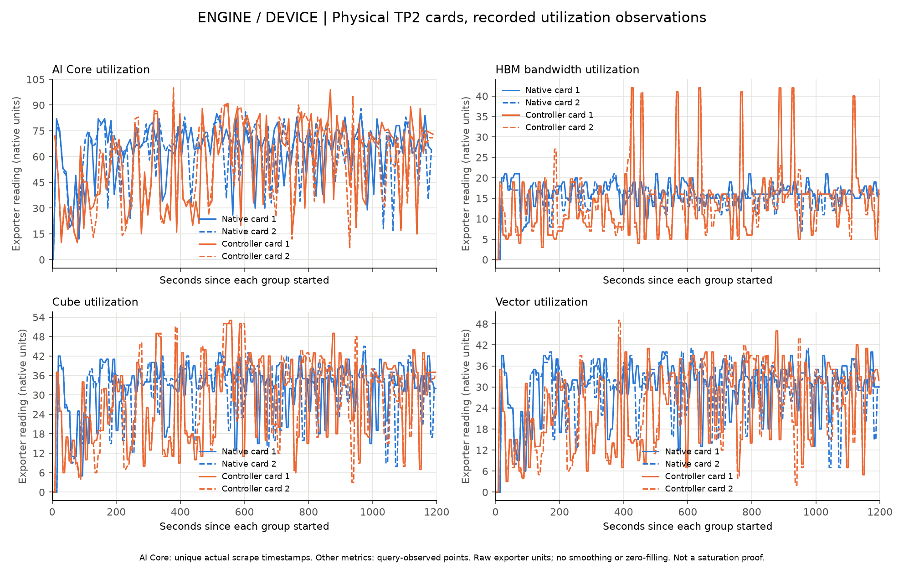
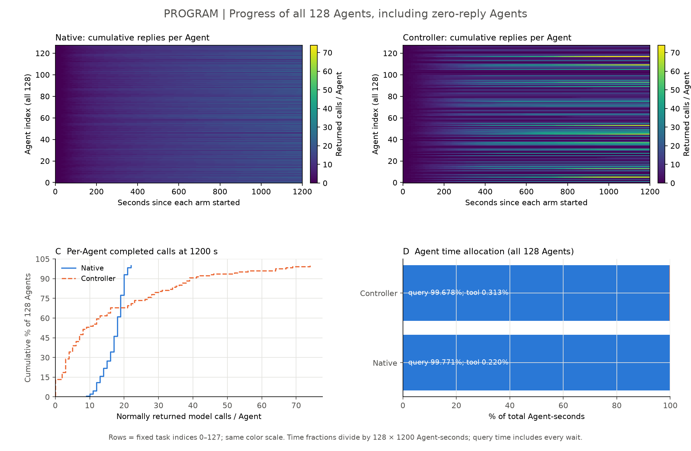
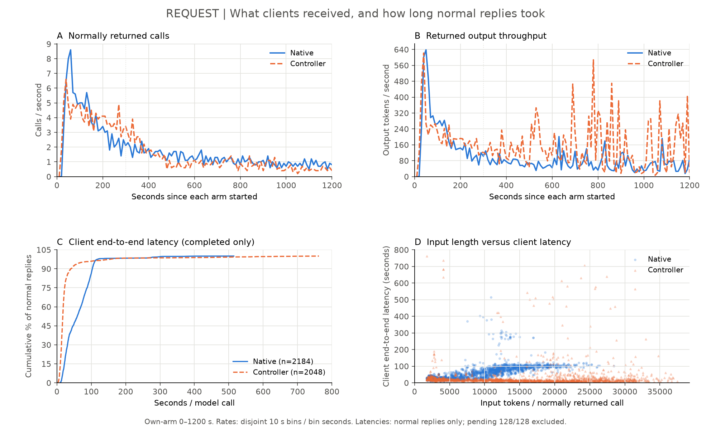
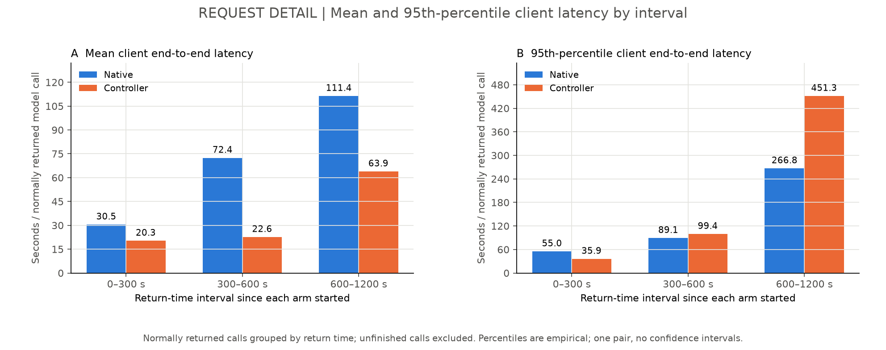

# SWE-bench Pro真实Agent对照：配置审查后的结果与问题

## 结论先说清楚

本次比较了Native组和Controller组，各128个Agent，整批同时到达，不在客户端限并发；每组观察20分钟。模型及两组预算一致，Controller组额外启用已明确标注的暂停容量修正。

Controller组在窗口内返回了更多输出token（多59.4%），已正常返回调用的平均延迟也更低；但它有17个Agent连第一次模型调用都没有正常返回。两组最终都没有完成提交。因此本轮不能宣布Controller整体更好，更不能把输出量变化当作相同工作量加速。

读下面的图时，蓝色表示Native，橙色表示Controller。先看任务是否推进，再沿请求链路解释等待转移到了哪里。

## 系统链路与实验边界

Agent产生第一次模型请求 → Controller决定放行或等待 → vLLM引擎排队、处理输入、生成输出 → 请求返回 → Agent执行工具并继续下一轮。Controller等待、引擎排队、模型计算和工具执行是不同阶段。

本轮两组各128个独立Agent；每个Agent保留多轮模型与工具依赖。两组模型采用相同8192 token调度预算，async_scheduling=True，上下文262144 token；Agent上限200步、1200秒、单次输出4096 token、工具60秒。一次Native→Controller顺序比较，不足以证明稳定因果收益。

## 第一层：Controller——哪些任务在引擎外等候？

最需要关注的是17个没有正常回复的Agent。已有记录中，它们约1192.5秒持续出现在Controller等待队列，状态为paused，尚无分配后端，step_count始终为1。这里的step_count是代理收到请求后的计数，不代表第一次模型调用已经执行成功。

左图把全部Agent按正常回复次数排序，避免平均数掩盖完全没推进的任务；右图只展示没有正常回复的Agent及其被观测到的排队时段。记录开始前的缺口没有补零，也没有当作完整逐事件追踪。

这张图展示Controller登记的活动、暂停和等待状态。活动program数不是引擎实际执行数；逐次动作采样文件缺失的面板保持缺失，不能解释为没有暂停或恢复。

固定源码的恢复策略优先选择已经进入多轮的请求，新任务优先级较低；兜底放行等待是1800秒，超过本轮Agent的1200秒总时限。这套规则没有保证新任务在本轮窗口内得到机会。快照重建仍需进一步核对每次选择，不能把非原子快照说成每个调度时刻的完整判断。

## 第二层：引擎和设备——队列减少，是否真的处理得更好？

Native的引擎内部平均排队时间为35.14秒，Controller为0.59秒。引擎里的队列明显变小，但第一层表明部分等待留在了Controller，不能把“引擎不排队”理解为“所有任务都不等”。

缓存图表示每个rank缓存池的占用，不是设备总HBM。输入计算、输出生成和缓存命中分别画在各自面板，不能互相替代。

上述阶段延迟来自各窗口内直方图sum/count增量；不是逐kernel耗时。分位桶只给区间，iteration指标也尚未被证明等同每一次真实调度步。

设备图来自本轮实际两张卡的记录，不用缓存占用推测设备利用率。AI Core用实际scrape时间去重，其他指标保留查询时观测点；纵轴保留exporter原生读数，不猜测未核实的单位。这些曲线没有提供kernel或通信profile，仍不能据此宣称算力、内存带宽或通信已经饱和。

## 第三层：Agent——每个任务是否都在推进？

Native每个Agent获得9–22次正常回复；Controller为0–74次，其中17个为0。它反映出两组进展分布差异很大。Controller的平均返回延迟不能代表没有获得返回的这些Agent。

终态原件显示，两组各128个Agent均以RetryError退出，完整异常均包含总时限到达。评分保持未决，不填成0分。任务完成数不能被引擎输出量替代。

## 第四层：请求——调用者实际拿到了多少，等了多久？

Native正常返回2184次、输出122499 token；Controller正常返回2048次、输出195306 token。Controller返回次数更少、输出量更多，说明实际回复长度与后续生成轨迹不同，不能直接解释为同工作量完成得更快。

正常返回调用的平均端到端延迟为61.27/30.01秒，p95为109.02/70.48秒（Native/Controller）。窗口末各128/128个未返回调用不在正常返回延迟分布中。

要同时看前段、后段和完整窗口。总体均值下降不代表后段长尾没有恶化，也不代表未获得第一次返回的任务被照顾到了。

## 当前判读和下一步

本轮观察到了更多输出交付、更小的引擎内部队列，以及更不均衡的Agent进展；没有证明完整批次完成更快。下一步先用已有记录核对新任务准入和恢复选择，并把首轮推进、等待上界、失败归档、报告交付纳入标准工作流门禁，再考虑新实验。

两组十分钟现场UI截图未按时取得，缺口明确保留；自动状态和设备记录仍在原包。逐请求client→proxy→engine没有完整一一关联，原子选择理由和kernel profile仍缺失。

## 复算与来源

本文数字来自规范四层报告data.json、normal-client-returns.csv、逐Agent终态、零回复审计和设备适配器；生成脚本不启动任何推理或配置变更。来源哈希、图文件哈希和生成入口记录在manifest.json。

公开数字记录见data目录；生成源码见reproduction目录。完整原包保留私有，未公开题面、工具内容或补丁。归档摘要见report.json。本次CI未查询。
