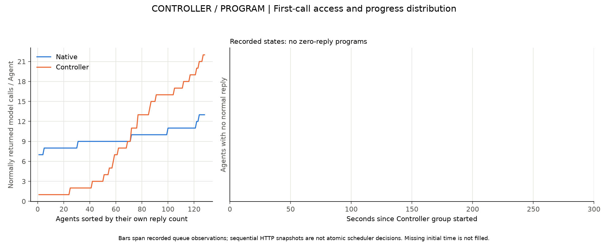
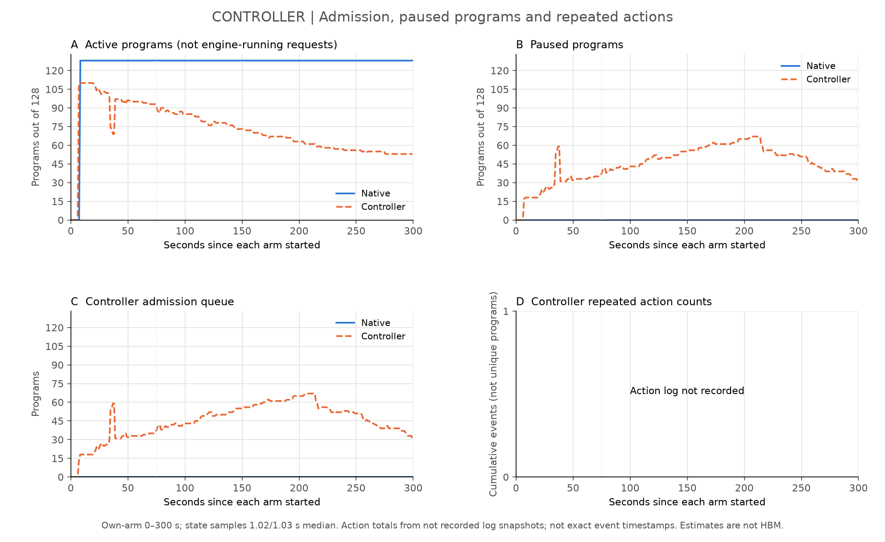
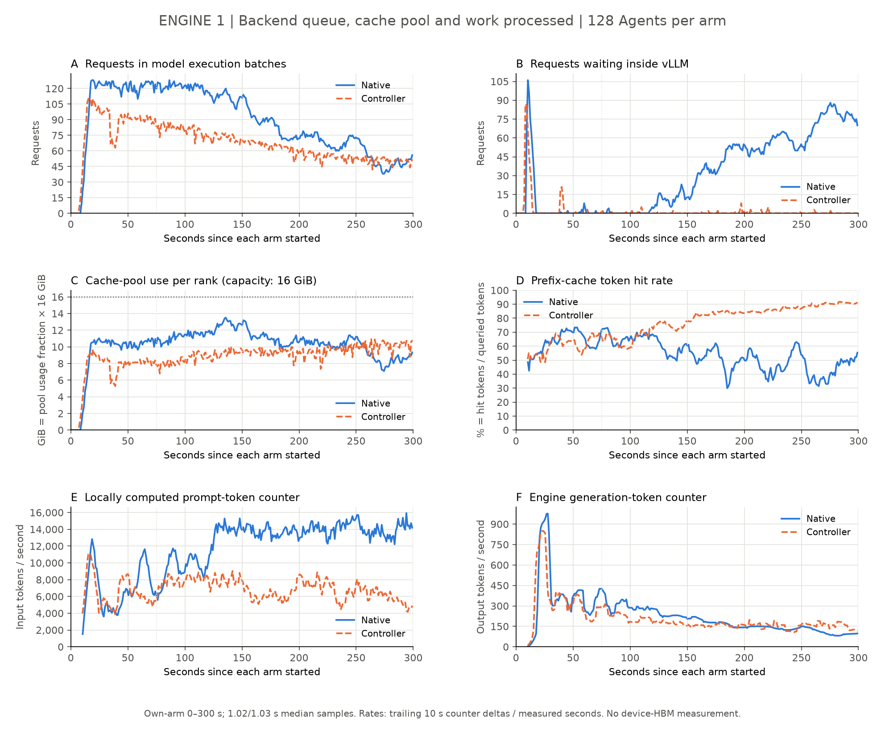
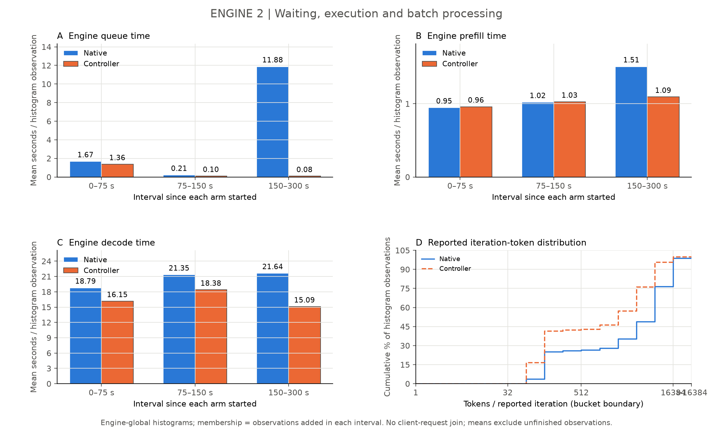
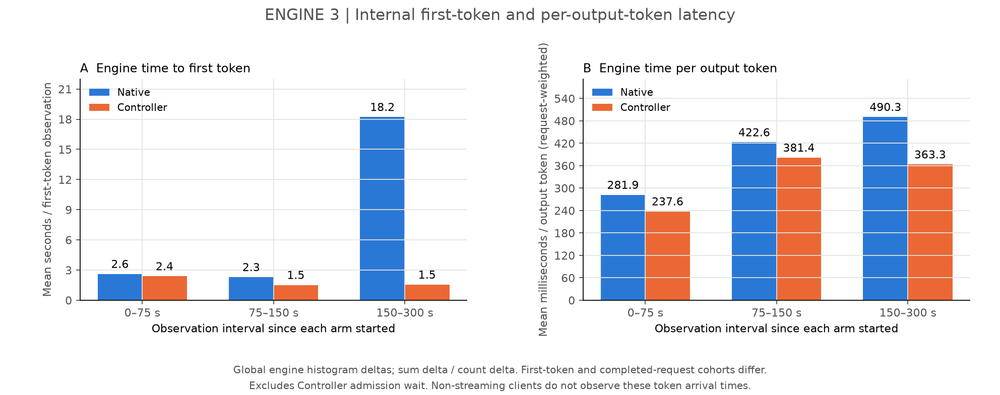
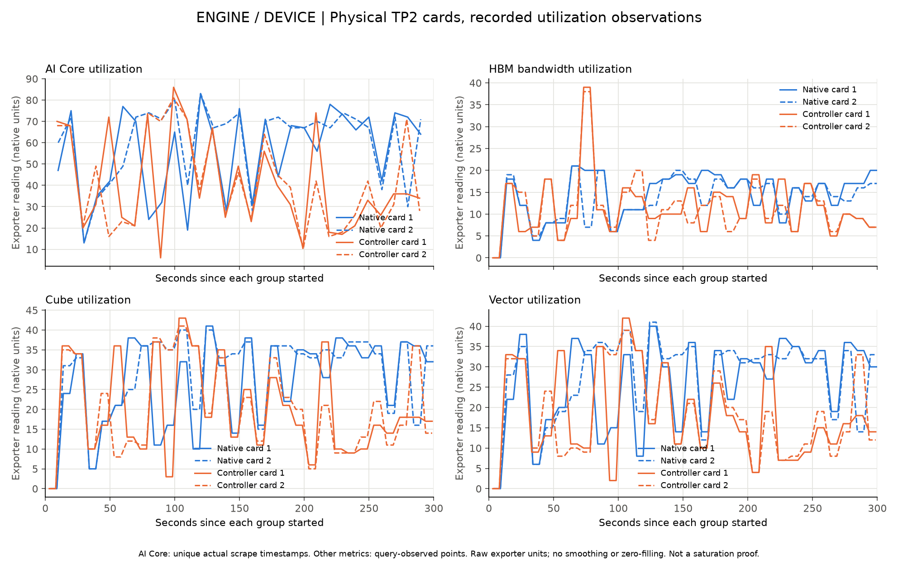
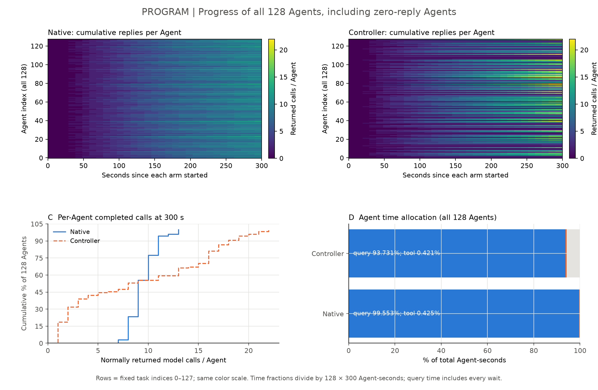
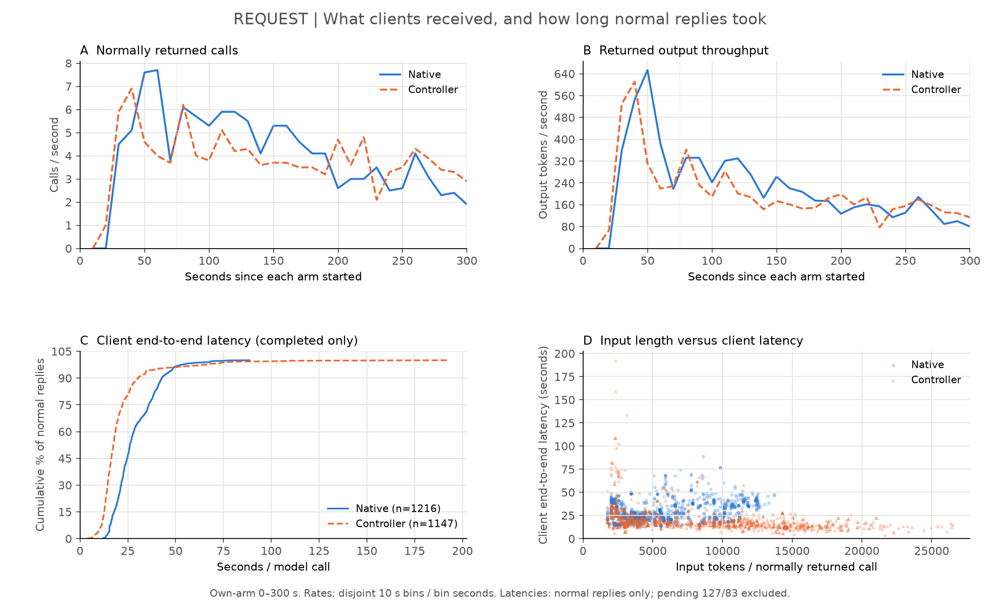
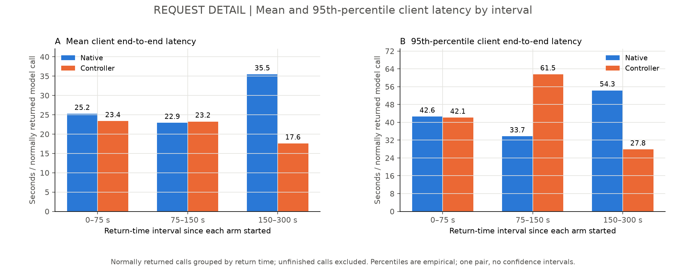

# SWE-bench Pro真实Agent对照：配置审查后的结果与问题

## 结论先说清楚

本次比较了Native组和Controller组，各128个Agent，整批同时到达，不在客户端限并发；每组观察5分钟。模型及两组预算一致，Controller组额外启用已明确标注的暂停容量修正。

Controller组在窗口内的返回输出量相对Native减少9.5%；它有0个Agent连第一次模型调用都没有正常返回。提交情况和等待分布需同时核对，不能把输出量变化当作相同工作量加速。

读下面的图时，蓝色表示Native，橙色表示Controller。先看任务是否推进，再沿请求链路解释等待转移到了哪里。

## 验证状态：未通过：仅作诊断，不作正式性能结论

Native组1个Agent将300秒总预算异常当作工具错误处理，随后仍发起89次模型请求；外层排空截止终止它，只有127份正常终态记录，缺失项没有补造。

Controller组128个Agent都有正常回复，等待优先级分支实际恢复32次；但还出现45次准入等待超时，不能宣称多轮等待问题已修复。

两组各128个Agent整批同时到达，无客户端并发限制；图中只统计前300秒，窗口外执行完整保留在原件。

总预算修复的28项相关回归通过；benchmark全仓在相同macOS环境下，修改前后均有69项失败，未把基线失败当作通过。正式长窗口继续受验收检查约束。

## 系统链路与实验边界

Agent产生第一次模型请求 → Controller决定放行或等待 → vLLM引擎排队、处理输入、生成输出 → 请求返回 → Agent执行工具并继续下一轮。Controller等待、引擎排队、模型计算和工具执行是不同阶段。

本轮两组各128个独立Agent；每个Agent保留多轮模型与工具依赖。两组模型采用相同8192 token调度预算，async_scheduling=True，上下文262144 token；Agent上限200步、300秒、单次输出4096 token、工具60秒。一次Native→Controller顺序比较，不足以证明稳定因果收益。

## 第一层：Controller——哪些任务在引擎外等候？

本轮有0个没有正常回复的Agent；这些任务中最短可确认的队列观测时长约0.0秒。逐任务状态与后端分配需结合原件核对，不能把代理计数当作模型调用已执行成功。

左图把全部Agent按正常回复次数排序，避免平均数掩盖完全没推进的任务；右图只展示没有正常回复的Agent及其被观测到的排队时段。记录开始前的缺口没有补零，也没有当作完整逐事件追踪。

这张图展示Controller登记的活动、暂停和等待状态。活动program数不是引擎实际执行数；逐次动作采样文件缺失的面板保持缺失，不能解释为没有暂停或恢复。

本轮Agent总时限为300秒。准入和恢复的逐次选择须结合本轮启用的策略、等待配置和实际日志核对，不能仅凭队列快照宣称每个调度时刻的完整判断。

## 第二层：引擎和设备——队列减少，是否真的处理得更好？

Native的引擎内部平均排队时间为5.29秒，Controller为0.41秒。需结合Controller等待队列判读，不能把“引擎不排队”理解为“所有任务都不等”。

缓存图表示每个rank缓存池的占用，不是设备总HBM。输入计算、输出生成和缓存命中分别画在各自面板，不能互相替代。

上述阶段延迟来自各窗口内直方图sum/count增量；不是逐kernel耗时。分位桶只给区间，iteration指标也尚未被证明等同每一次真实调度步。

设备图来自本轮实际两张卡的记录，不用缓存占用推测设备利用率。AI Core用实际scrape时间去重，其他指标保留查询时观测点；纵轴保留exporter原生读数，不猜测未核实的单位。这些曲线没有提供kernel或通信profile，仍不能据此宣称算力、内存带宽或通信已经饱和。

## 第三层：Agent——每个任务是否都在推进？

Native每个Agent获得7–13次正常回复；Controller为1–22次，其中0个为0。它反映出两组进展分布差异很大。Controller的平均返回延迟不能代表没有获得返回的这些Agent。

终态原件显示，Native组提交0个，Controller组提交0个。异常分类和评分状态以终态原件为准，不能把未决评分填成0分。任务完成数不能被引擎输出量替代。

## 第四层：请求——调用者实际拿到了多少，等了多久？

Native正常返回1216次、输出66472 token；Controller正常返回1147次、输出60128 token。返回次数、回复长度与后续生成轨迹需分别核对，不能直接解释为同工作量完成得更快。

正常返回调用的平均端到端延迟为28.58/20.62秒，p95为48.31/40.90秒（Native/Controller）。窗口末各127/83个未返回调用不在正常返回延迟分布中。

要同时看前段、后段和完整窗口。总体均值下降不代表后段长尾没有恶化，也不代表未获得第一次返回的任务被照顾到了。

## 当前判读和下一步

判读需同时核对输出交付、引擎内部队列和全部Agent的进展，局部指标不能证明完整批次完成更快。新实验前核对首轮推进、等待上界、失败归档和报告交付。

现场截图覆盖、逐请求client→proxy→engine关联、原子选择理由及kernel profile以本轮取证清单为准；缺失项不得用推测补齐。

## 复算与来源

本文数字来自规范四层报告data.json、normal-client-returns.csv、逐Agent终态、零回复审计和设备适配器；生成脚本不启动任何推理或配置变更。来源哈希、图文件哈希和生成入口记录在manifest.json。

公开数值见data，生成入口见reproduction，运行源与归档摘要见report.json。原题、答案、工具输出和补丁不公开；本阶段远端CI未查，不声称通过。
