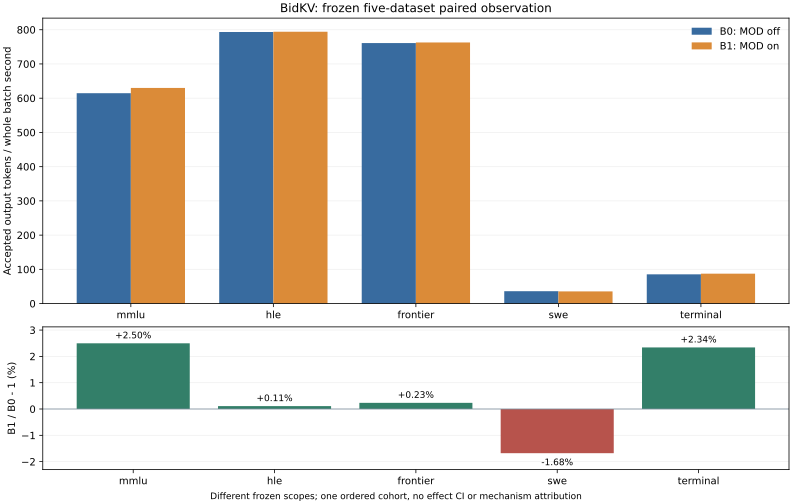

# BidKV：冻结五数据集MOD配对报告

执行状态：`completed`；完整执行标记：`True`。这不是自动通过项目四目标。

[实际启动身份](../actual-execution-identity.json)保留Popen前构造完成的command.json
argv/环境allowlist及实际PID/ready/wait绑定；正式服务没有独立/proc argv或loaded-import
RPC直接观测，这两个字段保留null，资格import证据与正式服务分开。

整个solver阶段策略观测：native enabled=False、calls=0、selections=0；bidkv
enabled=True、calls=0、selections=0。零调用情况下，正吞吐比值与正确数变化不能归因于BidKV机制。

B0与B1使用同一基础引擎、模型、硬件及共同配置，分别关闭/开启目标MOD。具体身份与必要适配见本批冻结计划；不能用准备、HTTP成功或零调用宣称机制收益。

模型：Qwen3.5-35B-A3B
BF16，修订`712cf74392b05026a6db2bf213d343747d1f6d45`。设备：2×Ascend910B2，物理`[6, 7]`/逻辑`[0, 1]`，并行`{"tensor": 2, "pipeline": 1, "data": 1, "expert": false}`。
MOD：[https://github.com/vLLM-HUST/vllm-hust-bidkv](https://github.com/vLLM-HUST/vllm-hust-bidkv)，源码`53eed4dd65bc4ba12efa37f9f1e334fa1ae51076`；基础vLLM`0fc695fc6d1d82e9a5ac6835ac8e4e1c83703665`、Ascend`5cb98caaadeff42b5b62b996e34bb2aaa29d20fd`及披露的共同兼容/测量适配。标准`five-datasets-20261113-v1`/SHA`66c050b7c6d705853f10bc437e6ace1707a9b46d43b6bdb7159724045045b756`。
依赖：`{"torch": "2.10.0+cpu", "torch_npu": "2.10.0.post4", "vllm": "0.23.0+empty", "vllm_ascend": "0.23.0", "transformers": "5.5.4", "tokenizers": "0.22.2", "CANN": "9.1"}`。完整身份与B0/B1开关见[绑定](../../driver-mod-v4/mod-binding.json)，[冻结计划](../execution-plan.json)、[进程/初始化开销](../runtime-overheads.json)与[原始数字/独立核验](../summary.json)分别保留。

| 数据集   | B0成功/计划 | B1成功/计划 |   B0 tok/s |   B1 tok/s | 吞吐变化 | TTFT P95改善 | TPOT均值改善 |
| -------- | ----------: | ----------: | ---------: | ---------: | -------: | -----------: | -----------: |
| mmlu     |     200/200 |     200/200 | 614.568863 | 629.912506 |  +2.497% |      -2.413% |      +1.809% |
| hle      |     200/200 |     200/200 | 793.275630 | 794.147654 |  +0.110% |      +9.832% |      -2.105% |
| frontier |     160/160 |     160/160 | 761.031051 | 762.812493 |  +0.234% |      -0.512% |      -0.295% |
| swe      |       64/64 |       64/64 |  36.151535 |  35.544568 |  -1.679% |     -12.331% |      -2.072% |
| terminal |       48/48 |       48/48 |  85.392668 |  87.390692 |  +2.340% |      -5.658% |      +1.017% |

吞吐为accepted输出token除以整个solver
batch首提交至末响应时间；失败请求的计时仍在完整区间内。不完整残批不推算完整吞吐。TTFT取首content事件，TPOT按每请求(token>1)计算并均权；分位数按(n−1)q线性插值。单臂或部分记录不足以给出配对效果。

## 单列的4K/16K C8资格

[完整证据、预热和实际退出](../../c8-results-v2/README.md)：两臂各按60秒预热/300秒正式提交窗口运行后排空，固定256输出。以下tok/s包含drain并除以phase
end−start，不能称为固定\[0,300)窗口产出。该资格与五项保留EOS的有限batch分别统计。

| 正式phase    | B0请求 | B1请求 |   B0 tok/s |   B1 tok/s | 吞吐变化 |
| ------------ | -----: | -----: | ---------: | ---------: | -------: |
| 4096-formal  |    225 |    236 | 189.513189 | 198.781805 |  +4.891% |
| 16384-formal |     77 |     81 |  64.708895 |  68.301798 |  +5.552% |

一次固定顺序资格不能证明32K长稳、总体时延等价或项目四目标；策略零调用时不能从该比值推断MOD机制收益。

## 分母与失败

正式controller的exit_code直接来自实际process.wait()；可选actual_client_returncode仅取消路径写入，本轮null不补填。全程owned等待、四份原grader无HTTP重算逐字节一致、各模型退出和双卡释放见[闭合审计](../closure-and-quality-recompute.json)及[生命周期](../full-owned-lifecycle-policy.json)。

| 数据集/臂          | 有最终记录的attempted | 返回失败 | length stop | 未执行/未完成 | TPOT排除 |
| ------------------ | --------------------: | -------: | ----------: | ------------: | -------: |
| mmlu/native        |                   200 |        0 |          20 |             0 |        0 |
| mmlu/candidate     |                   200 |        0 |          20 |             0 |        0 |
| hle/native         |                   200 |        0 |         124 |             0 |        0 |
| hle/candidate      |                   200 |        0 |         121 |             0 |        0 |
| frontier/native    |                   160 |        0 |          36 |             0 |        0 |
| frontier/candidate |                   160 |        0 |          43 |             0 |        0 |
| swe/native         |                    64 |        0 |           2 |             0 |        0 |
| swe/candidate      |                    64 |        0 |           2 |             0 |        0 |
| terminal/native    |                    48 |        0 |           2 |             0 |        0 |
| terminal/candidate |                    48 |        0 |           4 |             0 |        0 |

## 原质量与judge

质量使用原金标准和原评分器；token相同或不同不作为质量判据。HLE四层、Frontier两轨和MMLU学科分组见原grader汇总。720只是计划judge输入；实际HTTP、solver_failed、invalid和未决按stage单列。SWE/Terminal只报告轨迹推理性能，没有执行历史工具，不给解决率。

- 原汇总：[quality-bidkv-frontier-summary.json](../quality-bidkv-frontier-summary.json)（SHA
  `acffd63e873b2ecbd3c183a8ff5136111fec593389c3baa4698a9a6f0ae88955`）。
- 原汇总：[quality-bidkv-hle-summary.json](../quality-bidkv-hle-summary.json)（SHA
  `0e067bab248b8eb5eb84b64227e16b55ffc754c8a48c123e0ae2bb80b9fc47f9`）。
- 原汇总：[quality-native-frontier-summary.json](../quality-native-frontier-summary.json)（SHA
  `3398febeb3ff4e14dca1bbf11f95602b07937e48981f3df41e189388659b19d4`）。
- 原汇总：[quality-native-hle-summary.json](../quality-native-hle-summary.json)（SHA
  `1e5463c4d247cba2b74d37d22e8fd7c2662160a16db60ee790aa57f6ac1c1ceb`）。

| 数据集/臂/层或轨          | 已判成功/计划 | 有效grade | 原rate | 未决 | solver/judge length | 研究均分/10（仅有效） |
| ------------------------- | ------------: | --------: | -----: | ---: | ------------------: | --------------------: |
| frontier/bidkv/olympiad   |        55/100 |        98 | 55.00% |    2 |                33/6 |           不适用/未测 |
| frontier/bidkv/research   |          2/60 |        58 |  3.33% |    2 |                10/9 |                2.3286 |
| hle/bidkv/gold/text       |          8/64 |        36 | 12.50% |   28 |               38/28 |           不适用/未测 |
| hle/bidkv/gold/image      |          1/10 |         4 | 10.00% |    6 |                 1/6 |           不适用/未测 |
| hle/bidkv/revision/text   |        22/113 |        56 | 19.47% |   57 |               80/57 |           不适用/未测 |
| hle/bidkv/revision/image  |          2/13 |        12 | 15.38% |    1 |                 2/1 |           不适用/未测 |
| frontier/native/olympiad  |        63/100 |        95 | 63.00% |    5 |                29/7 |           不适用/未测 |
| frontier/native/research  |          1/60 |        57 |  1.67% |    3 |                 7/8 |                2.5053 |
| hle/native/gold/text      |          7/64 |        35 | 10.94% |   29 |               40/29 |           不适用/未测 |
| hle/native/gold/image     |          2/10 |         7 | 20.00% |    3 |                 1/3 |           不适用/未测 |
| hle/native/revision/text  |        21/113 |        55 | 18.58% |   58 |               81/58 |           不适用/未测 |
| hle/native/revision/image |          2/13 |         9 | 15.38% |    4 |                 2/4 |           不适用/未测 |

HLE沿冻结strict_json原评分：未决计入计划分母的非成功项，不能称为已证错误。Frontier沿冻结mmlu_extract_first：取首个完整显式VERDICT，length结尾满足原规则仍可解析；研究score为0–10、≥7成功。缺失/invalid/失败仍保留，原rate若null不以lower
bound代填。研究均分只覆盖有效grade。两者均是Qwen替代judge的单次本地协议，不是官方leaderboard复现；HLE校准误差原工具未实现，保留未验证。

| Judge所评solver/数据集 | 计划输入 | 已绑定HTTPattempted | 有效grade | invalid | solver_failed | transport失败 | length |
| ---------------------- | -------: | ------------------: | --------: | ------: | ------------: | ------------: | -----: |
| native/hle             |      200 |                 200 |       106 |      94 |             0 |             0 |     94 |
| bidkv/hle              |      200 |                 200 |       108 |      92 |             0 |             0 |     92 |
| native/frontier        |      160 |                 160 |       152 |       8 |             0 |             0 |     15 |
| bidkv/frontier         |      160 |                 160 |       156 |       4 |             0 |             0 |     15 |

MMLU原extractor：144/200→149/200；仅B0正确24题、仅B1正确29题。配对discordance双侧精确binomial诊断p=0.583132；固定子集、单次解码的诊断不证明总体差异、等价或重复性。

| MMLU学科         | 计划/臂 | B0正确 | B1正确 |
| ---------------- | ------: | -----: | -----: |
| biology          |      12 |     11 |     10 |
| business         |      14 |     12 |     13 |
| chemistry        |      18 |     10 |     13 |
| computer science |       7 |      4 |      4 |
| economics        |      14 |     13 |     11 |
| engineering      |      16 |     11 |     11 |
| health           |      14 |      8 |      6 |
| history          |       6 |      4 |      2 |
| law              |      19 |      6 |     12 |
| math             |      22 |     18 |     20 |
| other            |      15 |     10 |     12 |
| philosophy       |       9 |      6 |      8 |
| physics          |      21 |     21 |     16 |
| psychology       |      13 |     10 |     11 |

MMLU未解析答案：B0 0，B1 0；仍保留在200分母，不能只在可解析子集算正确率。

仅将未决grade视为可正可负、保持已判grade不变时，已判成功占计划分母的条件范围如下；这不是统计置信区间，也没有包含judge误判的不确定性：

| 数据集/臂       | 已判成功 | 未决 | 计划 |      条件范围 |
| --------------- | -------: | ---: | ---: | ------------: |
| hle/native      |       32 |   94 |  200 | 16.00%–63.00% |
| hle/bidkv       |       33 |   92 |  200 | 16.50%–62.50% |
| frontier/native |       64 |    8 |  160 | 40.00%–45.00% |
| frontier/bidkv  |       57 |    4 |  160 | 35.62%–38.12% |

## 成本、适用范围与不确定性

成本只可按相同费率比较solver
wall/accepted输出token，初始化、图编译、诊断生成、judge和额外主机/设备内存另列；实际货币费用未验证。完整数值及原件hash见summary.json与本批数字胶囊。原问题、答案、对话和完整SSE保持受控，公共hash不冒充原SSE重新读取。

| 数据集   | 同费率solver时间/输出token变化 |
| -------- | -----------------------------: |
| mmlu     |                        -2.436% |
| hle      |                        -0.110% |
| frontier |                        -0.234% |
| swe      |                        +1.708% |
| terminal |                        -2.286% |

本轮为先B0后B1的固定顺序单批，时间漂移、队列相关性及单次运行的不确定性保留；不把不显著写成等价，不以有限batch的P95/P99证明连续16K或32K长期稳定，也不把冻结子集升级为上游全集或四目标验收。

| 完整五项服务   | 初始化资源代理（卡秒） |
| -------------- | ---------------------: |
| service-native |            1256.953664 |
| service-bidkv  |            1185.494675 |
| service-judge  |            1216.684961 |

以上仅完整五项的三次fresh初始化，不含另列的C8准备，也不是总账单。容器与HBM数值采样见runtime-overheads.json，属于总观测，不能自动当作MOD独占增量或有效FLOP证据。

| 服务           | 留存样本 | 容器memory.current最大观测GiB | 各物理卡HBM最大观测MB    | 采样错误记录 |
| -------------- | -------: | ----------------------------: | ------------------------ | -----------: |
| service-native |       60 |                     26.353096 | {"6": 55943, "7": 55946} |            0 |
| service-bidkv  |       57 |                     22.765385 | {"6": 55935, "7": 55936} |            0 |
| service-judge  |       58 |                     20.554703 | {"6": 55933, "7": 55931} |            0 |

这些是留存采样区间内的总容器/设备最大观测，非精确分配峰值；缺样本保留未验证，不能用0或两臂总内存差冒充MOD独占内存。HBM单位沿用npu-smi原标记MB。

原HLE额外red/blue资格每臂2条、max32、保留EOS，与672/720和正式window分开；记录及不完整下界见diagnostic-overheads.json。
