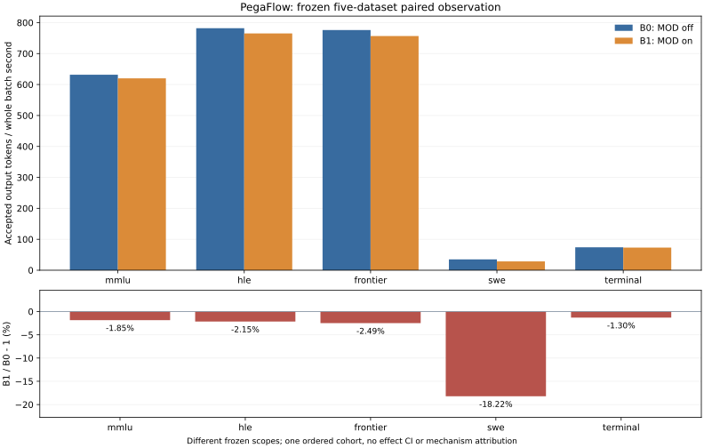

# PegaFlow：冻结五数据集MOD配对报告

执行状态：`completed`；完整执行标记：`True`。这不是自动通过项目四目标。

B0与B1使用同一基础引擎、模型、硬件及共同配置，分别关闭/开启目标MOD。具体身份与必要适配见本批冻结计划；不能用准备、HTTP成功或零调用宣称机制收益。

模型：Qwen3.5-35B-A3B
BF16，修订`712cf74392b05026a6db2bf213d343747d1f6d45`。设备：2×Ascend910B2,64GiB/card，物理`[2, 5]`/逻辑`[0, 1]`，并行`{"tensor": 2, "pipeline": 1, "data": 1, "expert": false}`。
MOD：[https://github.com/vLLM-HUST/pegaflow-hust](https://github.com/vLLM-HUST/pegaflow-hust)，源码`e2cdc2f7b32d8294b54a74545c05d103e5a5ecaf`；基础vLLM`0fc695fc6d1d82e9a5ac6835ac8e4e1c83703665`、Ascend`5cb98caaadeff42b5b62b996e34bb2aaa29d20fd`及披露的共同兼容/测量适配。标准`five-datasets-20261113-v1`/SHA`66c050b7c6d705853f10bc437e6ace1707a9b46d43b6bdb7159724045045b756`。
依赖：`{"torch": "2.10.0+cpu", "torch-npu": "2.10.0.post4", "vllm": "0.23.0+empty", "vllm-ascend": "0.23.0", "transformers": "5.5.4", "tokenizers": "0.22.2", "CANN": "9.1 installedimage/path"}`。完整身份与B0/B1开关见[绑定](../mod-binding.json)，[冻结计划](../execution-plan.json)、[进程/初始化开销](../runtime-overheads.json.gz)与[原始数字/独立核验](../summary.json)分别保留。

| 数据集   | B0成功/计划 | B1成功/计划 |   B0 tok/s |   B1 tok/s | 吞吐变化 | TTFT P95改善 | TPOT均值改善 |
| -------- | ----------: | ----------: | ---------: | ---------: | -------: | -----------: | -----------: |
| mmlu     |     200/200 |     200/200 | 631.681374 | 619.995317 |  -1.850% |      +2.524% |      -0.471% |
| hle      |     200/200 |     200/200 | 781.984881 | 765.199830 |  -2.146% |      +0.412% |      -3.268% |
| frontier |     160/160 |     160/160 | 776.048568 | 756.743061 |  -2.488% |      -3.431% |      +1.142% |
| swe      |       64/64 |       64/64 |  34.964343 |  28.595335 | -18.216% |      +5.760% |      -5.245% |
| terminal |       48/48 |       48/48 |  74.056521 |  73.092300 |  -1.302% |      +0.096% |      -4.153% |

吞吐为accepted输出token除以整个solver
batch首提交至末响应时间；失败请求的计时仍在完整区间内。不完整残批不推算完整吞吐。TTFT取首content事件，TPOT按每请求(token>1)计算并均权；分位数按(n−1)q线性插值。单臂或部分记录不足以给出配对效果。

## 分母与失败

正式controller的exit_code直接来自实际process.wait()；可选actual_client_returncode仅取消路径写入，本轮null不补填。全程owned等待、四份原grader无HTTP重算逐字节一致、各模型退出和双卡释放见[闭合审计](../audit/closure.json)及[生命周期](../audit/historical-receipts-supplement-v2.json)。

| 数据集/臂          | 有最终记录的attempted | 返回失败 | length stop | 未执行/未完成 | TPOT排除 |
| ------------------ | --------------------: | -------: | ----------: | ------------: | -------: |
| mmlu/native        |                   200 |        0 |          19 |             0 |        0 |
| mmlu/candidate     |                   200 |        0 |          19 |             0 |        0 |
| hle/native         |                   200 |        0 |         122 |             0 |        0 |
| hle/candidate      |                   200 |        0 |         122 |             0 |        0 |
| frontier/native    |                   160 |        0 |          35 |             0 |        0 |
| frontier/candidate |                   160 |        0 |          40 |             0 |        0 |
| swe/native         |                    64 |        0 |           2 |             0 |        0 |
| swe/candidate      |                    64 |        0 |           1 |             0 |        0 |
| terminal/native    |                    48 |        0 |           2 |             0 |        0 |
| terminal/candidate |                    48 |        0 |           2 |             0 |        0 |

## 原质量与judge

质量使用原金标准和原评分器；token相同或不同不作为质量判据。HLE四层、Frontier两轨和MMLU学科分组见原grader汇总。720只是计划judge输入；实际HTTP、solver_failed、invalid和未决按stage单列。SWE/Terminal只报告轨迹推理性能，没有执行历史工具，不给解决率。

- 原汇总：[quality-native-frontier-summary.json](../quality-native-frontier-summary.json)（SHA
  `c9fe3bccaa691c531e781bdd1dbb5a0e0cdbca5b2ba1c53b96f5bc3a537b56ca`）。
- 原汇总：[quality-native-hle-summary.json](../quality-native-hle-summary.json)（SHA
  `60ca9b923e86dd1d3f445f9a8ff478c8fb49dede9da875eb0a299c2ec5345b84`）。
- 原汇总：[quality-pegaflow-frontier-summary.json](../quality-pegaflow-frontier-summary.json)（SHA
  `63f5b780b89c5734edd95359e13d67e46e75e6fc400729edb175e25f86f544eb`）。
- 原汇总：[quality-pegaflow-hle-summary.json](../quality-pegaflow-hle-summary.json)（SHA
  `bd8435ece912019523da6a7d96c88c22eb113bbe889a43804106e1d49e826013`）。

| 数据集/臂/层或轨            | 已判成功/计划 | 有效grade | 原rate | 未决 | solver/judge length | 研究均分/10（仅有效） |
| --------------------------- | ------------: | --------: | -----: | ---: | ------------------: | --------------------: |
| frontier/native/olympiad    |        64/100 |        98 | 64.00% |    2 |                29/6 |           不适用/未测 |
| frontier/native/research    |          2/60 |        55 |  3.33% |    5 |                 6/8 |                2.5393 |
| hle/native/gold/text        |          5/64 |        30 |  7.81% |   34 |               40/34 |           不适用/未测 |
| hle/native/gold/image       |          0/10 |         7 |  0.00% |    3 |                 1/3 |           不适用/未测 |
| hle/native/revision/text    |        21/113 |        48 | 18.58% |   65 |               78/65 |           不适用/未测 |
| hle/native/revision/image   |          1/13 |         4 |  7.69% |    9 |                 3/9 |           不适用/未测 |
| frontier/pegaflow/olympiad  |        65/100 |        97 | 65.00% |    3 |                32/6 |           不适用/未测 |
| frontier/pegaflow/research  |          4/60 |        58 |  6.67% |    2 |                8/12 |                2.6181 |
| hle/pegaflow/gold/text      |          6/64 |        27 |  9.38% |   37 |               39/37 |           不适用/未测 |
| hle/pegaflow/gold/image     |          1/10 |         7 | 10.00% |    3 |                 1/3 |           不适用/未测 |
| hle/pegaflow/revision/text  |        20/113 |        57 | 17.70% |   56 |               80/56 |           不适用/未测 |
| hle/pegaflow/revision/image |          1/13 |         7 |  7.69% |    6 |                 2/6 |           不适用/未测 |

HLE沿冻结strict_json原评分：未决计入计划分母的非成功项，不能称为已证错误。Frontier沿冻结mmlu_extract_first：取首个完整显式VERDICT，length结尾满足原规则仍可解析；研究score为0–10、≥7成功。缺失/invalid/失败仍保留，原rate若null不以lower
bound代填。研究均分只覆盖有效grade。两者均是Qwen替代judge的单次本地协议，不是官方leaderboard复现；HLE校准误差原工具未实现，保留未验证。

| Judge所评solver/数据集 | 计划输入 | 已绑定HTTPattempted | 有效grade | invalid | solver_failed | transport失败 | length |
| ---------------------- | -------: | ------------------: | --------: | ------: | ------------: | ------------: | -----: |
| native/hle             |      200 |                 200 |        89 |     111 |             0 |             0 |    111 |
| pegaflow/hle           |      200 |                 200 |        98 |     102 |             0 |             0 |    102 |
| native/frontier        |      160 |                 160 |       153 |       7 |             0 |             0 |     14 |
| pegaflow/frontier      |      160 |                 160 |       155 |       5 |             0 |             0 |     18 |

MMLU原extractor：145/200→151/200；仅B0正确15题、仅B1正确21题。配对discordance双侧精确binomial诊断p=0.405032；固定子集、单次解码的诊断不证明总体差异、等价或重复性。

| MMLU学科         | 计划/臂 | B0正确 | B1正确 |
| ---------------- | ------: | -----: | -----: |
| biology          |      12 |     11 |     11 |
| business         |      14 |     12 |     11 |
| chemistry        |      18 |     15 |     12 |
| computer science |       7 |      4 |      4 |
| economics        |      14 |     11 |     12 |
| engineering      |      16 |      8 |      9 |
| health           |      14 |      7 |     11 |
| history          |       6 |      4 |      4 |
| law              |      19 |      6 |      8 |
| math             |      22 |     20 |     20 |
| other            |      15 |     11 |     10 |
| philosophy       |       9 |      6 |      7 |
| physics          |      21 |     18 |     20 |
| psychology       |      13 |     12 |     12 |

MMLU未解析答案：B0 0，B1 0；仍保留在200分母，不能只在可解析子集算正确率。

仅将未决grade视为可正可负、保持已判grade不变时，已判成功占计划分母的条件范围如下；这不是统计置信区间，也没有包含judge误判的不确定性：

| 数据集/臂         | 已判成功 | 未决 | 计划 |      条件范围 |
| ----------------- | -------: | ---: | ---: | ------------: |
| hle/native        |       27 |  111 |  200 | 13.50%–69.00% |
| hle/pegaflow      |       28 |  102 |  200 | 14.00%–65.00% |
| frontier/native   |       66 |    7 |  160 | 41.25%–45.62% |
| frontier/pegaflow |       69 |    5 |  160 | 43.12%–46.25% |

## 成本、适用范围与不确定性

成本只可按相同费率比较solver
wall/accepted输出token，初始化、图编译、诊断生成、judge和额外主机/设备内存另列；实际货币费用未验证。完整数值及原件hash见summary.json与本批数字胶囊。原问题、答案、对话和完整SSE保持受控，公共hash不冒充原SSE重新读取。

| 数据集   | 同费率solver时间/输出token变化 |
| -------- | -----------------------------: |
| mmlu     |                        +1.885% |
| hle      |                        +2.194% |
| frontier |                        +2.551% |
| swe      |                       +22.273% |
| terminal |                        +1.319% |

本轮为先B0后B1的固定顺序单批，时间漂移、队列相关性及单次运行的不确定性保留；不把不显著写成等价，不以有限batch的P95/P99证明连续16K或32K长期稳定，也不把冻结子集升级为上游全集或四目标验收。

| 完整五项服务     | 初始化资源代理（卡秒） |
| ---------------- | ---------------------: |
| service-native   |             951.370774 |
| service-pegaflow |            1009.484619 |
| service-judge    |             920.199043 |

以上仅完整五项的三次fresh初始化，不含另列的C8准备，也不是总账单。容器与HBM数值采样见runtime-overheads.json，属于总观测，不能自动当作MOD独占增量或有效FLOP证据。

| 服务             | 留存样本 | 容器memory.current最大观测GiB | 各物理卡HBM最大观测MB    | 采样错误记录 |
| ---------------- | -------: | ----------------------------: | ------------------------ | -----------: |
| service-native   |      557 |                     16.833763 | {"2": 56584, "5": 56583} |            0 |
| service-pegaflow |      572 |                     45.967476 | {"2": 56669, "5": 56668} |            0 |
| service-judge    |      913 |                     14.359177 | {"2": 56436, "5": 56430} |            0 |

这些是留存采样区间内的总容器/设备最大观测，非精确分配峰值；缺样本保留未验证，不能用0或两臂总内存差冒充MOD独占内存。HBM单位沿用npu-smi原标记MB。

原HLE额外red/blue资格每臂2条、max32、保留EOS，与672/720和正式window分开；记录及不完整下界见diagnostic-overheads.json。
