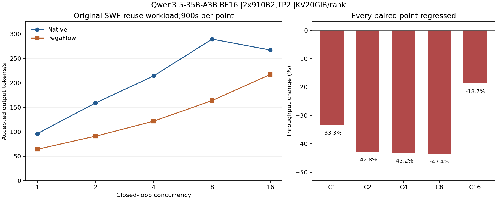

# restart-02 原 SWE 复用实验完成报告

本配置完成两臂 C1/C2/C4/C8/C16 各900秒，共10个观察点、2702条正式请求，协议失败0。全部吞吐比值为负，primary
C8下降43.3959%；没有取得可引用的提升。预注册规则只在C8、否则C16正向时倒序确认，两者均负，因此未触发该确认。后续容量探针另立profile，不能改写本组结果。

[可下载HTML报告](report.html)、[机器可读摘要](summary.json)、[原件索引](../windows.json)、[完整逐点表](../RESULTS.md)、[最终环境/退出证据与受控输入索引](../final-sources.json)。全部12个原始窗口（含两资格）的2797条请求已重新核验token数量、usage、预算和流完成，正式窗口吞吐从chunk时间重算。完整输入只保存在受控原件中，公共验证器明确区分SHA/清单核验和原输入字节复核。

| 并发 | Native tok/s | PegaFlow tok/s |      变化 | TTFT P95秒 Native/Pega | 保留请求数 Native/Pega |
| ---- | -----------: | -------------: | --------: | ---------------------: | ---------------------: |
| C1   |    96.182222 |      64.162222 | -33.2910% |          1.150 / 2.786 |              155 / 117 |
| C2   |   158.941111 |      90.964444 | -42.7685% |          1.437 / 4.731 |              240 / 148 |
| C4   |   214.448889 |     121.834444 | -43.1872% |          1.950 / 6.272 |              314 / 197 |
| C8   |   289.576667 |     163.912222 | -43.3959% |          2.486 / 7.005 |              433 / 270 |
| C16  |   267.316667 |     217.346667 | -18.6932% |          9.045 / 7.398 |              446 / 382 |

## 身份、负载与计量

模型Qwen3.5-35B-A3B
BF16，修订`712cf74392b05026a6db2bf213d343747d1f6d45`；两张Ascend910B2，物理3/4、逻辑0/1，TP2/PP1/DP1、EP关闭，容器64GiB/8CPU；每rank
KV20GiB、Pega host
pool30GiB、context262144、maxseq16、batch4096、MTP2、FULL_AND_PIECEWISE。两臂官方vLLM`0fc695fc6d1d82e9a5ac6835ac8e4e1c83703665`、Ascend`5cb98caaadeff42b5b62b996e34bb2aaa29d20fd`，PegaFlow执行源码`e2cdc2f7b32d8294b54a74545c05d103e5a5ecaf`，精确命令、包版本和二进制SHA在原件中。

两臂均显式设置enable_cpu_binding=false。后来按用户提供的MOD专用提示词核对，确认上游默认是true，且8CPU只是quota、实际affinity仍0–191，没有必须关闭的证据。因此本组只代表已披露的自定义配置，不当作保留默认优化的新MOD
profile；新defaultTrue profile另取C8资格并独立执行，不改写本组原件或分数。

原SWE多轮复用协议有8会话、360轮，保持原prepared输入及逐轮输出预算，按各臂实际输出token续接历史。吞吐分母固定900秒，分子仅chunk时间落在\[0,900)的实际生成token；在途请求另行排空。TTFT
P95沿原协议仅统计窗口内完成请求。summary另给同一旧总体的平均TTFT/TPOT；不能将它们当作新冻结五数据集的全有限批次统计。

## 质量、性能机制与边界

两组长前缀7551/8712-token的32-token冷/热/真实外部恢复样本逐token一致，实际外部加载与零save/load失败门槛均通过。此前两次Native未命中缓存短输入不重复的失败仍保留；在任何正式成绩前已把短样本改为完整保留的诊断项。有限样本通过不证明普遍数值等价或SWE解题正确率。完整动态prompt流可能随各臂输出不同；该观测不是固定输出逐token回放或重复统计实验。

源码为保证HMA安全性关闭Pega本地前缀命中。C8
Native本地prefix命中8,798,208/10,524,398；Candidate本地命中0，外部命中3,657,728/4,771,028，并加载约96.9GB
host数据。两臂原配置Native实际抢占为0。这些计数和源码说明外部恢复成本与本地APC收益的差异，属于有证据支持的机制解释，尚不是把单一因素隔离出来的因果实验。全部逐窗口计数由原metrics重新求差，见summary。

## 费用与验收范围

仅假设两臂卡数/费率相同、只计各900秒服务窗口，则单位生成token成本比值等于Native吞吐/Pega吞吐；C8约1.767，即成本上升约76.7%。没有据此虚构本机账单或新报价，未把启动、judge或其它租用区间计入该窗口。高多租户利用率未验证。

3.4.1单芯片有效算力：未建立同有效工作参考/FLOP证据，未验证。3.4.2吞吐/时延目标：本负载全部吞吐回退，不支持吞吐提升目标。3.4.3长上下文稳定性：观测到长prompt不等于通过单独的>=32K稳定性门槛，未验证。3.4.4成本/利用率：本窗口同价token成本恶化；报价适用性和高多租户利用率仍未验证。此报告不关闭T1–T5、RDMA/TailGuard或五数据集验收。

本报告的原SWE复用实验与`five-datasets-20261113-v1`完整五项分开。后者按用户新增要求在81/91各自项目内进行Native/插件比较，不能继承本报告或Engine历史成绩。

复算本目录：将`build_final_report.py.source`恢复为`.py`，安装Matplotlib3.10.8后执行`python build_final_report.py --input .. --out rebuilt`。只读取公共窗口、验证器及最终元数据包，不需要受控原始问题。
